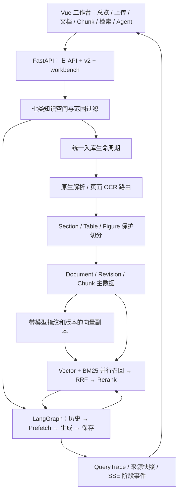

# AGENTS.md - 制造能源工业知识库系统

本文件是本项目的唯一完整总说明文档；根目录 README.md 仅作开源首页与快速入口。原 `README.md`、`WINDOWS_START.md` 和 `docs/ragas_evaluation.md` 的项目介绍、运行命令、架构、评估、Graph、验证、Windows 启动说明和 GitHub 发布规则已合并到这里；后续维护项目说明时优先更新本文件。

## Safety

- 禁止批量删除文件或目录。
- 禁止 `Remove-Item -Recurse`、`rm -rf`、`git clean -fd`、`git reset --hard`。
- 不要修改或输出 `.env` 中的秘密。
- 不要擅自 commit、push、merge、rebase 或回滚。
- 保留旧 `/api/*` 和现有 Vue 功能，采用渐进式重构。
- 构建使用 `npm run build -- --emptyOutDir=false`，避免清空 `dist`。
- 只允许在用户明确要求时删除单个明确文件；不要删除目录、缓存、构建产物或批量文件。

## Product

`制造能源工业知识库系统` 是面向制造业、兼顾能源与电气领域的本地化可配置知识库系统。主行业为汽车、高端装备、电子、消费品（含化妆品专属子库）及流程制造中的材料、能源。2026-11-02 已完成最终收集包的 2,986 张图片入库，连同既有化妆品资料，主库共 4,094 文档、4,086 条图片记录、7,686 个 Chunk。全部图片完成本地 OCR 和视觉特征索引，31 个动态图完成全部 1,006 帧处理；全部当前文本 Chunk 已预建真实 BGE 512d 向量。原件、网页介绍、来源、历史修订和未选候选均保留。资料仍为未审核来源参考；OCR、相似图片向量和检索就绪不等于 VLM 工艺语义理解、人工事实审核或模型训练完成。详细实现、数量口径与验收证据见本文末节。

- 官方产品名称：`制造能源工业知识库系统`。
- 前端、网页标题、API 标题、CLI 帮助、包描述和项目说明统一使用上述名称；RAG 是检索增强生成技术术语，不再单独充当产品品牌。
- npm 技术标识：`manufacturing-energy-industrial-knowledge-system`。本地根目录于 2026-11-01 经用户授权改为 `制造能源工业知识库系统`；GitHub 仓库地址、API 路径和历史数据 ID 保持不变。未经额外授权不重命名远端仓库。
- `Agent 案例库`、`多 Agent` 等术语描述的是业务知识类别或技术架构，不属于产品品牌，可按语义保留。

### 当前阶段：开源项目基座模式（用户于 2026-11-01 确认）

- **2026-11-02 用户确认当前及后续范围：仅建设知识库，完成资料入库、解析、索引、检索和可核查问答，不开展训练或微调。** 图片理解和图文检索复用现有预训练模型；下文训练/LoRA/NVIDIA 训练职责等历史说明不构成本项目后续训练授权。当前优先知识质量、评测、审核、表格检索与复现可靠性。

- 当前按可复用、可扩展的开源项目基座建设，先完善通用知识库链路、模块边界、开发文档和验证能力；后续在此基础上按行业场景深入优化，再进入具体企业项目的交付开发。
- 现阶段默认继续使用 SQLite 持久化。选用 **Navicat Premium Lite** 作为本机可选的数据库可视化管理工具，用于查看表结构、浏览数据和运行 SQL；它不替代 SQLite，也不作为项目运行、测试或普通克隆使用的必需依赖。
- Navicat Premium Lite 是第三方管理工具，不属于本项目开源代码；保持项目通过 Python/SQLite 和现有脚本独立运行，不把该工具打包成项目必装组件。
- 截至本次官方资料核对，Lite 支持 SQLite、PostgreSQL 等数据库及基本管理/查询功能，可免费用于商业和非商业用途，每家机构最多 5 个免费用户账户。具体能力见 [官方功能对照](https://www.navicat.com/en/products/navicat-premium-feature-matrix)，授权范围见 [官方产品说明](https://www.navicat.com.cn/products/navicat-premium-lite?lang=cn)。
- 下文 PostgreSQL、Milvus、Redis、对象存储、多租户权限与企业部署拓扑保留为后续扩展设计；根据实际数据规模、并发和应用要求决定何时实施，不把完整企业部署作为当前基座阶段的默认开发门槛。
- 2026-11-01 用户追加授权化妆品项目已有图文与文本训练资料的本地专属入库；2026-11-02 又授权六行业 Google 图文采集，并明确消费品复用化妆品案例、材料和能源聚焦流程制造。两个阶段的范围与证据分别保留在末节。Mac/GitHub 继续保存详细开发档案，未来进入客户交付阶段时再准备 Gitee 客户使用说明和目标环境验收。

### 长期 AI 工作定位（2026-11-02 分类确认）

用户后续 AI 工作的主要行业方向以本次确认的六类为准：**汽车、高端装备、电子、消费品等离散制造，以及材料、能源等流程制造**。电气、质量、设备维护等作为横跨行业的技术知识保留。这是长期业务定位；当前仓库承担其中的通用知识库能力，不把所有行业应用都堆入一个运行服务。

用户于 2026-11-02 明确以下六个主行业；此前传统制造、装备电子合并、电气等分类保留兼容入口，不再作为首页主行业。化妆品制造归属消费品制造，专属知识库保持原 ID、来源和本地使用规则。

| 制造类型 | 主行业 | 知识库重点 |
|---|---|---|
| 离散制造 | 汽车制造 | 研发、零部件、冲压、焊装、涂装、总装、检验 |
| 离散制造 | 高端装备 | 装备研发、精密加工、机器人、装调、检验、运维 |
| 离散制造 | 电子制造 | 元器件、电路板、电子装联、整机生产、测试 |
| 离散制造 | 消费品制造 | 日用消费品、家电、包装、化妆品相关研发与生产 |
| 流程制造 | 材料 | 冶炼、轧制、聚合、烧结、材料制备及连续/批次生产；配方、过程控制与检验 |
| 流程制造 | 能源 | 发电、炼化、煤气化、制氢等能源生产与转换；工艺流程、热力循环、气体处理与运行控制 |

- 产品建设采用“通用知识库底座 + 可配置行业知识包”，避免为每个行业复制一套系统。
- 行业、工艺、设备、材料、缺陷和证据类型分别建模；跨行业复用时必须保留工况、材料、单位、版本和适用范围。
- 知识问答、可见图像观察、工程推断和已审核结论必须区分。缺少现场检测、批准工艺或适用条件时，保留未知，不能把相似图片直接当作根因、质量放行或可执行设备参数。
- “资料入库/可检索”“人工审核通过”“模型微调完成”是不同状态，不能以入库数量宣称模型已正确学会或生产效果已验证。

```text
Vue Control Plane
  + FastAPI v1 Compatible API
  + Configurable RAG v2 Engine
  + Loader / Splitter / Index / Retriever
  + Pre Retrieval / Post Retrieval Pipeline
  + Optional LightRAG-style Graph-Enhanced Retrieval
  + Query Trace / Retrieval Metrics / RAGAS-Compatible Evaluation
  + Experiment Runner / JSON CSV Markdown Reports
```

默认策略：

```text
metadata filter
  + hybrid search (Vector 0.7 + BM25 0.3)
  + parent-child
  + rerank
  + contextual compression
```

原因：制造、能源和电气知识同时存在中文语义、材料牌号、设备型号、变量名、字段名、公式和缩写。BM25 负责精确词，Vector 负责语义，Metadata 隔离业务域，Parent-Child 补完整规则上下文，Rerank 和 Compression 控制相关性与 token 噪声。

## Current Implementation Status

2026-11-03 第七轮：工作台版本差异、图文/OCR区域对照、修正与撤回、质量统计和统一排错已接通。本机启停、环境检查、许可证和公开包检查已补齐；用户指定的1份不可恢复GIF原件已永久删除，当前有效资料为4,123文档、4,085图片、10,256 Chunk。用户取消来源版本/工况补证、长时间压测、整套恢复演练和干净环境复现，不再列作本轮待办。当前仅建设知识库，不训练、不微调。详细验收见文末第七轮。

2026-11-03 第六轮已完成并启用：79项退回结构逐项处置为 **5张恢复表（401单元格）、1项已有表替代、73项图形依据**；**4,086张图片全量语义描述及来源检查**完成，31个动态图另有91帧语义采样。首次图文独立72项为64/72，保留失败并修复后开发回归72/72，另留12来源首次独立36/36。旧真实来源回归144/144、Python292项、前端14项及主库桌面/手机通过。原件、正文、Chunk和修订均未覆盖，AI来源审核另存；1份GIF上游缺失尾帧仍明确标注，不补造画面。详见末节“第六轮”。仅建设知识库，不训练、不微调。

2026-11-02 第五轮：用户已改为授权 **Codex AI 依据来源完成审核，无需等待用户人工审核**；AI 审核、人工审核、整份资料发布分别记录，不冒充人工金标。已完成 Mac 预训练视觉推理、4,086 张图片统一图文语义向量、图文查询入口、来源绑定的 AI 审核记录、分页、缓存及中断恢复修复。最终回归与启用结果见末节“第五轮：六项联合优化与 AI 来源审核”。仅建设知识库，不训练、不微调。

2026-11-02 第四轮：第三轮的 4 个初召回失败和 1 个图片重排失败已修复并纳入冻结回归，5 例目标证据均进入最终第 1 位；原 72 + 24 例回归 **96/96**、原表格三策略 **21/21** 通过。新增与前 96 例预期来源隔离的 24 例，首次独立验收 **23/24**，保留 1 个 NIST AGV/AMR 缩写来源初召回失败，未按新集调参。新增可关闭的正文条件、明确表号、中文表头和完整图片来源标题匹配，Trace 保留真实模型分数及单独选择理由。完整 Python **228 项**、前端 **14 项**及构建/手机界面通过，本机服务已启用。自动结果全部仍待人工审核，仅建设知识库，不训练、不微调。详见末节“第四轮：初召回、图片标题依据与独立验收”。

2026-11-02 第三轮：72 个真实案例已补齐原件/原页、冻结指纹、单元格和人工核对清单；新增 24 例独立来源验收，冻结后未用其结果调参，首次通过 19/24，5 个失败保留。284 项结构候选全部完成自动核对，形成 201 页预览、17,697 个单元格定位及异常清单，**全部仍待人工审核**。新增有线扫描表格、合并单元格、保守跨页连接、上下标和公式原始表示保留能力。原 72 例、21 次表格回归全部通过；完整 Python 回归 210 项通过，之后透明图片处理的相关 44 项通过。详见末节“第三轮：审核材料、独立验收与复杂结构解析”。仅建设知识库，不训练、不微调。

2026-11-02 第二轮知识质量优化：已修复上一轮 5 个表格依据和 2 个图片文字依据失败项，冻结 72 例的检索/证据契约全部通过，原表格回归保持 21/21。显式 SI 词头因数/符号查询改为从本轮源表直接提取，缺行/冲突时拒答，避免模型额外推断；普通问答与 SSE 共用证据约束。实现、保留失败和最终验收见末节“第二轮：表格、图片文字依据与 SI 词头回答”。资料未自动审核，案例仍为待人工核验候选。

2026-11-02 知识质量优化首轮：新增修订绑定的资料审核、发布、撤回及审核历史；工作台检索和 Agent 可选择“只检索已审核发布资料”，表格增强可单独关闭。新增独立评测运行器、72 个公开合成契约用例和 72 个真实来源待人工审核候选；原 21 次指定表格回归命中由 17/21 提升至 21/21。真实候选仍有失败，不能作为人工金标或工业正确率。主库原有资料不自动发布。实现、复现命令及验收证据见末节“知识质量、审核与表格检索首轮优化”。本阶段仅使用既有预训练模型，不训练、不微调。

2026-11-02 专业文本首批已采集并入库：六行业及通用单位资料共 **28 份文档 + 2 套完整数据集**，PDF 合计 857 页，新增 2,571 个证据块。当前主库 4,124 文档、10,257 当前 Chunk，均有真实本地 BGE 512d 向量；原 4,086 条图片记录及化妆品专属库保持不变。来源筛选、表格核对范围、提取异常及验证证据见本文末节“专业文本资料首批”。这不是模型训练或工业知识全面审核完成的声明。

2026-11-02 最新状态：修复工作台请求失败后知识空间清空、不自动恢复的问题；离线显示静态行业分类与未知数量，连接失败保留最近成功快照，恢复后加载真实统计。新增后台常驻启动和根目录 `启动知识库.command`。前端提供分类图文画廊、原图与 OCR 证据、真实向量进度、同库相似图和七种检索模式。最终 2,986 张新图已幂等入库（重复运行 0 新增），4,086 条图片记录全部处理，7,686 个当前 Chunk 真实文本向量全部就绪。新增内容未替换已有 1,108 文档、2,244 个 Chunk 的正文与来源；详情与最终测试证据见“2026-11-02 平台恢复、全量图文入库与检索验收”。

以下 2026-11-01 及早期采集章节为历史过程记录，数量、待办状态与本节冲突时以本节及末尾最新验收为准。材料和能源继续限定流程制造，未选的 400 张泛消费品及 48 张宽泛材料候选没有混入最终包。

2026-11-01 P2 第一项已落实：全主库 2,244 个文本 Chunk 已预建真实本地 BGE 512d 向量；新工作台使用 SQL 服务端分页和增量查询索引；后台任务支持暂停、继续、失败重试、取消和重启续跑。另有 8 份合成文档 / 16 问的独立工程评测基线，以及 8 问待人工审核的私有来源检索草案。详细证据与限制见末尾“P2 文本索引、分页与后台任务”。千张图片仍没有执行视觉语义识读。

2026-11-01 历史状态：已实施 P1 可靠底座、Mac 本地文本模型链路，以及下文“参考工作台升级”的通用架构和页面。当前状态以本节、参考工作台升级、本文末节“Navicat 与化妆品专属资料入库”和 Known Boundaries 为准。通用架构与行业模块已建成；用户随后授权导入化妆品项目已有资料，其他行业采集仍未启动。

- 六个主要入口：总览看板、上传入库、文档管理、Chunk 管理、检索调试、Agent 对话；既有知识资产、元数据、向量索引、图谱、评估、API、项目说明保留在高级工具。
- 七类通用知识空间：制造通用、传统制造、汽车制造、装备与电子制造、材料行业、能源、电气；新增 `cosmetics_manufacturing`（化妆品制造工艺 AI 系统专属），共八个可选空间。专属空间须显式选择，普通跨域查询不混入其资料；会话范围固定，空库如实显示。
- Document → Section → Chunk → Vector 分层持久化；支持 Chunk 编辑、启停、删除、修订历史和保留编辑结果的索引重建。
- 原生解析 + Apple Vision OCR，支持低文本 PDF 页面、独立图片及 DOCX 内嵌图片文字；HTML table/img 保护切分。OCR 不等于理解图片里的工艺关系或缺陷。
- Vector 与 BM25 并行召回，可选 RRF/加权融合，保留原始分数、通道和排名；新工作台默认 RRF，旧 API 默认权重保持兼容。
- 已接 LangGraph + LangChain StructuredTool 的强制预检索工作流、真实 MLX SSE、持久化会话/消息/事件/来源、失败与中断状态。不是模型任意调用外部工具的自治 Agent。

- 原件按 SHA256 保存，SQLite 持久化文档、当前 Chunk、处理版本、任务、QueryTrace 与向量缓存；重启恢复已有资料，删除为软删除，保留原件、修订历史与失败证据。
- 旧版上传/处理、v2 ingest、CLI 共用同一持久化引擎；重复相同输入与配置可复用处理结果，版本冲突明确报错，避免旧处理覆盖新版本。
- `runtime_mode=offline` 为默认离线模式；`configured` 由服务端环境配置真实 Embedding、Reranker 和 Chat，失败明确返回错误，不静默回退成演示答案。
- 本机已具备 Qwen3.5-9B text-only MLX 4bit、BGE-small-zh-v1.5 512d 与 BGE-reranker-base 的独立本地服务；模型路径、依赖锁和启动入口见下文。
- 评估中心默认读取真实 JSONL 文件与已保存报告；唯一 run_id、不可覆盖报告、可选择的运行/样本/失败记录已接通。评分模式为 `offline_proxy`，不是官方 RAGAS 或 LLM 裁判评分。
- 前端默认空态、Demo 来源标记、独立评测预设、失败结果清理、后端错误详情和处理反馈已修复；本轮已通过真实 Vue/Vite 构建与隔离 API fixture 的浏览器验收。

2026-06-29 历史基线（保留过程记录，后续差异以上述 P1 状态为准）：

- FastAPI v1 `/api/*` 保持兼容，模块化 v2 `/api/v2/*` 已接入同一个应用。
- 文档上传、处理、单文档删除与 v2 索引生命周期已同步。
- Loader、Splitter、Embedding、Vector Store、Index、Retriever、Pre/Post Retrieval 均按模块拆分。
- 支持 Vector、BM25、Hybrid、Parent-Child、Summary、RAG-Fusion 检索模式。
- 每次查询生成 `QueryTrace`，包含查询变换、召回、排序、压缩、回答、阶段耗时、token 和 cost 字段。
- 前端支持策略配置、检索 Trace、排序变化、压缩前后对比。
- 前端评估中心支持 JSONL 上传校验、实验预设、批量评测及 JSON/CSV/Markdown 报告下载。
- 实验运行器输出分类指标、失败样例、样本级评估结果、对比报告和推荐实验。
- 评测指标按 doc/chunk id 保序去重，避免重复 Chunk 使 nDCG 超过 1。
- RAGAS Evaluation Center 已增强为四指标闭环：Faithfulness、Answer Relevancy、Context Precision、Context Recall。
- 新增 `/api/v1/evaluation/*`，用于评估数据集、运行记录、样本详情、失败样本、指标总览和自动诊断。
- 新增可选 `Graph-Enhanced Energy Retrieval`：规则实体/关系抽取、JSON 图存储、local/global/hybrid 图检索、图上下文和独立 API/前端页面。
- 侧边栏保留 11 个核心入口；LlamaIndex Runtime 设计、RAG 问答演示、报告中心三个旧入口仍保持移除。

## Quick Start

下面是兼容的离线启动方式。Apple Silicon Mac 的真实本地模型启动方式见“P1 本地运行与开发记录”；无需为使用已有模型再次下载、转换或训练。

Windows PowerShell：

```powershell
cd "C:\Users\Administrator\Desktop\江翰宇\制造能源工业知识库系统"
python -m pip install -r backend/requirements.txt
python backend/main.py
```

另开一个 PowerShell：

```powershell
cd "C:\Users\Administrator\Desktop\江翰宇\制造能源工业知识库系统"
npm install
npm run dev
```

默认地址：

- 前端：http://127.0.0.1:8080
- RAGAS 页面：http://127.0.0.1:8080/#/ragas
- 后端：http://127.0.0.1:8000
- FastAPI Swagger：http://127.0.0.1:8000/docs
- v2 配置能力：http://127.0.0.1:8000/api/v2/config/options

前端通过 Vite proxy 访问后端 `/api/*`，因此本地联调时需要同时启动 FastAPI 和 Vite。

如果提示 `Port 8080 is already in use`，说明前端已经启动。可以直接打开前端地址，或用下面命令查占用进程：

```powershell
Get-NetTCPConnection -LocalPort 8080 | Select-Object LocalPort,OwningProcess
```

原来的 `python backend/main.py` 仍然可用，但实际会加载模块化的 `app.main:app`，旧 `/api/*` 与新 `/api/v2/*` 同时保留。

## Windows Troubleshooting

打开前端看到后端不可用：

- 说明 Vite 已启动，但 FastAPI 没有启动。
- 回到后端终端执行：

```powershell
python backend/main.py
```

`npm run dev` 提示依赖缺失：

- 在项目根目录重新执行：

```powershell
npm install
```

端口被占用：

- `8080` 被占用通常说明前端已经在运行。
- `8000` 被占用通常说明后端已经在运行。
- 可以先查占用进程：

```powershell
Get-NetTCPConnection -LocalPort 8080 | Select-Object LocalPort,OwningProcess
Get-NetTCPConnection -LocalPort 8000 | Select-Object LocalPort,OwningProcess
```

如果确认要关闭某个明确进程，再执行：

```powershell
Stop-Process -Id <PID>
```

不要为了处理端口问题删除目录、缓存、`node_modules`、`dist` 或重装项目。

## Runtime Entrypoints

- 兼容启动：`python backend/main.py`
- 模块启动：`python -m app.main serve`
- 前端：`npm run dev`
- v1 兼容 API：`/api/*`
- v2 策略 API：`/api/v2/*`
- v1 Evaluation API：`/api/v1/evaluation/*`
- Mac 本地完整文本链路：`.venv-retrieval/bin/python scripts/run_local_stack.py`（模型/环境须已准备）

## Core Pipeline

```text
loader
  -> cleaner
  -> structure/table parser
  -> content type detector
  -> splitter
  -> metadata enricher
  -> index builder

query
  -> rewrite / expand / transform / router
  -> retrieve / fusion
  -> rerank / compress / dedupe / parent recovery
  -> answer
  -> trace
  -> evaluation

optional graph
  -> entity/relation extraction
  -> JSON graph
  -> local/global/hybrid graph retrieval
  -> graph context
```

## Architecture Rules

- 不要把新逻辑继续堆进 `backend/main.py`。
- Loader 放 `app/loaders/`。
- 清洗和结构抽取放 `app/preprocessors/`。
- Chunk 策略放 `app/splitters/`。
- Embedding 和 Vector Store 通过 Factory 选择。
- Index、Retriever、Pre Retrieval、Post Retrieval 独立。
- 每次 query 必须生成并保存 `QueryTrace`。
- 旧文档处理接口与 v2 引擎必须保持同步；处理时替换该文档 Chunk，删除时调用 `engine.remove_document()`。
- 评测指标放 `app/evaluation/`，同时输出检索、RAGAS-compatible 和 latency/token 指标。
- 新策略必须可以通过 `QueryOptions` 或 YAML 配置启用/关闭。
- 图增强逻辑只能放在 `app/graph_retrieval/` 和独立 Graph API，不得替换基础 Hybrid Retrieval 默认路径。

## Supported Strategies

- Loaders：Markdown、TXT、PDF、DOCX、HTML、CSV/Excel、ChatML/JSONL
- Splitters：Recursive、Markdown Header、Parent-Child、Business Object
- Index：Vector、BM25、Hybrid、Metadata、Parent-Child、Summary
- Pre Retrieval：Rewrite、Expansion、Transformation、Metadata Router、MultiQuery、HyDE
- Post Retrieval：Rerank、Compression、Deduplication、Filter、Parent Recovery、RRF
- Vector stores：Chroma、FAISS、Qdrant、pgvector、Milvus adapters
- Embeddings：Local/HuggingFace、BGE、Qwen、OpenAI、DashScope adapters
- Graph Retrieval：Naive、Local Graph、Global Graph、Hybrid Graph；默认不进入基础 Query API

## RAG Optimization Angles

1. 数据采集
2. 文档结构化
3. Chunk 切分
4. Metadata 设计
5. Embedding 模型选择
6. 向量数据库选择
7. 索引策略选择
8. 预检索优化
9. 检索融合
10. 后检索优化
11. RAGAS 评估
12. 实验对比

## Data Ingestion

统一入库管线：

```text
raw document
  -> loader
  -> cleaner
  -> structure/table parser
  -> content type detector
  -> splitter
  -> metadata enricher
  -> index builder
```

支持的 Loader：

- Markdown / TXT
- PDF：用 PyMuPDF 提取文字层与页码；依赖缺失、加密或只有图形的扫描页明确报错，不再生成占位文本
- DOCX：用 python-docx 按正文顺序提取段落和表格；新工作台 auto 路径追加本地图片 OCR，不支持旧 `.doc`
- HTML
- CSV / XLSX：保留完整行列并转换为 Markdown Table Document；XLSX 用 openpyxl，保留原始公式而不重算；旧 `.xls` 需另存为新的 `.xlsx`
- ChatML / JSONL：一个 system-user-assistant 案例一个 Case chunk

表格抽成独立保护 Chunk，生成 `table_id`，正文使用占位符，避免普通切分把表格切碎。HTML figure/img 也作为保护块；图像 OCR 输出包含 figure_id、原图指纹、识别文字及 bbox。旧 ingest 默认 native，新工作台默认 auto；详见参考工作台升级。

推荐 metadata：

```json
{
  "domain": "风电故障诊断",
  "task": "变量解释",
  "doc_type": "变量字典",
  "chunk_type": "变量解释",
  "source": "wind_variables.xlsx",
  "section": "机舱振动变量",
  "page": 12
}
```

CLI 入库：

```powershell
python -m app.main ingest --path data/raw/manual.md --config app/config/rag_config.yaml
python -m app.main ingest --config app/config/rag_config.yaml
```

省略 `--path` 时会递归处理 `data/raw/` 下的非隐藏普通文件，不处理 `.gitkeep`。前端旧版文档处理、v2 与 CLI 共享持久化索引生命周期：重新处理成功后原子替换当前 Chunk，保留旧修订；删除文档从当前查询索引移除，但不删除原件和修订历史。解析失败不以占位文本发布成功。

## Data Contracts

- 每个 Document 有 `doc_id`。
- 每个 Chunk 有 `chunk_id`、`doc_id`、content 和 metadata。
- Parent-Child 的 child metadata 必须包含 parent 信息。
- Table chunk 不得被普通 splitter 切碎，必须有 `table_id`。
- Figure 接口保留 `figure_id`、caption 和 image path。
- ChatML 一个案例一个 Case chunk。
- Graph Entity 必须有稳定 `entity_id`、类型、domain 和 `source_chunk_ids`。
- Graph Relation 必须有稳定 `relation_id`、合法关系类型、端点实体和来源 Chunk。

## Index Strategies

| 策略 | 适合场景 |
|---|---|
| Vector Index | 语义问答、概念解释、故障规则、建模流程 |
| BM25 Index | 变量名、字段名、公式、缩写、精确术语 |
| Hybrid Search | 能源电气默认场景，融合 BM25 与 Vector |
| Metadata Index | 多业务域、任务类型、故障类型过滤 |
| Parent-Child | 故障规则、技术手册、长章节、表格上下文 |
| Summary Index | 长 PDF、课程资料、图表混合章节 |
| RAG-Fusion | 复杂、多角度且召回不足的问题 |

向量库统一通过 `VectorStoreFactory` 选择：Chroma、FAISS、Qdrant、pgvector、Milvus。P1 的查询仍使用本地 exact-search 内存适配层，向量缓存在 SQLite 中按模型身份、算法版本和内容复用；尚未接入这些产品的外部向量服务。SQLite 持久化不等于已部署 Chroma/Milvus 等服务。

`offline` 使用确定性 Hash Embedding，旧模型名称仅为兼容别名；`configured` 使用服务端显式配置的真实 Embedding，当前本机配置为 BGE-small-zh-v1.5 512d。前端下拉框名称不代表该模型已安装，实际提供方和模型身份写入 QueryTrace。配置或调用失败会报错，不以 Hash 替代 configured 结果。

## Pre Retrieval

- Query Rewrite：补全口语、省略和指代
- Query Expansion：加入中文名、英文名、字段名、变量名、单位和同义词
- Query Transformation：生成 metadata filter 或结构化意图
- Metadata Router：识别风电、负荷、储能、电气工程和行业案例域
- MultiQuery：生成多个查询提高召回
- HyDE：生成假设文档再检索，实验项，默认关闭

## Post Retrieval

- Rerank：对初召回结果重新排序
- Contextual Compression：抽取与 query 相关句子
- Deduplication：按 chunk_id / 内容标识去重
- Document Filter：过滤低相关结果
- Parent Context Recovery：child 命中后补全 parent
- RAG-Fusion / RRF：多 query 排名融合，默认 `k=60`

## Graph-Enhanced Energy Retrieval

`Graph-Enhanced Energy Retrieval` 是基础 RAG 之上的可选进阶层，参考 LightRAG 的 local / global / hybrid 双层检索思想，但不替换现有 Vector、BM25、RRF、Rerank 和 RAGAS 主线。

```text
RagChunk
  -> 规则优先实体抽取
  -> 能源关系抽取
  -> 轻量 JSON Graph Store
  -> Local / Global / Hybrid Graph Retrieval
  -> Graph Context + Related Chunk Context
```

第一版特点：

- 支持 `wind_oam`、`load_forecast`、`storage_ems` 三个能源知识域。
- 实体类型包括 Variable、FaultType、Component、Feature、Model、Metric、System、Scenario、Strategy 等。
- 关系包括 INDICATES、USED_FOR、INPUT_FEATURE_OF、SUPPORTS、CONSTRAINED_BY、PART_OF、EVIDENCED_BY 等。
- `local_graph` 面向 AccY、lag_96、SOC 等具体实体的一跳/二跳检索。
- `global_graph` 面向负荷预测到储能削峰填谷、EMS/BMS/PCS 协同等业务链路。
- `hybrid_graph` 合并局部实体证据和全局多跳路径。
- 默认存储为 `data/graph/energy_graph.json`，不强制引入 Neo4j。
- 前端 `Graph-Enhanced RAG` 页面提供构图、统计分布、示例问题和 Prompt-ready Context。

该模块不会改变 `/api/v2/query/test` 的默认行为。后续可把规则抽取替换为 LLM 抽取，把 JSON Store 替换为 Neo4j，或接入原生 LightRAG Runtime。

## Query Trace

```powershell
python -m app.main query --question "塔架一阶共振怎么判断？" --config app/config/rag_config.yaml
```

默认持久化引擎把每次成功或失败的 QueryTrace 保存到 `data/runtime/knowledge.sqlite3`，可经 Trace API 在重启后读取；使用 `RAG_DATA_DIR` 时随运行目录改变。未绑定持久化存储的独立引擎仍保留 `data/traces/` JSON 兼容路径。内容包括：

- original query
- rewritten query
- expanded queries
- metadata filter
- retrieval mode 和完整配置
- retrieved docs 与原始排名
- reranked docs 与最终排名
- compressed context
- answer
- pre/retrieval/rerank/compression/generation/total latency
- runtime_mode、真实模型身份、语料版本、调用阶段状态、缓存命中及错误码
- offline token 为字符估算，configured token 使用服务报告值；未配置价格时 cost 为 `null`，不编造零成本

前端“RAG 检索测试”页可直接配置策略并查看 trace，同时展示 `original_rank`、`final_rank`、各阶段 latency，以及上下文压缩前后的内容。

## RAGAS Evaluation Center

示例评测集：`data/eval_sets/energy_rag_eval.jsonl`

```powershell
python -m app.main eval --eval-set data/eval_sets/energy_rag_eval.jsonl --config app/config/eval_config.yaml
```

检索指标：

- Hit@K：TopK 是否命中正确文档
- Recall@K：TopK 覆盖多少 gold documents
- MRR：第一个正确文档是否靠前
- nDCG@K：综合相关性与排序位置

RAGAS-compatible 四个核心指标：

- `faithfulness`：回答是否被上下文支持，用于判断幻觉。
- `answer_relevancy`：回答是否真正回应用户问题。
- `context_precision`：相关 chunk 是否排在 Top-K 前面。
- `context_recall`：回答所需关键证据是否完整召回。

RAGAS 指标总表：

| 指标 | 评估对象 | 低分表现 | 优化方向 |
|---|---|---|---|
| Context Precision | 检索排序 | 相关 chunk 排名靠后，无关 chunk 混入前列 | Metadata Filter、Hybrid Retrieval、RRF、Rerank、优化 chunk 粒度 |
| Context Recall | 检索覆盖 | 必要证据没召回，多跳信息缺失 | 提高 top_k、多查询、Query Decomposition、Parent Document Retriever |
| Faithfulness | 答案可信度 | 回答包含上下文不支持的内容 | Prompt 约束、引用来源、无证据拒答、Context Compression |
| Answer Relevancy | 答案贴题度 | 回答偏题、啰嗦、没有正面回答 | Query Rewrite、Intent Router、Few-shot、结构化输出 |

扩展指标：

- `answer_correctness`：仅在 ground_truth 存在时计算。
- `context_entity_recall`：上下文实体覆盖。
- 工程指标：Embedding、Retrieval、Rerank、Compression、Generation、Total latency，输入/输出 tokens，Embedding 维度和向量库文档数。

当前使用 `app/evaluation/ragas_evaluator.py` 的 `offline_proxy` 评分器，以离线代理规则输出兼容字段。上表是指标目标语义，不代表当前已实现官方 RAGAS 的完整算法或 LLM 裁判；即使问答使用 configured 真实模型，评估仍为 offline_proxy。报告保留此模式和限制说明，缺失评分显示 `—`，不能据此宣称生产准确率。

前端评估中心能力：

- 四指标 Dashboard：当前均分、上次分数、趋势、指标解释、低分含义和优化入口。
- 评估数据集列表从 `data/eval_sets/` 的真实 JSONL 文件发现，上传后可选择；`wind_fault_qa` 等历史内置对象仅在显式 Demo 模式提供。
- 评估运行记录：run_id、配置、top_k、状态、样本数和四指标均分。
- 单样本评估详情：question、ground_truth、retrieved_contexts、retrieved_chunk_ids、reference_context_ids、generated_answer、四指标、failure_type、optimization_suggestion、trace。
- 失败样本分析：`retrieval_miss`、`bad_ranking`、`noisy_context`、`hallucination`、`off_topic`、`incomplete_answer`、`wrong_domain`、`bad_citation`。
- 自动诊断：根据四个核心分数返回 primary_failure_type、root_cause 和 suggestions。
- 能源场景说明：风电故障诊断、区域负荷预测、储能 EMS、工业计算逻辑。
- 趋势图与不同检索配置对比。

评估 API：

- `GET /api/v1/evaluation/datasets`
- `POST /api/v1/evaluation/datasets`
- `GET /api/v1/evaluation/datasets/{dataset_id}`
- `POST /api/v1/evaluation/run`
- `GET /api/v1/evaluation/runs`
- `GET /api/v1/evaluation/runs/{run_id}`
- `GET /api/v1/evaluation/runs/{run_id}/samples`
- `GET /api/v1/evaluation/runs/{run_id}/failures`
- `GET /api/v1/evaluation/metrics/summary`
- `POST /api/v1/evaluation/diagnose`

旧接口保持兼容：

- `POST /api/v2/eval/run`
- `POST /api/v2/eval/upload?filename=*.jsonl`
- `GET /api/v2/eval/reports/{filename}`

评估边界：P1 默认不混入历史 Demo 分数或运行记录，dataset/run/sample/failure 来自文件和已保存报告。数据集/报告路径受目录边界约束，run_id 唯一，重复文件不覆盖；文档 ID 与 Chunk ID 的参考集合不能混用。图增强仍独立于基础评测链路。

## Experiment Comparison

```powershell
python -m app.main experiment --config app/config/experiment_config.yaml
```

默认包含：

1. Vector + BGE
2. Hybrid + BGE + Metadata
3. Parent-Child + Hybrid + Rerank + Compression
4. RAG-Fusion + Rerank

报告输出到 `reports/eval_reports/`：

- JSON：完整机器可读结果
- CSV：指标对比
- Markdown：人工阅读报告
- 带唯一标识的实验对比报告：所有实验横向指标、综合质量分和推荐实验；新运行不覆盖旧报告

选型建议：

- 变量解释：BM25 + Metadata Filter
- 故障规则：Parent-Child + Hybrid + Rerank
- 表格问答：Metadata Filter + Table Retriever + Compression
- 复杂语义问题：MultiQuery 或 RAG-Fusion，但延迟更高

## API

兼容 API：

- `GET /api/health`
- `GET /api/state`
- `POST /api/documents/upload`
- `POST /api/documents/{document_id}/process`
- `DELETE /api/documents/{document_id}`
- `GET /api/chunks`
- `GET /api/metadata`
- `GET /api/vector-index`
- `POST /api/retrieval/search`
- `POST /api/context/build`
- `POST /api/chat`

v2 API：

- `GET /api/v2/config/options`
- `POST /api/v2/ingest`
- `POST /api/v2/query/test`
- `GET /api/v2/traces/{trace_id}`
- `POST /api/v2/eval/run`
- `POST /api/v2/eval/upload?filename=*.jsonl`
- `GET /api/v2/eval/reports/{filename}`
- `POST /api/v2/experiments/run`
- `GET /api/v2/graph/status`
- `POST /api/v2/graph/build`
- `POST /api/v2/graph/query`
- `GET /api/v2/graph/entities`
- `GET /api/v2/graph/relations`

FastAPI Swagger 提供完整请求模型：http://127.0.0.1:8000/docs

## Configuration

- `app/config/rag_config.yaml`
- `app/config/model_config.yaml`
- `app/config/eval_config.yaml`
- `app/config/experiment_config.yaml`

检索策略通过配置或 API request 选择。模型 URL、模型身份和 API Key 只从服务端进程环境读取；`.env.example` 是说明模板，应用不会自动加载 `.env`，浏览器不提交服务地址或凭据。`scripts/run_local_stack.py` 提供已验证的纯本地配置。

## Project Structure

```text
app/
  api/                 # ingest/query/eval/config/experiment routes
  chains/              # RAG chain 与 prompt
  config/              # YAML 配置
  core/                # models 与 ConfigurableRagEngine
  embeddings/          # EmbeddingFactory
  evaluation/          # metrics/RAGAS/experiment/report/diagnostics
  graph_retrieval/     # LightRAG-style energy graph layer
  knowledge/           # 兼容 API 的持久化知识服务
  indexes/             # vector/BM25/hybrid/metadata/parent/summary
  loaders/             # md/pdf/docx/html/csv/excel/chatml
  post_retrieval/      # rerank/compression/dedupe/filter/parent/RRF
  pre_retrieval/       # rewrite/expansion/transformation/router/HyDE
  preprocessors/       # clean/table/figure/metadata
  retrievers/          # 多检索器
  splitters/           # recursive/header/parent-child/business
  storage/             # SQLite 原件、文档、版本、任务、trace 与向量缓存
  runtime/             # configured 模型协议适配与身份/响应校验
  vectorstores/        # Chroma/FAISS/Qdrant/pgvector/Milvus adapters
backend/               # FastAPI v1 compatible API 与历史演示种子
frontend/              # Vue control plane
data/eval_sets/        # JSONL 评测集
data/graph/            # 运行时轻量图谱 JSON
data/runtime/          # SQLite、原件、模型、验证证据与服务日志；不提交
indexes/               # 本地索引数据
reports/eval_reports/  # JSON/CSV/Markdown 评估报告
scripts/               # CLI 入口、本地模型转换/服务、固定检索模型下载和一键启动
tests/                 # 非破坏性单元测试
```

## Commands

```powershell
python -m app.main ingest --path data/raw/manual.md --config app/config/rag_config.yaml
python -m app.main ingest --config app/config/rag_config.yaml
python -m app.main query --question "塔架一阶共振怎么判断？" --config app/config/rag_config.yaml
python -m app.main eval --eval-set data/eval_sets/energy_rag_eval.jsonl --config app/config/eval_config.yaml
python -m app.main experiment --config app/config/experiment_config.yaml
python -m app.main serve --port 8000
python -m unittest discover -s tests -v
python -m compileall -q app backend tests scripts
npm run build -- --emptyOutDir=false
```

也可使用：

- `scripts/run_ingest.py`
- `scripts/run_query.py`
- `scripts/run_eval.py`
- `scripts/run_experiment.py`

## Validation Baseline

发布前至少执行：

```powershell
python -m pip install -r backend/requirements.txt
python -m unittest discover -s tests -v
python -m compileall -q app backend tests scripts
npm install --ignore-scripts
npm run build -- --emptyOutDir=false
```

2026-06-29 本地验证结果：Python 单元测试 9/9 通过、全模块编译通过、Vite 构建通过；新增 `/api/v1/evaluation/diagnose` 与 `/api/v1/evaluation/metrics/summary` 烟测通过。全局 Python 环境的 `pip check` 可能存在其他项目包版本冲突，不属于 `backend/requirements.txt` 声明的依赖；生产部署应使用独立 `.venv`。

2026-11-01 P0 品牌与定位调整的历史验证：复用本机已有 Python 3.12.14 验证环境，9/9 单元测试通过，109 个 Python 文件在内存中编译通过；根接口/OpenAPI 新名称与 health/state/config 烟测通过，41 个 method/path 组合与修改前一致。测试运行目录和 Trace 隔离在临时目录。当时未安装前端 Vue/Vite 依赖，未执行构建；之后 P1 的新验证见下文，不以这条历史记录替代。

## P1 本地运行与开发记录（2026-11-01）

本节是 Mac/GitHub 开发档案，记录实际实现、环境和验证范围，不是已完成 NVIDIA/Gitee 客户交付的声明。P1 实施时目录和远端名称未改；随后根目录已按用户授权更名（见下述记录）。未执行 commit、push、部署或模型训练；本轮云端模型推理调用为 0。公开依赖和 BGE 权重下载不等于调用云端推理，未外发私有资料。

### 持久化与查询语义

- 默认运行根目录为项目内 `data/runtime/`；可通过服务端 `RAG_DATA_DIR` 指定独立目录。`knowledge.sqlite3` 保存 documents/chunks/revisions/jobs/traces/vectors，`originals/` 保存带 SHA256 身份的原件；不能以 Git 快照代替这些数据的独立备份。
- `app/knowledge/service.py` 连接兼容 API 与 `ConfigurableRagEngine`；旧 upload/process/delete、v2 ingest、CLI 统一写入同一存储。相同内容和处理配置支持幂等复用，跨进程版本检查阻止过期结果覆盖当前版本；任务失败与中断保留记录，不自动把未知任务判为成功。
- 单文档删除为软删除：当前可检索 Chunk 失效，原件、历史 revision、任务与历史 trace 保留；重新启动不会重新注入已删除的演示种子。已有 `backend/uploaded_documents/` 保留，不进行批量清理或自动迁移。
- 查询冻结本次配置和语料版本，向量缓存区分模型、维度、算法 revision 与内容；配置切换不修改其他请求的模型选择。提交答案前检查语料版本，过期证据不能冒充最新结果。
- `offline` 用 Hash/规则回退，只供离线验证；`configured` 使用服务端配置的完整模型链路，配置缺失、身份/维度不符、限长或服务失败均明确报错。不会自动重试外部 POST，也不会把错误替换为离线成功答案。Trace 保存阶段信息和可用 token，未定价成本为 `null`。
- 外部向量库尚未部署：当前是 SQLite 向量缓存 + 内存 exact search。Graph 仍是独立规则图层；不能把共现关系、多跳路径或离线分数视为已审核的工业因果结论。

### 已锁定的本机模型与环境

本机验证平台为 Apple Silicon Mac、Python 3.12.14。两套环境必须隔离，不能把 MLX 的 Transformers 5.x 与检索服务的 Transformers 4.x 混装。

| 服务 | 环境与固定核心版本 | 模型及本地位置 |
|---|---|---|
| 文本生成 | `.venv-mlx`；mlx/mlx-metal/mlx-lm 0.32.2，Transformers 5.22.1，tokenizers 0.23.3；全量锁见 `scripts/local_model/requirements-mlx.lock.txt` | Qwen3.5-9B 的 text-only MLX 4bit 派生物；`data/runtime/models/qwen3.5-9b-mlx-4bit/` |
| Embedding | `.venv-retrieval`；PyTorch 2.10.0、Transformers 4.57.6、tokenizers 0.22.2；全量锁见 `scripts/requirements-local-retrieval.txt` | `BAAI/bge-small-zh-v1.5`，512d，CPU；revision `7999e1d3359715c523056ef9478215996d62a620` |
| Reranker | 同 `.venv-retrieval`，CPU float32 | `BAAI/bge-reranker-base`；revision `2cfc18c9415c912f9d8155881c133215df768a70` |
| Web | Node 24.22.1、npm 11.6.2、Vue 3.5.38、Vite 7.3.5、@vitejs/plugin-vue 6.0.7 | npm 依赖版本保持现有 `package-lock.json`，不升级依赖 |

BGE 文件位于 `data/runtime/models/BAAI--<模型名>/<revision>/`，下载脚本只读取官方固定 revision 的白名单文件，核验许可证、文件尺寸和可用的官方 SHA256，拒绝覆盖冲突原件。完整下载记录为 `data/runtime/models/retrieval-download-*.json`。模型服务使用 local-files-only、禁用 remote code，不在启动时下载模型。

在已有模型和环境的本机，直接使用下一节的启动命令。以下仅用于新环境复现，不要在已有环境上盲目重建，也不需要为每次启动重复下载权重：

```bash
cd "${PROJECT_ROOT}"
python3.12 -m venv .venv-mlx
.venv-mlx/bin/python -m pip install --index-url https://pypi.org/simple -r scripts/local_model/requirements-mlx.lock.txt
python3.12 -m venv .venv-retrieval
.venv-retrieval/bin/python -m pip install --index-url https://pypi.org/simple -r scripts/requirements-local-retrieval.txt
.venv-retrieval/bin/python scripts/download_local_retrieval.py
```

PDF/DOCX/XLSX 解析器与测试客户端单独安装，不隐式混入模型服务依赖：

```bash
.venv-retrieval/bin/python -m pip install --index-url https://pypi.org/simple -r backend/requirements-parsers.txt
.venv-retrieval/bin/python -m pip install --index-url https://pypi.org/simple -r backend/requirements-dev.txt
```

本机已验证 PyMuPDF 1.26.7、python-docx 1.2.0、openpyxl 3.1.5。PyMuPDF/MuPDF 使用 AGPL-3.0 或 Artifex 商业许可；后续闭源/网络服务交付必须符合适用许可或取得商业许可，不能因解析器是可选依赖而忽略。许可证出处见 `backend/requirements-parsers.txt`。

MLX 派生物使用已存在的官方 Qwen3.5-9B 原始 checkpoint 转换，没有应用旧 LoRA，也没有进行训练。本机只读源路径记录在 `conversion.json` 中。复现时把 `--source` 指向合法取得、已核验的原始 checkpoint，`--output` 必须是新目录；已有输出会被拒绝，不能覆盖原模型或已验证派生物：

```bash
.venv-mlx/bin/python scripts/local_model/convert_mlx.py \
  --source "/已存在的官方Qwen3.5-9B原始模型目录" \
  --output data/runtime/models/qwen3.5-9b-mlx-4bit
```

转换要求至少 12 GiB 可用磁盘，使用 MLX-LM 官方 Qwen3.5 sanitizer 和 4bit affine/group_size=64 量化，在 CPU 上逐叶计算避免整份 BF16 权重进入 Metal。转换记录位于输出目录 `conversion.json`，原始索引 SHA256 为 `26d3539b516be613f39563617cb9d33b3f83d401298125be392c80cefb8f7fe5`；原权重大小/mtime 未变。派生权重为 5,038,168,585 bytes（约 5.04 GB），不含视觉 tensor。转换记录本身不替代推理验收。

### 一键启动已有本地链路

```bash
cd "${PROJECT_ROOT}"
.venv-retrieval/bin/python scripts/run_local_stack.py
```

另开终端启动前端：

```bash
cd "${PROJECT_ROOT}"
npm run dev
```

本机当前没有全局 npm 命令时，可直接启动已安装的项目 Vite：

```bash
"${NODE_BIN}" \
  node_modules/vite/bin/vite.js --host 127.0.0.1 --port 8080
```

| 地址 | 职责 |
|---|---|
| `http://127.0.0.1:8080` | Vue 控制台；检索页/评估页显式选择 `configured` 才调用真实模型 |
| `http://127.0.0.1:8000` | 同时提供旧版、v2 和评估 API；Swagger 为 `/docs` |
| `http://127.0.0.1:15101/v1/chat/completions` | Qwen3.5-9B text-only 本地生成；模型名 `qwen3.5-9b-mlx-4bit` |
| `http://127.0.0.1:8082/v1/embeddings` | BGE 512d 文本向量 |
| `http://127.0.0.1:8082/api/v1/services/rerank/text-rerank/text-rerank` | BGE Reranker，DashScope-compatible 请求形状 |

`run_local_stack.py` 只使用本地地址，不读取/修改 `.env` 或参考项目配置；它设置 `RAG_CHAT_*`、`RAG_EMBEDDING_*`、`RAG_RERANK_*`、模型 revision、512 维、120 秒超时及本地离线加载开关。Embedding revision 含 `:token_chunks_weighted_mean_l2_v1` 算法标识，算法变化必须更换缓存身份。

脚本先核验模型服务 `/health` 的身份和策略，复用匹配服务；端口被未知服务占用时退出，不杀其它进程。`Ctrl-C` 仅停止本脚本创建的后端/模型子进程；复用的既有服务保留。日志以唯一文件名存入 `data/runtime/service-logs/`。

本轮也实测了完整冷启动与退出：先正常停止此前测试模型服务，再以新隔离运行目录启动 MLX、BGE 与后端，6.598 秒健康就绪；SIGINT 后启动器 exit code 为 0，所创建的两个模型监听均已关闭。该数值是启动耗时，不是推理速度，此项没有新增生成调用。证据为 `data/runtime/startup-validation/3ca91aba349c494db2218e3ad6f018dd/result.json`。P1 阶段交付时测试服务均已停止，环境、模型、原件与验证记录保留；后续工作台阶段的预览运行状态见文末。

```bash
# 只检查模型服务，不启动进程
.venv-retrieval/bin/python scripts/run_local_stack.py --check
# 已有匹配模型服务时，仅启动后端
.venv-retrieval/bin/python scripts/run_local_stack.py --backend-only
```

独立调试模型时可分别运行：

```bash
.venv-mlx/bin/python scripts/local_model/serve_mlx.py --port 15101
.venv-retrieval/bin/python scripts/serve_local_retrieval.py --port 8082
```

注意 `serve_mlx.py` 独立默认端口仍为 5101；一键链路显式使用 15101，不能把两者混用。更改后端 `--port` 后，还必须相应调整 Vite `/api` proxy；默认推荐保留 8000。系统 PATH 没有 Node/npm 时，需要使用本机已核验运行时的绝对路径；本轮使用 Node `${NODE_BIN}` 与已存在的 npm 11.6.2 CLI，不代表系统全局已安装 npm。

### 输入限制、烟测证据与尚未验收内容

- MLX 服务仅接受文本、固定模型、temperature=0 的 chat 请求；参考工作台升级后同时支持非流式与真实 SSE。最大 prompt 4096 tokens、最大输出 2048 tokens，一键配置输出上限 1024。过长 prompt 明确拒绝，不静默截断；图片、模型自主 tool calling 和旧 LoRA 不受支持。
- 本轮单次短合成文本推理记录为 2.342 秒，51 prompt tokens + 12 completion tokens，峰值约 4.91 GiB。它证明本机可运行该 text-only 派生物，不代表复杂工业回答质量或稳定吞吐。
- 检索服务每个模型段上限 512 tokens、请求最多 32 条文本/128 段，Rerank query 最多 256 tokens。Embedding 按 token 分段，段内 CLS+L2，按源 token 数加权合并再归一化；Rerank 对完整文档分段取最大分数，并返回匹配 token 区间。任何上限超出均报错，不静默截掉尾部。
- `data/runtime/local-retrieval-smoke-20261101.json` 记录合成输入验证：Embedding 0.140 秒，两个输入分别 8/1395 source tokens、1/3 段，得到 512d 归一化向量；Rerank 1.006 秒，771/901-token 两文档各 2 段，尾部证据参与排序，`truncated=false`。这是单次受控烟测，不是通用性能基准。
- 既有 8B 视觉模型与旧 LoRA 未适配当前 MLX text-only 链路；P1 阶段当时未做视觉推理、图文向量化、OCR、微调或模型合并；后续工作台阶段已接文字 OCR，见文末。无制造生产数据、客户现场或 NVIDIA GPU 端实测结论。
- 前端状态逻辑回归 8/8 通过。精确锁定版本下 `npm run build -- --emptyOutDir=false` 通过；Playwright 1.62.1 + 本机 Chromium 对本项目构建产物以全 API fixture 验证标题、Demo 标记、错误详情、旧结果清理、dataset/run/sample 切换及预设隔离，无 pageerror，1280px/390px 无页面级横向溢出。此项浏览器验收不冒充真实模型端到端测试。
- 随后使用真实 API 完成 11/11 页面加载、默认 Demo 离线检索、合成 Markdown 上传与处理（1 个 Chunk）；全部请求 HTTP 200，pageerror=0、API 5xx=0，1280px 无页面级横向溢出。后端使用独立临时 SQLite/评估/报告目录，未调用真实模型；结束后仅停止本次后端与 Vite。结果与截图保留在 `/private/tmp/manufacturing-p1-live-browser-hz_k8b7v/evidence/`。
- 合成文件真实解析专项 12/12 通过，覆盖已安装的 PDF/DOCX/XLSX 解析器；这不等于客户复杂版式、扫描图片或任意 Office 文件已通过验收。
- `.venv-retrieval` 完整 Python 回归 77/77 通过，failures=0、errors=0、skipped=0；证据为 `data/runtime/p1-python-regression-14f1a4f7b7654cd5a4ea3f98d9e63353.json`。130 个 Python 文件在内存中编译通过，`git diff --check` 通过。此前环境缺少 httpx 的失败记录 `data/runtime/p1-python-regression.json` 保留；安装已固定的 `backend/requirements-dev.txt` 后重跑通过。解析专项属于已覆盖内容，不与全套结果累加。
- 生产使用前仍需独立金标评测、真实文件解析覆盖、权限隔离和目标容量验证。备份应同时覆盖一致性的 SQLite 快照、原件、模型/算法版本清单和评估报告；运行中的数据库使用 SQLite backup API 或停服务后备份，不能只复制 Git 源码。

### 真实 HTTP 文本闭环验证

`scripts/verify_local_text.py` 使用全新独立 `data/runtime/validation/<uuid>/`，只上传两份合成 Markdown，端口 18000，并复用已匹配的本地模型服务。脚本会产生 3 次真实本地文本回答，保留原件、SQLite、评估报告和日志；不读取客户资料，也不启动参考项目。

```bash
# 先按上文启动匹配的本地模型服务，再运行独立验证后端
.venv-retrieval/bin/python scripts/verify_local_text.py
# 状态逻辑回归可独立执行，不调用模型
node --test tests/frontend_state.test.mjs
```

2026-11-01 通过记录为 `data/runtime/validation/338eab1760cf4425bf7df10cf66dc613/result.json`：

- 首次链路实际执行 BGE Embedding、BGE Reranker 和 MLX 生成，Trace 总耗时 6.868 秒，223 input tokens + 153 output tokens；回答正确给出合成试验站的 12 千瓦上限并引用实际 Chunk ID。
- 后端重启后两份文档、Chunk、历史 Trace 和报告恢复；再次查询耗时 6.797 秒，3 次向量缓存命中，模型调用记录仅含 rerank/chat，没有重复 Embedding。
- 显式过滤到不存在的 domain 后没有证据，也不调用生成；单文档软删除后仅当前索引失效，原件保留。
- 真实报告 `ragas_run_1fc601d15f9646abac3a85649537bfd5` 的回答来自本地模型，评分模式仍为 `offline_proxy`。示例 faithfulness 为 0.4595，不能将代理评分或合成问题通过解释为工业质量承诺。
- 首次尝试在重启时受端口 TIME_WAIT 检查误判影响而失败，保留在 `data/runtime/validation/c0c4e9b471164e82b16b663f6a5701e9/`；修复端口检查后第二次通过，不删除失败证据。截至本项验证，9B 实际短推理累计 6 次（独立烟测 1 次、首次闭环 2 次、通过闭环 3 次），云端模型调用 0 次。

## GitHub Publication

远端：

```text
https://github.com/JHY-1224/General-Energy-RAG-System.git
```

默认分支：`main`

可以提交：

- 源码
- 配置
- 示例评测集
- `.gitkeep`
- 示例报告
- 测试
- 文档

禁止提交：

- `.env`
- API Key、Token、密码、Cookie、私钥
- 上传文件
- `data/traces/`
- 生成的评测 JSON/CSV/Markdown
- `node_modules/`
- `dist/`
- 缓存目录
- `data/graph/energy_graph.json`
- `data/runtime/`（原件、SQLite、模型权重、服务日志和本机验证证据）
- `.venv-mlx/`、`.venv-retrieval/` 等虚拟环境

`data/graph/energy_graph.json` 是运行时图索引，不提交；只保留 `data/graph/.gitkeep`。

推送前先执行：

```powershell
git status
git diff --check
python -m unittest discover -s tests -v
python -m compileall -q app backend tests scripts
npm run build -- --emptyOutDir=false
```

不要在 AGENTS、Issue、Commit 或 PR 中粘贴 API Key、Token 或 GitHub 凭据。

## GitHub Upload Commands

以下保留 2026-06-29 的历史人工操作示例，其中 README/WINDOWS_START 等已合并文件名不构成当前提交清单。实际提交应先核对当前 diff 和禁止提交项；助手默认不自动 commit 或 push。

```powershell
cd "C:\Users\Administrator\Desktop\江翰宇\制造能源工业知识库系统"
git status
git diff --check
python -m unittest discover -s tests -v
python -m compileall -q app backend tests scripts
npm run build -- --emptyOutDir=false
git add AGENTS.md README.md WINDOWS_START.md app/api/routes_eval.py app/evaluation/eval_dataset.py app/evaluation/experiment_runner.py app/evaluation/ragas_evaluator.py app/evaluation/report_generator.py app/evaluation/ragas_diagnostics.py app/main.py frontend/src/App.vue frontend/src/mock.js frontend/src/styles.css tests/test_ragas_diagnostics.py
git status
git commit -m "Enhance RAGAS evaluation center and consolidate docs"
git push origin main
```

如果需要提交 `data/graph/.gitkeep`，只添加这个明确文件，不要添加运行时图谱 JSON：

```powershell
git add data/graph/.gitkeep
```

## Known Boundaries

- 默认 offline 可在无模型服务时运行；configured 已接真实模型协议和本机文本链路，失败不会回退成 offline 成功。
- 后续接其它模型或数据库时优先替换 adapter，保持既有 API、trace 和 evaluation contract。
- 当前 Runtime 是 LlamaIndex 风格的可配置对象模型，尚未安装并接入真实 `llama-index` SDK。
- Chroma、FAISS、Qdrant、pgvector、Milvus 名称当前仍落到本地 exact-search 适配层，SQLite 保存向量缓存；尚未连接这些外部向量数据库服务。
- 文档、Chunk、版本、任务、trace 与向量缓存已持久化到 SQLite，原件保存在运行目录的 `originals/`。旧上传目录保留；本轮不对历史外部业务资料做未经授权的迁移或清理。
- PDF/DOCX/XLSX 可选解析依赖缺失时明确失败，不索引占位内容。工作台 auto 路径支持 PDF 页面/图片/DOCX 图片的 Apple Vision OCR；Excel 公式不重算。OCR 是文字识别，扫描表格行列重建、曲线数值提取和图片语义理解尚未实现。
- 本机真实文本生成、Embedding 与 Reranker 已具备独立服务；官方 RAGAS、LLM 裁判及成本价格表尚未接入，评估模式为 offline_proxy。
- 无 ground truth 时不计算 answer_correctness。
- HyDE、Summary、RAG-Fusion 默认关闭，不影响基础路径。
- 无 `--path` 的 ingest 只扫描 `data/raw/` 下非隐藏普通文件，不处理 `.gitkeep`。
- Graph Retrieval 是 LightRAG-style 轻量实现，当前不包含原生 LightRAG、Neo4j、社区摘要或 LLM 实体抽取。
- Graph 模块默认独立运行，不改变 `/api/v2/query/test` 和现有 RAGAS 评估结果。
- 内置种子是明确标记的 Demo 数据；用户上传资料与真实评测记录分别保存，不能一概当作演示数据。工业诊断、工艺与质量结论仍须结合适用条件和工程师复核。
- 视觉 8B、旧 LoRA、真实行业资料填充、图文多模态索引、独立制造金标、生产权限和 NVIDIA/Gitee 目标环境验收未完成。七类行业空间已建，不等于这些资料或模型能力已具备。

## 制造能源工业知识库升级架构（2026-11-01 设计与阶段状态）

本节保留已确认的业务方向和分阶段设计。P0 品牌更名及 P1 文本可靠底座已有上述实现与验证；下文的完整资产/事件模型、图片区域处理、人工审核、行业包和规模化门槛仍是目标设计，不能整体当作当前功能清单。保留 Vue、FastAPI、现有 `/api/*`、QueryTrace 及模块化 RAG 结构，按阶段增量升级，不直接重写整个系统。

### 参考项目核对结论

只读参考本机“化妆品喷涂AI智能系统”的 `docs/KNOWLEDGE_BASE.md`、`assistant_app/backend/knowledge_*`、`image_processing.py`、`visual_units.py` 及 `reports/knowledge-1100-learning-20261031-v1/SUMMARY.md` 和相关汇总证据。未修改参考项目、未复制其私有原件、未调用其在线模型；本次不是重新逐图识读或验收。

- 参考项目的最终记录是：1100 份原件已保存，1099 份完成识读和语义索引，成功部分含 2160 个区域、5460 个真实向量；1 个多帧 GIF 未完成，保留原件、未知状态和未发布草稿。不得简写为“1100 张全部学习成功”。
- 该批包含网页来源和预览图，来源说明、分类及模型观察未全部经人工核验；不是 1100 个现场缺陷金标。
- 同图区域检索 Top5 为 2160/2160，证明索引自查一致性；33 条自然描述查找指定示例的 Top1 为 15/33、Top5 为 26/33。两者不等于现场缺陷准确率或因果诊断能力。
- 参考项目使用视觉服务识读与真实图文 Embedding，知识库更新不改变模型权重；其独立训练产物与这批资料入库分开记录。
- 最值得迁移的是原件保全、来源分层、总览与局部识读、严格结构校验、按区域记录完成度、调用账本与缓存、版本修订、引用回查和独立备份恢复。不要直接照搬历史成功率、容量参数或在线配置。
- 参考项目的助手知识库与工业业务平台是不同模块；助手已接视觉不代表工业平台所有学习/质检流程都已启用 OCR 或自动判定。

### 目标产品：通用底座与行业知识包

通用底座统一提供原件接收、解析、图像识读、知识修订、索引、检索、引用、评测和备份。行业包提供术语/同义词、材料与设备分类、工艺对象、适用条件、规则模板和评测集。

建议的首批行业包依次是：制造通用；传统制造中的化妆品包材/喷涂试点；汽车及零部件；装备与电子制造；材料；能源；电气。先把一个有代表性的制造试点做实，再复用底座扩展，其余行业不能只挂菜单就宣称已完成。

领域模型采用多维 metadata，避免把行业、工序和分块结构混成同一字段：

| 维度 | 建议字段与含义 |
|---|---|
| 资料归属 | knowledge_base_id、project_id；组织/客户隔离在需要时增加独立授权字段 |
| 行业 | industry、subsector、domain_tags；支持制造与能源/电气交叉标签 |
| 工业对象 | process、equipment、material、product、defect、standard_id |
| 现场条件 | site、line、station、batch、source_event_id、observed_at、applicability |
| 内容语义 | knowledge_type：SOP、参数表、材料说明、维护规则、缺陷案例、检测记录等 |
| 分块结构 | chunk_kind：text、table、case、parent、child、image_region；与 knowledge_type 分开 |
| 证据与版本 | source_id、asset_id、revision_id、page、frame、bbox、source_sha256、evidence_type、review_status |

现有 `domain/doc_type/chunk_type` 和英文域 ID 通过兼容映射逐步迁移；不能直接重命名存量字段或让新过滤条件排除旧资料。缺失 metadata 保留未知；显式用户过滤优先，推断过滤必须可解释、可关闭，放宽时也不能越过资料归属或权限边界。

### 目标数据与处理架构

```text
原始文档 / 表格 / 图片 / 扫描页 / 来源清单
  -> 资产登记：真实格式、SHA256、来源、用途/许可、事件身份
  -> 不可变原件 + 独立预览/页/帧/区域
  -> 文本解析 | 表格结构 | OCR/视觉识读
  -> 结构校验 + 覆盖统计 + 失败/未知待办
  -> 可追溯知识版本：原文、来源介绍、模型观察、人工修订分别保存
  -> 全文/BM25 + 文本语义 + 图文语义索引
  -> 行业/工艺路由 + 检索融合 + 重排 + 证据压缩
  -> 回答与原图/页码/区域/版本引用
  -> 人工反馈、独立评测、版本失效与增量重建

可选图谱：从证据和审核规则构建材料—工艺—设备—缺陷关系
          默认独立检索；经评测有效后再选择性加入主查询
```

1. **资产与业务事件分开。** 相同字节按 SHA256 去重保存，同一图片可关联不同批次/检测事件；不能用文件去重替代产量或事件去重。原件保持不变，裁剪图与预览保存变换、原图坐标和来源关系。
2. **持久化是首要基础。** P1 已使用 SQLite 元数据/任务/版本库与文件原件库，复用现有 Retriever/VectorStore 接口；并发规模或多站点需要时再评估 PostgreSQL、对象存储和一个真实向量服务。不上来同时部署五种向量库，也不把 Hash fallback 标记为真实语义检索。
3. **任务按阶段续跑。** 接收、解析/识读、索引、审核分别有状态；每阶段可为 pending/running/ready/partial/failed/unknown。任务保存输入哈希、模型身份、处理版本和已完成区域。稳定 job_id、幂等键、原子领取和有界并发防止重复处理；未知远端调用须核对，不盲目重发。
4. **版本化索引。** 资产、解析结果、知识修订和索引版本分别标识。修订发布、撤回、重处理或单文档删除必须同步使旧全文、向量和图谱引用失效；查询在交付答案前复核引用版本。持久化恢复不自动重跑已经完成的模型调用。
5. **冻结单次查询配置。** 用查询级模型/索引配置替代共享可变配置切换，避免一个用户选模型影响其他请求。真实调用的模型、token、耗时、计费和降级原因进入 QueryTrace；演示数据明确标识。

### 图片与扫描文档升级重点

- 图片作为一等资产；文档页、GIF 帧及局部区域是带父引用的证据单元。按真实编码识别，记录扩展名不一致、方向变换、分辨率和颜色转换，不能覆盖原始证据。
- 文字层 PDF 直接解析；扫描页和嵌入图片走独立识读；DOCX/表格保留标题、行列、单位和脚注。超出覆盖或长度上限必须明确 partial，不能靠静默截断宣称完整处理。
- 大图按总览与重叠局部分别识读，具体尺寸/并发/预算通过试点确定。每区域记录原图 bbox、页/帧、识读结果、失败原因、模型和 parser 版本。
- 识读输出采用受校验结构：可见观察、可读文字、表格字段、原文数值/单位、不确定项、缺失背景。字段位置和原图引用保留；非法结构、身份错配、截断或不完整响应不可发布为成功。
- 来源标题/网页介绍、模型看到的事实、模型推断和人工确认分开保存。来源文字可独立检索，不能暗示视觉模型把标题复述成画面事实；相互冲突时展示冲突和适用范围。
- 优先建设文字找图、图找图、资料编号精确查找和带原图引用的问答。复杂缺陷检测、精密色差、厚度/尺寸计量及根因诊断另需现场标注和专门验证。
- 图文 Embedding 与视觉生成模型采用独立 adapter，模型与成本配置分开；本地/云端为可选运行方式，私有资料外发只在明确授权后启用。本轮不调用参考项目的云端服务，也不迁移凭据。
- 可参考官方图文向量接口能力：[阿里云 Multimodal embedding API](https://help.aliyun.com/en/model-studio/multimodal-embedding-api-reference)；扫描页解析能力参考 [PyMuPDF Page API](https://pymupdf.readthedocs.io/en/latest/page.html)。实际模型版本、依赖许可证和组合兼容性在实施时锁定与验证，本节不指定未验证的部署版本。

### 知识审核、问答与评估

- 建议知识状态：原件已接收、模型提取未核验、人工草稿、已审核发布、已撤回。处理完成与审核通过分别显示；用于生产规则的内容必须满足适用范围和确认要求。
- 回答引用绑定 `asset_id + revision_id + page/frame/bbox + chunk_id`，可打开原件并定位证据；人工修订更新新问答，历史回答保留当时版本。缺证据或冲突时明确提示，不用模板答案冒充真实模型回答。
- 表格/参数问答保留行列、单位、上下限、材料牌号和工况，不跨材料、设备或批次拼接出一个无来源参数。
- 图谱边区分“来源明确陈述”“审核规则”“模型候选关系”；实体共现或跨图连接不能当作已证实因果。按 source/revision 支持局部增删与失效，单域重建不能清空其他域。
- 评估分为：原件完整性、解析/区域覆盖、OCR与表格字段正确性、检索召回/排序、引用/版本正确性、回答支持度与适用条件、运维恢复与成本。RAGAS 可以补充，不能替代人工事实核对或现场质量指标。
- 数量分别报告原件数、唯一字节数、业务事件数、区域/帧数、完整可检索数、partial/failed/unknown 数和人工确认数；不以向量条数代替已学资料数。
- 同图检索用于索引自查；效果验收采用独立自然语言问题和新图片，按同源网页、原图及裁剪、产品、事件或批次分组划分开发/验证/锁定测试，防止数据泄漏。
- 建议先建立 100–200 条人工核验的制造试点问答及独立图像检索集。覆盖术语/SOP、表格数值、相似缺陷、跨资料关系、缺证据拒答与版本撤回。具体质量阈值用试点基线确认，不能预报尚未实测的准确率。
- 评估页面全部接真实 run/dataset/sample/failure，演示数据使用独立入口或明确标识；run_id 唯一、报告不可覆盖，保存配置、输入版本与结果证据。

### 分阶段实施与退出条件

| 阶段 | 主要工作 | 验收门槛 |
|---|---|---|
| P0 产品定位（已实施） | 品牌更名、长期行业定位、参考经验与架构设计 | 品牌一致；既有 API/数据/技术栈保持；当前能力与规划分开 |
| P1 可靠底座（实现与验证见上文） | 持久化清单/版本/任务；统一旧版与 v2 入库生命周期；修复 metadata 误过滤、预设污染、旧结果与假统计；接通一个真实文本模型/Embedding/Reranker组合 | 重启资料可恢复；重复入库幂等；旧接口回归通过；真实与演示状态可分辨；引用和报告可追溯；不等于生产级效果验收 |
| P2 前置工作台（本轮） | 参考截图搭建通用工作台、七类知识域、分层管理、OCR 文字、Chunk 运维、RRF、预检索与真实流式会话 | 详见下文实施矩阵与验收；行业资料暂缓收集 |
| P2 制造图文试点（后续） | 区域视觉识读、VLM adapter、真实图文索引、原图定位；具体资料范围以后确认 | 原件哈希与来源完整；区域覆盖如实记录；失败可续跑；文字找图/图找图/问答通过独立测试 |
| P3 行业包扩展 | 制造通用、汽车、装备电子、材料包；复用能源和电气案例；SOP/表格/案例专用策略 | 新领域通过配置扩展；同义术语不串域；数值/单位与适用范围可查；各域独立评测 |
| P4 图谱与规模化 | 证据关系图、跨资料链路；按实际容量选择向量/对象存储、任务调度和部署方式 | 图谱增益有对照评测；撤回/删除同步失效；并发、容量、备份恢复在目标环境实测 |

目录设计优先复用 `app/loaders/`、`app/preprocessors/`、`app/embeddings/`、`app/vectorstores/`、`app/retrievers/`、`app/evaluation/` 和 `app/graph_retrieval/`。P1 已新增有实际职责的 `app/storage/`、`app/knowledge/`、`app/runtime/`；后续图片与行业包再按需要扩展 `app/assets/`、`app/jobs/`、`app/domain_packs/`，不预建空模块或把新逻辑堆进 `backend/main.py`。

前端逐步把现有页面接上真实状态，并增加图片/证据预览、批次进度、异常续跑、修订确认与行业包设置；保留现有 Vue 导航及操作习惯，待能力接通再增加入口。后续开发仍需按明确授权分阶段实施，不能把本方案当作批量迁移、训练、外发资料或正式部署授权。

### 开发、训练与客户交付职责

- Mac 保存原始材料、过程、失败证据、开发与本地测试；本项目和参考项目资料保持独立，复用前核对许可及隐私。
- GitHub 保存允许公开的源码、工具、配置示例、测试与详细开发档案；私有工厂图片、凭据和真实业务库不上传。
- NVIDIA 云端在授权下承担真实模型训练/推理与目标 GPU 验证；成果和证据回同步，不能只留云端唯一副本。知识库入库默认不触发训练；微调单独使用经过许可与审核的数据，并隔离测试集。
- Gitee 面向客户提供可核验、可部署的版本、必要已训练产物和使用说明。客户说明聚焦固定环境、基座/产物来源与路径、配置、启动/停止、备份和排错，不要求客户重新训练或理解开发过程；没有目标环境实测时如实标注。

## 本地根目录更名记录（2026-11-01）

用户授权将本地根目录由 `General-Energy-RAG-System` 改为 `制造能源工业知识库系统`。本次为同一父目录内的原子更名，保留 Git 状态、原件、模型及全部未提交改动；同步修正两个虚拟环境启动脚本与文档中的当前路径。历史 JSON/日志中的旧绝对路径作为当时证据保留，查阅时用当前根目录替换其旧前缀；未改写历史验证结果，也未改名远端仓库。

更名前的路径相关文件副本与操作记录保存在 `data/runtime/root-rename-c087955ee6114eb88eec9ceace463bb6/`；该目录属于忽略的本地运行资料。Codex/Finder 中后续请使用当前新目录打开项目。

## 参考工作台升级（2026-11-01，先架构和功能，资料后填）

本节保留首次工作台升级的阶段记录；其中“本轮”“暂不采集”“预览库”指该阶段。用户随后追加的化妆品资料入库、当前网页主库与新增验证以本文末节为准。

### 用户范围与参考依据

用户提供 8 张截图和功能说明，没有可访问的源码或演示链接。本轮以这些图文为视觉和职责参考，独立实现代码；不声称复用了参考项目源码。用户进一步明确：**暂不采集资料，先完成通用架构和几大行业功能模块。** 不自动迁移化妆品项目千余张图片，不调用其云服务或读取凭据，不开展模型训练。

源文件修改前快照和 8 张原截图保存在 `data/runtime/reference-upgrade-b9f1cde4e87843298530ca449b77b588/`。该快照含此前未提交的 P1 改动，原件与模型权重未移动。当前工作台预览使用隔离目录 `data/runtime/workbench-preview-20261101/`，其中只有内置 Demo 与合成验收资料；默认业务运行目录仍为 `data/runtime/`。不要把两者混为已收集的行业资料。

### 功能架构与行业模块



七个知识空间由 `app/knowledge/catalog.py` 统一定义，前端从 API 读取，不维护另一份行业清单。每个空间复用上传、解析、切分、编辑、检索、问答、来源与评估底座；空间模块是资料分类与业务边界，不伪造工艺推理程序或现成知识。

| 空间 ID | 功能模块 | 后续资料重点 |
|---|---|---|
| manufacturing | SOP 与工艺、质量与缺陷、设备与维护 | 跨行业术语、体系、基础工艺和案例 |
| traditional | 包材与喷涂、加工与成型、现场案例 | 传统制造工艺、机械加工和喷涂 |
| automotive | 零部件与装配、涂装与表面处理、质量追溯 | 汽车零部件、装配、检验与材料 |
| equipment_electronics | 装备与装调、电子装联、检验与维修 | 装备手册、装联规范、调试维修 |
| materials | 材料与性能、试验与标准、配方与适用条件 | 牌号、性能、试验条件及材料适用范围 |
| energy | 风电与储能、负荷与功率、能源管理 | 既有能源资料和制造现场能源知识 |
| electrical | 配电与设备、控制与驱动、电气维护 | 电气设备、配电、驱动与工业控制 |

行业资料后填时应携带来源、授权、领域、工艺/设备/材料、版本、单位、工况和审核状态。入库与模型训练是两条链路；上传资料不触发微调。当前七个空间的子模块是展示与组织规范，尚没有对子模块独立权限或专用审核工作流的实现。

### 参考亮点评估与实际接入结果

| 参考能力 | 本轮实现 / 判断 | 实现位置 |
|---|---|---|
| 多类型文档统一入库 | 文件与纯文本均进入原件、任务、版本、Chunk 的同一生命周期 | `app/knowledge/service.py`、`workbench.py`、`app/core/engine.py` |
| Document → Section → Chunk → Vector | 新增 sections/vector_records；主数据与可重建向量副本分离 | `app/storage/workbench_store.py`、`section_builder.py` |
| 原生解析 + OCR | PDF 按页路由，独立图片与 DOCX 图片本地 OCR；不足覆盖有标记 | `app/loaders/ocr_router.py`、`scripts/local_model/vision_ocr.swift` |
| 复杂内容保护切分 | Markdown/HTML 表格及 HTML figure/img 独立保护，标题分节不拆保护块 | `table_extractor.py`、`section_builder.py` |
| Vector + BM25 + RRF | 并行召回、RRF/加权切换，原始分数与召回通道保留 | `app/indexes/hybrid_index.py` |
| Prefetch | 领域问答强制先检索；无证据拒答；对话记忆问题走独立来源明确的路径 | `app/agent/service.py` |
| LangGraph / LangChain | 实际 StateGraph + StructuredTool；固定只读检索工作流，禁用 LangSmith 外传 | `app/agent/service.py`、`backend/requirements-workbench.txt` |
| SSE 流式回答 | MLX 服务逐段发送真实 delta；API 转发 token、stage、tool、sources、done/error | `serve_mlx.py`、`app/runtime/streaming.py` |
| 来源溯源 | 保存 chunk_id、revision_id、文件、页、原始分数和来源内容快照；可下载对应版本原件 | `routes_workbench.py`、messages/agent_events/traces |
| Chunk 运维 | 编辑、启用/停用、删除、新修订、CAS 冲突检测；索引重建不重解析原件 | `app/knowledge/workbench.py` |
| 问答日志与历史 | 会话/消息/事件落库，request_id 幂等冲突，单会话单运行，进程退出标记中断 | `app/storage/workbench_store.py` |
| 检索调试与工作台 | 六页真实接口；11 个既有页面功能通过主入口/高级工具保留 | `frontend/src/WorkbenchApp.vue`、原 `App.vue` |
| PostgreSQL + Milvus | 已纳入服务器架构和迁移契约；本轮没有启动或连接服务，不把名称适配层当作实库 | 见下方服务器目标拓扑 |
| Redis | 规模化任务队列/缓存可选；本地版本不引入无实际职责的 Redis 依赖 | 见下方任务契约 |
| 文档物理删除 | 当前采用软删除并同步失效检索；永久清除不开放，须满足明确单文档授权与保留规则 | 保留既有 Safety 约束，避免损失原件/证据 |

### 服务端职责与服务器目标拓扑

保留现有目录，按职责对应参考架构，避免搬动已运行的 P1 模块：

| 参考职责 | 本项目路径 | 边界 |
|---|---|---|
| api / schemas | `app/api/routes_workbench.py`、`app/core/models.py` | 请求校验、响应契约、错误码和 SSE |
| services / models | `app/knowledge/`、`app/storage/` | 文档生命周期、主数据、版本、会话和事务 |
| rag | `loaders/`、`preprocessors/`、`splitters/`、`indexes/`、`retrievers/` | 解析、结构保护、向量/关键词检索 |
| agent | `app/agent/` | 有界工作流、证据预取、历史与生成 |
| core / config | `app/core/`、`app/config/`、`app/runtime/` | 引擎、可配置策略、模型协议 |
| storage | `RAG_DATA_DIR`、其下 originals/derived/tools/traces | 原件不可覆盖，派生产物和日志分离 |
| frontend | `frontend/src/WorkbenchApp.vue` / `workbench.css` | 工作台布局；旧组件承载高级页面 |

```text
已验证 Mac 本地：
Vue :8080 → FastAPI :8000
  ├─ SQLite：Document / Section / Chunk / Revision / Job / Session / Message / Event / Trace
  ├─ 原件 originals/ + 派生 OCR 图片 derived/
  ├─ 本地 exact search + SQLite 向量缓存 + 内存 BM25（从当前 Chunk 可重建）
  ├─ MLX Qwen3.5-9B 4bit :15101
  └─ BGE Embedding / Reranker CPU :8082 + Apple Vision OCR

服务器目标（尚未部署）：
Vue → 反向代理 / 认证 → FastAPI
  ├─ PostgreSQL：权威主数据、版本、会话、任务、Trace、事务 outbox
  ├─ 对象存储：不可变原件和派生物
  ├─ Milvus：chunk_id + revision_id + embedding_fingerprint 对应向量副本
  ├─ Redis + Worker：可选异步任务、进度和有界重试
  └─ 独立 Embedding / Reranker / 文本与视觉推理服务
```

迁移实施契约：

1. PostgreSQL 保存权威当前版本，Chunk 更新与 outbox 同事务提交；Milvus 不充当文档主数据库。
2. Worker 按 `(document_id, revision_id, embedding_fingerprint)` 幂等建索引；先写新版本，成功后发布版本指针，失败保留原版本及错误证据。
3. 检索对 Milvus 的结果再次核验当前版本、enabled、knowledge_base_id；删除/撤回先在主数据失效，再由 outbox 清理副本，杜绝旧向量回流。
4. 应用 BM25 从同一发布版本快照构建，Vector/BM25 使用相同过滤语义；RRF 使用名次而非混合不同量纲分数。
5. Redis 仅承担队列、锁与缓存，任务事实保存在主库；锁有所有者、超时、心跳，重试不重复提交模型调用或覆盖新修订。
6. 身份、租户、资料授权、审计、对象访问鉴权必须在对外服务器部署前实现；当前 `knowledge_base_id` 是业务范围过滤，不是安全隔离或多租户权限。
7. 先在目标服务器完成导入、双读核对、撤回/删除、故障恢复和备份恢复测试，再切换权威存储。保留 Mac 独立备份和旧运行目录，不以 Git 快照代替数据库备份。
8. 永久删除应先输出单文档影响清单、共享原件引用、历史来源引用和恢复方案，再执行明确授权的单对象清除。当前版本不提供不可逆清除按钮/API。

官方设计依据：[LangGraph Graph API](https://docs.langchain.com/oss/python/langgraph/graph-api)、[LangGraph Streaming](https://docs.langchain.com/oss/python/langgraph/streaming)、[Milvus Standalone](https://milvus.io/docs/v2.5.x/install_standalone-docker.md)、[Psycopg 事务与连接](https://www.psycopg.org/psycopg3/docs/basic/usage.html)、[Apple Vision 文字识别](https://developer.apple.com/documentation/vision/vnrecognizetextrequest)。上述部署文档只用于架构核验，不表示本项目已部署 PostgreSQL/Milvus。

### 数据、OCR、检索与会话约束

- 现有 P1 数据库首次打开时做加法迁移：补当前知识域和 Section、更新写版本并推进 generation；历史 revision payload 和原件不改写。旧无知识域记录按既有能源/电气领域映射，禁止猜成制造已采集资料。
- Chunk 编辑生成整份文档的新修订；失效相关父快照，防止父级恢复带回已停用/删除内容。重建索引只读取当前 enabled/retrievable Chunk。重新解析原件是不同操作，可能产生新切分，不能伪装成重建。
- VectorRecord 包含当前修订、模型指纹、模型、维度、后端和状态。Hash 向量标记为 `offline-hash-sha256-v1`，真实 BGE 与 Hash 缓存隔离；旧 Chroma/Milvus 等选择名仍为兼容别名，实际后端是本地 exact search。
- OCR 上限：每 PDF 300 页、每页/图 4000 万像素；DOCX 最多 100 个图片部件、单部件 32 MiB。原文件 64 MiB 上限不变，超限明确失败。macOS 首次 OCR 用本机 xcrun 编译 Swift；Windows/Linux 未配置 OCR provider 时明确报错，不用占位答案冒充识读。
- PDF auto 使用原生文字长度、图片/绘图数量路由；文字稀少且有视觉内容时 OCR。表格数量与文本密度记录在 metadata。不是学习型版面路由器；复杂扫描表格的行列关系未重建。文本层 PDF 含图时记录图片语义尚未处理。
- DOCX 图片按 media part 记录，不能伪造页码或正文精确插入位置。OCR bbox 是归一化文字位置；纯图无可读文字保留 figure 原件但设置 retrievable=false。多帧 TIFF 等当前仅识别首幅，后续应拆帧再入库。
- agent_rag：读取最近 6 条已完成消息（每条最多 1200 字符，事件中声明窗口）→ 强制只读 knowledge_search → generation → persist。会话知识域固定，前端新会话选择不会改变旧会话范围。
- conversation_memory：明确的“我刚问了什么”类问题只读历史，sources 为空，不把会话记忆当行业证据。一般指代追问可组合上一条用户问题检索；不是完整 LLM 查询重写器。
- 历史来源保存当时内容与 revision；当前 Chunk 链接明确表示当前版本，原件下载绑定旧修订。无权限系统前只监听 localhost，历史原件接口不能直接暴露给公网。
- 真实生成必须收到模型匹配的 SSE、正常 finish_reason 和 `[DONE]` 才发布 completed；截断、异常工具调用、断连/知识版本变化均保留失败/中断，不伪造 token。离线模式明确是一次性证据摘录。
- LangGraph 状态按每轮从 SQLite 读取，不宣称具有中途恢复推理的 checkpoint 能力。中断可记录并重新提问，不自动重跑已付费调用。LangSmith tracing 显式关闭；不外传资料、消息或源码。

### 新 API 与运行方式

前缀 `/api/v2/workbench`：

- `GET /summary`、`/status`、`/knowledge-bases`、`/documents`、`/chunks`
- `POST /documents/upload?filename=...&knowledge_base_id=...`（原始文件请求体，64 MiB）
- `POST /documents/text`、`/documents/{id}/process`、`/documents/{id}/rebuild`
- `DELETE /documents/{id}`（软删除）
- `GET /documents/{id}/sections`、`/revisions`、`/source?revision_id=...`
- `PATCH /chunks/{id}`、`DELETE /chunks/{id}?expected_revision=...`
- `POST /retrieve`（只检索不生成，便于分离调试与调用成本）
- `GET/POST /sessions`、`GET/DELETE /sessions/{id}`（DELETE 为归档）
- `POST /sessions/{id}/stream`，带 question、request_id、QueryOptions

SSE 事件：`session`、`stage`、`tool_start`、`tool_end`、`sources`、真实 `token` 或明确离线 `answer`、`done` / `error`。每 10 秒无事件时 heartbeat。来源字段含 doc/chunk/revision/page、vector_score、bm25_score、fusion_score、rerank_score、各通道排名。

新环境在独立虚拟环境安装：

```bash
python -m pip install -r backend/requirements.txt -r backend/requirements-parsers.txt \
  -r backend/requirements-workbench.txt -r backend/requirements-dev.txt
npm ci
```

`backend/requirements-workbench.txt` 锁定 LangGraph 1.2.19、langchain-core 1.7.3 及实际解析的新增依赖；本机安装没有升级既有 FastAPI/Pydantic/PyTorch/Transformers。Element Plus Icons Vue 2.3.2 从官方 npm 获取并校验完整性，使用其 MIT 图标库；未引入整个 Element Plus 组件栈。LangGraph/LangChain 为 MIT；PyMuPDF 的 AGPL/商业许可边界沿用 `requirements-parsers.txt`，不因本地 OCR 替代而免除 PDF 解析依赖的许可要求。

本机已有环境无需重装模型。正常业务启动仍使用上文 `scripts/run_local_stack.py` 和 `npm run dev`。查看本轮独立验收数据：

```bash
RAG_DATA_DIR='data/runtime/workbench-preview-20261101' .venv-retrieval/bin/python scripts/run_local_stack.py
```

前端入口 `http://127.0.0.1:8080/#/dashboard`；Agent 页选择“真实模型”才调用本地服务。默认离线模式用于检查数据链路，不代表模型推理。

### 验证与交付边界

- Python 完整回归 93/93，通过持久化/并发、旧 API、评估、分层记录、Chunk 编辑/停用/删除、索引重建、七类范围过滤、会话持久化/幂等/中断恢复、原件校验、OCR 路由、RRF 和 SSE 截断/模型错配测试。
- 前端状态与 SSE 解码测试 11/11；Vue/Vite 构建保留 dist，所有 Python 文件编译检查。浏览器使用用户批准的本机 Playwright/Chromium，仅访问 localhost，测试桌面 1280×645 与移动 390×844。
- 浏览器覆盖上传 → 解析 → Chunk 编辑/启停 → 检索 → 多轮问答 → 刷新恢复；六页截图、原有七个高级入口、控制台错误和横向溢出检查。视觉对比与修复记录见根目录 `design-qa.md`，不能以构建成功代替该验收。
- 实际 Apple Vision OCR 识别合成图中的 `48 C` 和 `15 minutes`，入库后真实 BGE + MLX 回答包含正确数值与来源 ID。一次实测为 142 个 SSE token 事件，首段 2.687 秒、末段 8.539 秒；这是该合成样本的耗时，不是吞吐或工业质量承诺。证据 `data/runtime/workbench-model-qa-20261101/result.json`。
- 最终版本第二次实测为 141 个 token 事件、首段 2.219 秒、末段 8.721 秒，证据 `data/runtime/workbench-model-validation/9389cc867b3249d49992f4082709deec/result.json`；脚本后续每次输出独立 UUID 目录。重启保持原回答/来源一致的证据为 `data/runtime/workbench-model-qa-20261101/restart-result.json`。
- 当前预览保留运行；启动器 Ctrl-C 只停止本轮所属进程。未 commit、push、部署服务器或迁移真实业务资料。原始资料、旧修订与旧 P1 记录保留。
- 未完成部分明确属于后续：真实行业资料填充、视觉 8B/VLM 语义识读、图文向量与图找图、扫描表格结构恢复、PostgreSQL/Milvus/Redis 目标环境实装、多租户权限、永久清除和生产验收。当前交付是可运行的通用工作台与这些服务器模块的设计，不是完整生产集群。
- 本参考工作台初版曾使用全量列表、同步解析和每次重建查询索引；后续 P2 第一项已替换新工作台主路径，见末尾记录。旧无分页 API 保留兼容。OCR 派生结果缓存、千图视觉任务与高并发/更大容量测试仍未完成。


## Navicat 与化妆品专属资料入库（2026-11-01）

### 范围、连接与当前运行库

用户追加要求：本机创建 Navicat 连接，把化妆品 AI 项目的一千多张图片及文本训练资料放入本项目，并标明为“化妆品制造工艺 AI 系统专属”。本轮只整理指定的已有资料，没有重新上网采集、迁移凭据、执行源项目脚本、调用云模型、训练/微调模型或发布资料。

Navicat Premium Lite 的“我的连接”已保存并实际连接两套 SQLite 数据库；测试连接均成功，应用显示 SQLite 3.45.0，各有 12 张表：

| Navicat 连接名 | 数据文件 | 用途 |
|---|---|---|
| 制造能源工业知识库-开发主库 | `data/runtime/knowledge.sqlite3` | **当前网页使用此库，含新增化妆品资料** |
| 制造能源工业知识库-验收库（当前网页） | `data/runtime/workbench-preview-20261101/knowledge.sqlite3` | 历史合成验收库；名称中的“当前网页”是切换前的旧标注，以实际文件路径为准 |

SQLite 采用本机文件连接，无数据库账号密码；没有使用或保存聊天中提供的密码。Navicat 只作为管理工具，项目运行依旧不依赖它。连接验证与验收库连接前备份见 `data/runtime/navicat-validation/c3822f01ad23488094330d6a9d64f12f/`。

当前本地服务使用 `.venv-retrieval/bin/python scripts/run_local_stack.py` 的纯本机模型配置，`RAG_DATA_DIR=data/runtime`，前端 `http://127.0.0.1:8080/#/documents`，后端仅监听 `127.0.0.1:8000`。历史合成库完整保留，没有合并进化妆品空间。

根目录更名后的 Codex 会话仍引用旧路径；本轮曾创建 `General-Energy-RAG-System -> 制造能源工业知识库系统` 兼容符号链接以恢复启动，未移动真实目录或覆盖文件。后续受限执行器不接受符号链接工作区根，电脑工具再次因此不可启动。开发时应从真实中文根目录重新打开项目；本轮经工具审批在真实路径完成文件操作，网页验收使用用户已授权的本机 Playwright。此问题与 SQLite/Navicat 连接无关，不修改系统安全配置来规避。

### 已导入资料、数量与含义

来源根目录：`${PRIVATE_COSMETICS_SOURCE}`。

- 图片只取 `evaluation/local-only/google-factory-11categories-20261030-v1/图文数据集_1100张_最终版/总清单.jsonl` 指定的最终集合，不重复导入中间下载目录。共 **1,100 张唯一原图**，230,822,234 字节；每张同时保存配套 `.txt` 来源介绍和 `.json` 元数据。最终清单也保存到导入审计目录。
- 格式：JPEG 739、WebP 223、PNG 134、GIF 3、AVIF 1。分类为玻璃瓶、包装、护肤、油漆、喷漆、包材、化妆品喷漆、涂装、化妆品包装、喷漆加工、美妆，每类 100 张。这些是来源搜索分类，**不是人工核验的视觉标签**；包含产品和营销图片，不能称为 1,100 张制造现场缺陷标注图。
- 文本训练资料共找到 7 个物理文件，按完整字节去重为 **5 份文件、1,140 条训练参考记录**。重复副本的位置作为 `source_aliases` 保留，没有删除源项目副本。
- 每张图对应一个来源介绍 Chunk，每条训练案例对应一个参考 Chunk，因此专属空间为 **1,105 份文档、2,240 个 Chunk**。加上原开发主库 3 份能源 Demo / 4 个 Chunk，当前主库合计 **1,108 份文档、2,244 个 Chunk**。合成验收库是另一份数据库，统计不混算。

| 去重后的训练来源（相对源项目） | 记录数 |
|---|---:|
| 化妆品资料采集包_20261025/cosmetics_sft_dataset_20261025_1650/data/train.messages.jsonl | 36 |
| data/text-training/shared-policy-20261027-v4/train.messages.jsonl | 456 |
| data/text-training/app-20261027-v1/train.messages.jsonl | 72 |
| data/text-training/balanced-20261027-v3/train.messages.jsonl | 456 |
| local_training/qwen-text-teaching-20261027-v2/train.messages.jsonl | 120 |

原始 JSONL（含原 system 消息）作为不可变文件保存；检索只索引 user/assistant 文本，**不把来源文件的 system 策略当作本项目系统指令或证据**。训练参考独立标为 `training_reference_not_independently_verified`，不把训练答案当成已确认工艺标准。未混入验证/测试集，也没有导入模型权重、凭据或无关原始文献集合。

图片只建立“原图 + 来源网页介绍 + 来源指针”的参考关系，`image_analysis_status=not_run`、`review_status=source_caption_unverified`。没有对这 1,100 张图执行 OCR/VLM，没有生成图文向量，不能把已有网页标题称为模型看图理解结果。

### 专属规则、入库与页面实现

- `app/knowledge/catalog.py` 增加 `cosmetics_manufacturing`，隶属于传统制造，提供工艺图文参考、文本训练参考、来源与审核三个组织模块；其余七个通用空间保留。
- 所有导入文档/Chunk 保存 `source_system`、`exclusive_to_system`、知识库 ID、原件 SHA256、来源记录 ID、原网页地址、原目录、修订、许可与审核状态。原件与介绍/元数据按 SHA256 放入 `originals/`；SQLite 保存记录与引用，未将图片塞进数据库 BLOB。
- 空间规则为 `allow_cloud_upload=false`、`allow_public_redistribution=false`、`allow_training=false`。后两项表示没有因本次知识库导入获得公开再分发或训练授权，不代表用户不能以后单独授权。普通上传与 CLI 导入到该空间也继承本地专属规则。
- 检索在建立向量索引前按知识域过滤；无明确专属知识库条件时不召回该空间。真实模式只允许 Embedding、Reranker、Chat 全部使用本机 loopback 端点，云地址在任何模型调用前报 `local_only_material`，空专属库同样执行检查。此为本地数据使用边界，不是多用户权限系统。
- 导入支持稳定源 ID、逐文件进度、失败证据与幂等续跑。来源图片/介绍/元数据或清单改变时明确冲突，必须创建独立资料版本；不覆盖旧修订、不重新启用已删除文档，不因重跑覆盖人工编辑。
- 专用参考资料禁止走通用“重新解析原件”，避免训练 system 消息被普通 JSONL loader 索引或专属策略丢失；重建索引读取当前 Chunk，保留编辑结果。
- 文档页新增知识库、文件名筛选和每页 50 条显示；Chunk 页可预览版本绑定的原图、下载原件、查看来源/未核验标签和完整元数据。`GET /api/v2/workbench/documents/{id}/preview?revision_id=...` 只内联允许的图片格式，修订与存储路径边界沿用下载校验，设置 nosniff/CSP；原件字节完整性由导入及本轮全量审计核对。非图片仍走原件下载。
- 导入完成当时使用前端分页和完整 API 快照；本记录后的 P2 已接通新工作台 SQL 服务端分页、后台解析/文本索引任务与查询索引复用。2,240 条私有 Chunk 的页面实测仍不等于高并发或十万资料容量测试。

重复运行以下命令会复用已入库的相同资料；不会触发模型训练或云调用：

```bash
.venv-retrieval/bin/python scripts/import_cosmetics_corpus.py   --source-root '${PRIVATE_COSMETICS_SOURCE}'
```

`--preflight-only` 只核对源清单、哈希、大小、文本结构与训练 split；`--limit 3` 可做小批先验。默认写开发主库，可用 `--store` 指定隔离运行目录；每次结果使用唯一文件名，原失败证据保留。

### 实际验证、备份与剩余边界

本轮审计目录：`data/runtime/corpus-imports/cosmetics-20261101-024280f76c/`，均在 `.gitignore` 的本地运行目录内。

- `pre-import.sqlite3` 是入库前数据库独立备份；`post-import.sqlite3` 是批量完成后的数据库备份，原件始终保留在源项目及本项目不可变资产目录。备份不是回退授权，恢复前先备份当前库并确认范围，不能直接覆盖现有资料。
- `result-f2a66349f7ac40dcae40c0d435d9ea2f.json`：全量完成，1,105 份处理、1,102 新增、3 份先验复用、0 失败。
- `integrity-result.json`：逐字节核对 1,100 原图、1,100 介绍、1,100 元数据、5 份训练文件均相同；1,140 条参考内容严格等于原 user/assistant 内容，原 system 未混入；SQLite integrity_check=ok。
- `resume-validation/result-26c00c20983c4c6b81b568a00cdaf8d4.json`：全量重跑 1,105 份全部 reused、新增 0、失败 0；运行前后当前文档/Chunk 快照完全一致。
- 最终 Python 回归 **101/101**，前端状态/SSE **11/11**，146 个 Python 文件内存编译、保留 dist 的 Vite 构建及补丁空白检查通过。新增测试覆盖专属 opt-in、外部模型调用前拦截、普通上传继承、来源变化冲突、删除不复活、训练 system 排除与幂等续跑。测试均使用隔离合成夹具，不改真实资料。
- 本机 Playwright 实际页面验证：专属筛选 1,105 份、50 条/页共 23 页、翻页与文件名筛选、原图预览和标签、专属 BM25 命中、制造通用不串入、390px 移动页无外层横向溢出；控制台和页面错误为空。证据 `ui-final/result.json` 与对应截图；`ui-final/formats-result.json` 验证 JPEG/WebP/PNG/GIF/AVIF 原图均可显示，训练参考标签单独验证。视觉记录追加在根目录 `design-qa.md`。
- 用**一份真实导入的图片配套文字**完成本地 BGE-small-zh-v1.5 512d + BGE-reranker-base + Qwen3.5-9B MLX 4bit 的混合检索与 SSE。收到 226 次真实 token 事件，首段 1.780 秒、末段 10.943 秒，来源 ID、文档过滤和消息落库通过。模型说明来源未经核验，证据不足以描述具体画面/工艺。证据 `local-model-b456959aece84758bdee4b7303cd3e41/result.json`。这只验证链路，未验证行业答案准确率；未把图片字节发给文本模型。
- 导入完成当时只有离线 Hash 与按需 BGE 缓存，未全量预建；此历史限制已由后续 P2 文本索引任务解决。现在 2,240 个私有 Chunk 加 4 个 Demo Chunk 均已核验对应 BGE 512d 缓存与当前向量副本；这仍只是文本向量。
- 尚未完成：逐图 OCR/视觉语义识读、人工分类/来源许可/内容核验、图文 Embedding 与图找图、独立制造问答评测及生产验证；训练资料入库不代表微调完成。继续保持开源基座模式，未 commit、push、部署外部服务器或公开源资料。


## P2 文本索引、分页与后台任务（2026-11-01）

本轮范围遵循用户最新优先级：先解决真实文本向量预建、列表全量读取和批量后台任务，同时准备小型独立评测。继续使用 SQLite + 本机 MLX/BGE，未更换数据库、调用云端、公开私有资料、执行训练或 Git 发布。

### 数据安全与实际结果

开发证据根目录：`data/runtime/p2-index-jobs/c654e673af0441458cd2d78db565703e/`。`baseline/` 保留本轮修改前相关代码；`pre-change.sqlite3` 是修改前数据库独立备份，`post-completion.sqlite3` 是完成后通过 SQLite backup API 生成并验证的备份。原件和原始项目未移动、未改写。数据库备份不含原始文件本体，原件仍须和备份一起保留。

- 全库真实索引任务 `task_27acbe79073648fc8aa5b7d8d9a93e9a`：**2,244 / 2,244 完成，0 失败、0 过期**，模型 `BAAI/bge-small-zh-v1.5`，512d。其中 869 项复用已有内容缓存、1,375 项使用本轮生成的向量；项数不是 HTTP 请求次数，相同文本可共用向量。
- 任务实测暂停、继续；正常退出时保存 144 完成 / 2,100 待处理，后端重启后自动接续同一个任务完成。重复提交相同模型、范围、资料版本会返回原 task_id，不重新计算。
- `full-index-integrity.json`：2,244 个当前 Chunk 逐个核对模型指纹、缓存键、512d、有限数值、单位范数和修订关联；1,108 文档、2,244 Chunk、1,108 修订、2,244 Section 与修改前数据库逐行相同。2,902 个内容寻址原始资产逐文件 SHA256 验证通过；重复介绍/元数据共享文件，所以资产文件数不等于逻辑引用数。SQLite integrity_check 为 `ok`。
- 私有图片仍是原图 + 未核验来源介绍，尚未执行逐图 OCR/VLM，也未建立图文向量。全量“文本向量就绪”不等于“模型已理解 1,100 张图片”。

### 后台任务生命周期

实现位置：`app/tasks/service.py`、`app/storage/task_store.py`、`app/api/routes_tasks.py`、`frontend/src/TaskCenter.vue`。

- FastAPI lifespan 启动/停止本地 worker；SQLite `BEGIN IMMEDIATE` 原子认领，跨进程同一库最多一个活跃任务。任务、明细、阶段事件落库；文件解析每次 1 份，Embedding 每批最多 8 个 Chunk 且按总字符数分批。
- 支持 `index`（当前可检索文本向量）和 `process`（待解析文档原生解析/OCR/切分）。普通文件上传先保存原件，再创建后台解析任务，HTTP 返回不等待整份解析；相同原件已入库时直接复用当前结果，保留人工编辑；已入库文档重建索引保留当前人工编辑。专用图文/训练参考不能用普通解析器重解析。
- 状态：`queued → running → completed / partial / failed`；运行中暂停/取消先进入 `pause_requested / cancel_requested`，当前小批结束后生效。暂停继续复用已完成项；失败需显式重试失败和剩余项；取消保留原件、已发布结果与任务记录，不等于撤销入库。
- 每项冻结文档写版本、Chunk 修订、内容哈希与模型指纹。资料变化时标为 `stale`，不覆盖新内容；应对当前版本创建新任务。执行期间模型指纹改变时报错，不混用向量。缓存的维度、数值有效性和非零范数也会校验。
- 向量缓存、当前副本和明细结果在同一事务发布。解析已提交但进度未记账时，使用任务/明细标记认回已完成修订，避免重复发布。
- 崩溃恢复以所属 PID 已退出为前提，活进程不自动抢占；运行项恢复待处理。采用本地至少一次执行加持久化缓存，**不是严格 exactly-once**；极端中断可能重复当前未提交小批的本地推理，但不会覆盖已变化修订。正常退出续跑已实机验证，异常进程恢复、提交后中断和并发认领由隔离测试覆盖。
- 后台真实任务限定 loopback 模型端点，不自动调用云服务；专属知识库原有 opt-in 与本地资料规则继续有效。当前没有分布式 worker、定时任务或强制终止 OCR 子进程功能。

新增 API（前缀 `/api/v2/workbench`）：

| 方法 / 路径 | 用途 |
|---|---|
| `POST /tasks` | 创建 `index` / `process`，返回 202 与 task_id；可按知识库或 document_ids 选择 |
| `GET /tasks?page=1&page_size=20` | 任务分页与 worker 状态 |
| `GET /tasks/{task_id}` | 进度、模型、完成/失败/过期数 |
| `GET /tasks/{task_id}/items?page=1&page_size=50&status=failed` | 可筛选明细、错误码与执行次数 |
| `POST /tasks/{task_id}/{pause,resume,cancel,retry}` | 显式控制；非法状态转换返回冲突 |

操作入口：**高级工具 → 任务中心**，选择范围和“真实模型 · 本地配置”，点击“预建文本向量”。新上传资料解析后可在这里批量预建真实向量；离线 Hash 仍是独立验收模式。任务中心默认真实模式；文档行的重建索引沿用工作台当前离线/真实模式，任务详情会显示实际模型。

参考实现依据：[FastAPI lifespan](https://fastapi.tiangolo.com/advanced/events/) 与 [SQLite 事务](https://www.sqlite.org/lang_transaction.html)。本地线程/SQLite 已满足当前单机基座，不据此宣称企业集群交付。

### SQL 分页与增量查询索引

实现位置：`app/storage/workbench_read.py`、`app/indexes/snapshot_cache.py`、`app/core/engine.py`、`frontend/src/DocumentPicker.vue`、`frontend/src/WorkbenchApp.vue`。

- 新工作台文档、Chunk、远程文档选择框每页 50 条，服务端单页最多 100 条；SQL 同一读事务计算 total + LIMIT/OFFSET，按知识库/文档/文件名/正文过滤。总览通过 SQL 统计并只读最近 6 份文档。详情按 ID 请求，检索来源不因目标位于第 50 条以后而失联。
- `GET /documents?page=...&page_size=...&knowledge_base_id=...&q=...`；选择框增加 `compact=true`。`GET /chunks?page=...&page_size=...&document_id=...&q=...`；支持独立 document/chunk 详情接口。
- 旧无分页调用仍返回完整 items，保留旧 `/api/*` 和高级工具兼容；会话历史列表尚未改为服务端分页。不能把新页面分页描述为已消除整个项目所有全量 API。
- 引擎先读语料 generation，未变时跳过完整 Chunk 快照；按模型、过滤范围和索引模式保留最多 6 个查询索引。已有向量复用，只重建新增/变化的 Chunk，移除失效项；BM25 仅在对应语料变化时重建。持久化缓存批量读取，首次热启动仍需装载所选范围到内存，检索仍是本地 exact search，未接 Milvus/FAISS 原生服务。
- 主库实测分页各返回 50 条；5 次本机串行采样中位延迟：documents 4.97 ms、chunks 5.30 ms。此为当前约 2,244 Chunk 的轻量烟测，非并发/压力承诺。
- 私有库首次 Vector 查询从持久化缓存装载 2,240 项，仅调用一次 query Embedding，耗时 256.42 ms；后续查询复用 2,240 项、更新 0，第二次 47.39 ms。混合检索复用相同索引，Reranker 仍按问题调用。后续真实延迟随机器负载变化，不能据此保证任意规模。

### 小型独立评测基线

公共合成夹具：`tests/fixtures/p2_baseline/corpus.json`（8 份虚构文档）、`queries.jsonl`（16 问，其中 13 个证据问题 + 3 个空范围隔离问题）。编号、温度、单位和告警均为软件测试示例，不可作实际工艺参数。覆盖相似产线区分、字段名、版本、单位、缺失信息、来源未核验和知识库隔离；问题单独编写，没有拿原训练答案自评。

```bash
# 默认离线；每次创建独立运行目录，不混入主库
.venv-retrieval/bin/python scripts/run_p2_baseline.py
# 已启动本地模型时：真实 BGE / Reranker + 6 个回答检查
.venv-retrieval/bin/python scripts/run_p2_baseline.py --runtime-mode configured --answers
```

结果写 `data/runtime/p2-baselines/<唯一ID>/result.json`，含夹具哈希、配置、trace、检索 ID、指标、耗时和模型调用。真实本轮结果在 `f4ad083bbf5a477486a0ecfc10efd145/`：BM25 / Vector / Hybrid 各跑 16 问，48 个范围隔离检查通过；13 个有证据问题的 Hit@5 均为 1，MRR 分别 0.9615 / 0.9615 / 1.0。6 个回答检查通过，其中 5 个调用本地 Qwen，1 个空证据问题验证固定拒答且不调用生成。检查是合成事实片段/引用 ID 与拒答断言，**不是完整语义裁判、官方 RAGAS 或行业正确率**。

私有真实语料另准备 8 问来源查找草案 `cosmetics-retrieval-draft.jsonl`，只取图片配套来源介绍，按同一网页来源合并相关文档并标记 `pending_human_source_relevance_review`；同源图片应整组划分评测/训练，不随机拆图造成泄漏。结果保存在同目录 `cosmetics-retrieval-draft-result.json`，不公开、不自动加入正式金标；仍需人工核验相关性、来源有效性与漏标后，才能用于业务结论或优化选型。原训练 JSONL 未作为 gold answer。

### 验证与后续边界

- 新增隔离测试覆盖 SQL 分页不调用 snapshot、查询复用/局部变化、认领互斥、暂停续跑、进程中断恢复、失败重试、取消保留、原件篡改、版本变化、模型指纹变化、非法缓存、解析提交后恢复、API 生命周期和评测夹具一致性。
- 本机 Playwright 真实验收：主库 1,105 份专属文档 / 23 页、Chunk 45 页、文档选项分页、空筛选；任务 2,244 完成与明细分页；390px 外层无横向溢出。独立合成库验证上传排队、后台完成、暂停继续、失败重试、取消保留原件、跨页来源定位与空搜索清理详情。`ui-acceptance/result.json` 控制台/pageerror 为空；所有交互写入仅在独立 `ui-fixture/`，主库只读验收。参考视觉对比追加在 `design-qa.md`。
- 本轮最终回归：Python **117/117**、前端状态/SSE **11/11**；156 个 Python 文件内存编译通过，Vite 构建保留既有 dist，补丁空白检查通过。重复上传保留人工编辑和复用旧任务定位也通过独立浏览器验收，分别见 `duplicate-result.json`、`task-focus-result.json`。
- 当前任务已有支持后续千图处理的队列、快照版本和进度基础，但尚未添加批量 VLM 识读、OCR 派生缓存/审核台、图文 Embedding、正式行业金标、大规模并发或生产环境验证。这些不在本轮完成声明内。


## 六行业分类与 Google 图文采集（2026-11-02，执行记录）

用户明确要求六个主行业、各行业 Google 图片主搜索页蓝框中的每种细分类别各50张，并保留图片下方介绍作标签。分类已按“离散制造4类、流程制造2类”实施。消费品制造内部显示“化妆品制造工艺 AI 系统专属”子库及1105份资料；父卡片统计含子库，点击专属入口仍明确选中专属 ID，通用父库不会自动混入专属内容。

- `catalog.py` 新增 `high_end_equipment`、`electronics`、`consumer_goods`，保留汽车、材料、能源既有 ID；化妆品配置 `parent_id=consumer_goods`。没有移动或改写当前 documents/chunks/revisions。旧制造通用、传统制造、装备电子合并、电气入口保留在“通用、专属与历史知识空间”。
- 浏览器电脑连接器受旧项目符号链接工作根限制而无法启动；依据用户明确 Chrome 使用及重新接管授权，改用 macOS AppleScript / 辅助功能控制现有 Google 图片标签页。Chrome Apple 事件 JavaScript 开关此前没有实际勾选；用户手工确认勾选后 `1+1=2` 与页面读取验证成功。没有修改 Chrome 配置文件、其他权限、用户浏览数据或登录凭据。
- Google 页面链接在鼠标悬停后才生成 imgres 地址，采集脚本对实际图片卡片触发鼠标悬停，再读取其公开 DOM 的原图、来源页、介绍和当前预览；不执行网页或来源文档中的指令。真实页面加载过程有一次读取超时，相关已采集计划保留并续跑。
- 冻结的真实蓝框标签位于 `data/runtime/industry-images-20261102-v1/plan.json`：汽车15类、高端装备16类、电子13类、消费品8类、材料12类、能源11类，共75类，目标3750张。蓝框是搜索标签，包含英语、繁体、地点或资讯词；不将其等同于正式行业工艺分类。只处理六个主搜索页的一层标签，不递归展开新的推荐标签。
- 图片、TXT、JSON、总清单、观察快照、下载回执、去重记录、进度均保存在上述私有运行目录；原图优先，失败回退的Google预览图明确标记，不把低分辨率预览冒充源站原图。每个文件经解码、字节SHA256与像素SHA256校验，同一图只能占一个类别名额，类别未达到50则如实记录缺额。
- 原始标签保存完整网页介绍，不生成缺陷标注或工艺结论；`source_caption_unverified`、许可待核验、未视觉识读、未获公开再分发或训练授权等状态随图保留。本轮不调用学习模型、不自动将未审核新素材入库或训练。
- 小批电动汽车50张核验通过：45张原图、5张Google预览、50份TXT和JSON，文件和像素完全重复0。后续实时数量以 `进度.json` 和 SQLite 清单为准，不能把3750目标当成已完成。

可复用工具：

```bash
# 采集需要用户已启用 Chrome“允许 Apple 事件中的 JavaScript”；tab ID 从本次实际窗口读取
.venv-retrieval/bin/python scripts/capture_industry_plan.py --tab-id <Google图片标签页ID>
# 使用具备 Pillow 的本机 Python；所有网络下载只是公开图片文件，不调用模型
python scripts/collect_industry_images.py --tab-id <Google图片标签页ID>
python scripts/build_industry_gallery.py
```

脚本默认从 `plan.json` 续跑，每类已满50则跳过；`--limit-categories 1` 用于先验，`--retry-incomplete --max-scrolls 40` 可重新寻找未满类别。若Google要求验证，明确暂停等待人工处理，不绕过验证。`图片浏览.html` 是本地分页素材浏览器，配套CSV和JSONL可回查来源。代码使用现有 Python 标准库及本机 Pillow，不安装新的浏览器或爬虫服务。

分类验证：原117项Python回归通过，新分类/专属继承2项通过；采集离线合成测试3项、精选导出安全测试1项通过。Vue构建保留dist通过；实际Playwright验证六主类、4/2分组、化妆品在消费品内部、专属跳转范围、390px布局通过。截图与交互结果在 `taxonomy-qa/`。本轮修改前代码和独立数据库备份在 `changes/5eaae8b5d726489e806affee6b7afb1f/`，原件保持原位。


2026-11-02 用户追加允许多选有助于知识库优化的图片：原75类各50张继续；另准备汽车工艺流程、高端装备结构/装配、SMT/AOI、化妆品包材工艺、材料相图/性能、储能系统结构六组定向检索。`精选候选采集/plan.json` 是候选计划，不算已精选结果；`精选补充/` 保存实际视觉筛选记录、用途与来源，原介绍保持原样。可用于OCR、结构化切分、图文对应和证据检索的图片优先；纯营销图、校园横幅等弱相关候选排除。视觉筛选不替代技术事实、版权或训练授权核验。导出时再次与主采集和精选集合按字节/像素去重，未通过的原候选不删除。

`prepare_curated_candidates.py` 从已观察并下载的配图里寻找未占主配额的技术图候选；`export_curated_supplement.py --review-file ...` 仅按明确视觉选择记录导出，保留未选原因与因重复省略记录。候选不直接冒充精选，不因网页包含“工艺”就自动认定图片适合学习。


### 2026-11-02 后续范围校正：材料、能源必须属于流程制造

用户进一步明确：消费品以已存在的化妆品制造1100张图为典型案例，材料与能源必须是流程制造资料。因此原“按行业泛词收满所有Google热门推荐”的3750张计划已停止并保留，不再把该目标当成当前完成标准。停止时原包保存2648张：汽车750、高端装备800、电子650已按原蓝框配额完成；泛消费品400与广义材料48只是待审核候选，不因数量足够就成为流程制造学习资料。停止/范围变更证据为原包 `scope-update-20261102-process-only.json`，没有删除任何原件。

新专项目录为 `data/runtime/process-manufacturing-images-20261102-v1/`。以“材料生产工艺流程图”“能源生产工艺流程图”在同一Chrome实际检索，原始蓝框分别14项；全量观察保存在 `observed-plan-all-google-chips.json`，采集计划保留其中适用的材料6类（PVC、正极材料、焊接材料、人造石墨、塑料、化工）与能源5类（化工、燃料、发电、电解水、氢气）。软件/绘图方法、烟草、PCB、能源设备模组装配等未作为这些领域的流程制造核心标签，排除理由随计划保存。

- 材料围绕原料、配方、制备、冶炼、轧制、聚合、烧结及过程控制；能源围绕能源生产/转换，如电站热力循环、炼化、制气、制氢、净化、工艺PFD/P&ID。纯风景、宏观行情、招聘展会与泛品牌宣传不计入核心资料。
- `collection/relevance.py` 仅做保守的来源介绍预筛；能源设备的电池包/光伏组件装配不冒充能源生产过程。预筛通过仍标记 `caption_screened_pending_visual_review`，必须实际看图后才能归入流程相关资料；技术事实、图中参数和许可状态继续待核验。
- 每适用工艺标签先准备最多70张候选以便筛选，候选计划770张不是合格图片数；最终按每类至少50张流程相关图片整理，不用无关图补数量。不够时保留缺额并继续寻找，不伪造完成。
- 原有消费品典型案例继续引用现有化妆品专属库。原宽泛采集中的消费品宏观图保留为原始候选；新增精选优先工艺、设备关系和结构标注，避免重复收集大量泛消费品图片。


流程专项首批实际看图已识别出网页标题和图像主题不符的情况，例如“PVC生产工艺”介绍却配药品注册流程、Logo或成品广告。`visual-review/<类别>/review.json` 分别记录流程相关选择、辅助参考、未选择及原因；新增 `visible_topic_or_use` 与 `process_role`，原始介绍作为原始介绍保留，Google搜索词不当作图像真实工艺标签。首个70张候选只初选39张过程相关、3张辅助，尚需补充；没有把候选配额写成已验收50张。

### 2026-11-02 本轮整理结果与最终验证

上述首批缺额已通过中英文生产工艺定向检索补充。当前交付入口为 `data/runtime/制造能源工业图文资料入口.html`，不以历史阶段的候选目标或缺额描述替代以下结果：

| 资料组 | 数量 | 当前状态 |
|---|---:|---|
| 汽车制造 | 750张，15个搜索标签各50 | 来源介绍配对完成，未全量做画面相关性或工程事实审核 |
| 高端装备 | 800张，16个搜索标签各50 | 同上 |
| 电子制造 | 650张，13个搜索标签各50 | 同上 |
| 离散技术图精选 | 3张 | 机器人单元、发动机标注剖面、PCB类型对照；已看图选择相关性 |
| 材料流程相关 | 430张 | 6类各50核心 + 130补充 |
| 能源流程相关 | 353张 | 5类各50核心 + 103补充 |
| 消费品既有典型案例 | 1100张图 + 5份文本 | 沿用化妆品制造专属库，共1105文档，单独选择使用 |

- 本轮新参考结果为 **2986张**：2203张离散搜索参考 + 783张已看图筛选的流程相关参考。两个新参考集合之间、各自集合内未发现字节或解码像素完全重复；这不代表所有近似构图、裁剪或语义重复均已清除。化妆品既有图不重复复制、不计作新采集数量。
- 流程资料在 `data/runtime/process-manufacturing-images-20261102-v1/已筛选流程制造图文-v1/`：**550张核心 + 233张补充**，各图保留原介绍TXT、来源JSON、来源网页、原图/预览类型、实际画面用途与过程角色；有图片浏览HTML、CSV、JSONL、配额结果与完整性核验。它们是过程相关参考，包含PFD/P&ID、设备、物料、性能/检验表及仿真/模型，不宣称783张全部为完整流程图。
- 流程候选共1267张，实际已看图并记录1217张，另50张未选择/未完成视觉筛选候选没有导出。`review*.json` 记录分批决定，`scope-correction*.json` 保留后续实际主题校正；某图虽属材料流程但不属于PVC或焊材时，只作补充，不用错误工艺标签填核心配额。原介绍不被改写为推断结论。
- 导出783张中746张为源站图片、37张为Google预览。其中1张的原图引用为Google非HTTP的`x-raw-image`标识，仅保存明确标注的Google预览和有效来源网页，不冒充可直连源图。两套原始候选全量核验亦通过；核验器只对该明确预览类型作单独计数，不允许`file://`、私网地址或未知非HTTP地址成为可下载源。
- 原2648张宽泛候选与3张技术精选仍在 `industry-images-20261102-v1/`；其中400张泛消费品、48张宽泛材料仅保留历史候选，不计入2986张结果。原75类/3750目标已废止，`plan.json` 标记`superseded`阻止照旧续采，原计划与进度副本保留。流程采集按视觉配额达到550张后，计划标记`closed`，原候选上限1270与实际1267差额不冒充采集失败或已审核数量。采集器只接受显式`frozen`的新计划；两组已结束的计划不会被默认续跑。
- 本采集阶段（后续入库授权之前）**没有将新图片入主库、批量OCR/VLM识读、图文Embedding、训练/微调或上传公开仓库**。网页介绍、技术参数、工程事实和许可均待进一步核验。已看图筛选是相关性整理，不等于制造知识已审核或模型已正确学会。
- 最终核验：783张导出图片全部解码、SHA256/像素指纹、来源JSON/TXT及候选原件一致；主库`documents/chunks/sections/revisions`与修改前独立备份逐行一致，仍为1108文档、2244 Chunk、1108修订。证据为导出目录`完整性核验.json`和候选目录`verification-*.json`；首次核验遇非HTTP原图标识的失败日志保留，再按明确预览契约核验通过。
- 分类与流程范围6项测试、采集/导出/来源验证7项测试通过；32个相关Python文件内存编译、补丁空白检查通过。此前117项回归及保留dist的Vue构建仍保留原验证记录。本地Playwright最终验证783张图库分页、筛选、搜索、空态、原始介绍、图片加载及390px布局；工作台验证4/2行业分组、化妆品在消费品内及专属跳转、材料/能源流程说明均通过，页面错误为空。证据为`process-manufacturing-images-20261102-v1/ui-acceptance/`。
- 后端已加载最新分类说明，本机前端8080、后端8000与既有本地模型服务继续运行；未新装模型/依赖，没有commit、push或部署。

流程资料工具：`record_process_review.py`保存明确看图决定；`export_reviewed_process.py`仅导出明确选中且满足配额语义的图，候选数量不能替代视觉选择；`build_industry_gallery.py`区分核心、补充与历史原始候选；`verify_industry_collection.py`核验所有原图、介绍配对与来源类型。材料与能源后续新增资料仍必须围绕连续/批次生产、能源生产转换及过程控制，不能退回宏观资讯、厂房风景或能源设备装配来充当流程制造知识。


## 2026-11-02 平台恢复、全量图文入库与检索验收

### 本轮授权、范围与数量

用户要求修复前端 500 和空白知识空间，并把已收集的最终分类图文全部入库、处理、嵌入与测试。本轮仅使用既有本机素材和模型；没有新采集、安装模型、外传资料、训练/微调或 Git 发布。导入前独立备份 SQLite，原件、旧修订、失败日志、原始候选均保留。

| 知识空间 | 本轮新增图片 | 当前文档 | 说明 |
|---|---:|---:|---|
| 汽车制造 | 752 | 752 | 750 搜索参考 + 2 精选 |
| 高端装备 | 800 | 800 | 已收集最终包 |
| 电子制造 | 651 | 651 | 650 搜索参考 + 1 精选 |
| 材料（流程制造） | 430 | 430 | 核心与补充保留原分类/实际主题字段 |
| 能源（流程制造） | 353 | 356 | 另有既有 3 份历史能源资料 |
| 消费品 → 化妆品制造专属 | 0 | 1105 | 1100 条既有图片记录 + 5 份文本参考 |
| 合计 | 2986 | 4094 | 不包含未选/归档候选 |

- 图片记录 4,086，唯一图片字节指纹 4,085。材料包与化妆品历史包中有一张字节相同的图，保留两个来源记录，底层原件按 SHA256 复用；没有以删除跨库记录伪造去重数量。
- 4,055 张单帧图 + 31 个动态图，动态图共 1,006 帧，累计检查 5,061 帧。2,389 条图片记录识别到文字，1,697 条没有识别到文字；后者仍可按来源介绍和视觉相似度检索，不生成虚构 OCR。
- 当前 7,686 个可检索 Chunk 均有真实 `BAAI/bge-small-zh-v1.5` 512d 缓存及当前修订向量副本；4,086 条图片均有 Apple Vision revision 2 的 768d 视觉特征。
- 网页介绍和搜索标签保留原文，不作为画面事实。例如搜索标题与 OCR 内容可能不一致；后续审核须结合原图、实际主题、来源与适用条件。数据入库状态、机器识别状态、工程审核状态分别保存。

### 请求失败与前端修复

1. 请求层区分网络不可达、超时和 HTTP 错误；GET 15 秒、写入 180 秒上限，不自动重发变更请求。失败不再误显示为“空库”。
2. 总览使用与后端目录同步校验的静态行业清单作为断网展示，数量显示 `—`；已有快照在失败时继续显示并注明更新时间。10 秒重试、网络恢复与页面重新可见会触发读取；会话读取失败不再使行业统计整体失败。
3. 六个主行业采用离散 4 / 流程 2 分组，消费品卡片进入化妆品专属子库。普通父级或跨域检索不隐式包含专属资料。
4. 文档页默认分类画廊，保留表格切换；SQL 分页每页 50 条，按库、标签和来源介绍/文件名搜索。显示原图、原介绍、来源页、OCR 状态、动态帧数、当前文本向量进度和视觉特征维度；Google 预览标记继续保留。
5. 检索页暴露 BM25、Vector、Hybrid、Parent-Child、Parent-Child Hybrid、Summary、RAG-Fusion，提供 RRF/加权融合、重排、压缩、查询扩展及同图 OCR 关联开关。命中可看原图、来源 Chunk 和真实分数；新增同库相似图查询。
6. 任务中心新增“图片 OCR + 视觉索引”和“补齐动态图所有帧”，复用暂停、继续、重试、取消及重启续跑机制。

### 入库、处理与检索实现

- `app/knowledge/industry_import.py` 校验最终清单、路径、图片/介绍/JSON SHA256，复用已有原子入库流程；稳定来源键保证重复导入复用。新行业资料保持本地使用与未审核标记，不错误继承化妆品系统专属标签。
- `scripts/local_model/image_analysis.swift` 使用本机 Vision OCR 和图像特征，无云调用。`image_analysis_cache` 按原图指纹、Swift 算法及 macOS 版本隔离；分析回执与原件不可覆盖。英文/中文识别文字、bbox、置信度保留，可追溯每段机器 OCR。
- `animation_analysis.py` 与 `split_image_frames.swift` 解码全部动态帧，逐帧缓存 OCR/768d 特征；新增文字按帧号去重入库，图像检索采用全部帧特征均值再归一化。逐帧回执仍保留；均值聚合不代表时序动作理解。帧 OCR 的置信度范围是全部帧观测，缺失为 null，不能沿用首帧置信度。
- 一张 11856×5304（约 63 MP）工程图超过处理预算；保存原件，另生成最大边 6000px 的派生副本识别，保留缩放记录与小字识读限制，再仅重试该失败项。未缩小或覆盖原件。
- 图片任务每项冻结文档写版本与模型身份，最多并行 2 项，CAS 发布新修订，保留人工编辑、来源 Chunk 与历史版本。全部图文完成后再冻结并预建当前文本向量。
- 文本检索用来源介绍 + OCR/逐帧 OCR 的 BGE512d、BM25、RRF/加权与本地 BGE reranker。BM25 只索引内容及语义元数据，排除 SHA、内部路径及策略字段，避免噪声稀释关键词。
- `ImageContextRecover` 在图片标题命中后按同一文档恢复相关 OCR（上限 4800 字），记录每个真实 `evidence_chunk_id`；相同图片恢复结果去重，避免标题和 OCR 占据多条 Top-K。同图关联可通过 `QueryOptions.image_context` 关闭。不会跨文档、跨库或从停用 Chunk 补证据。
- 摘要检索映射回真实 Chunk ID；来源标题中的 `|` 不再误触发表格压缩。回答前后验证所有实际引用的当前修订与启停状态；无关文档入库不再使已有证据回答失败。
- 修复服务启动时兼容索引遇到并行文档更新就崩溃的问题：仅旧兼容索引跳过过期副本，正式查询/显式重建仍严格校验修订，不关闭并发保护。
- 图像相似检索是库内现有图对现有图的 768d 特征 cosine 查询；文本找图依赖介绍/OCR。没有将这两个向量空间冒充 CLIP/Qwen-VL 统一跨模态嵌入，也没有用视觉特征生成工艺结论。索引仍为 SQLite 缓存 + 本地 exact search，未部署外部 Milvus。

### 本机启动与复现

Apple Silicon Mac 已有运行时与权重无需再次安装。双击根目录 `启动知识库.command`，或运行：

```bash
.venv-retrieval/bin/python scripts/start_workbench.py
# 只验证/启动，不打开浏览器
.venv-retrieval/bin/python scripts/start_workbench.py --no-open
# 单独后台启动后端 + 现有本地模型
.venv-retrieval/bin/python scripts/run_local_stack.py --background
```

前端 8080、API 8000、本地检索模型 8082、MLX 15101。启动器复用已验证服务，遇未知端口占用报错，不停止其他进程。后台日志与 PID 记录保存在 `data/runtime/service-logs/`；脱离本次终端后继续运行，但不是系统开机自启或故障守护。SQLite/Navicat 不需要云账号，知识库运行不依赖 Navicat 窗口保持打开。

相关工具：`import_industry_corpus.py`（最终包校验/幂等导入）、`finish_industry_processing.py`（等图片任务完成后预建当前向量）、`verify_industry_ingestion.py`（只读全量核验）、`verify_industry_retrieval.py`（真实来源检索和问答）、`verify_platform_ui.mjs`（本机浏览器验收）。CLI 参数以 `--help` 为准；不要对历史归档候选直接批量导入。

### 本轮验证证据

统一证据目录：`data/runtime/platform-completion/1ba0cc0f828842a690202be2931eba52/`。`pre-change.sqlite3` 为改动前独立备份，完整性为 ok；所有失败日志与修复后的新结果分开保留。

- 全量数据核验 `full-integrity-final.json`：4094 文档、4086 图片记录、7686 当前真实文本向量、4086 视觉向量，11129 个独立来源资产 SHA256 核验通过；动态帧文件指纹通过，原2244个Chunk正文及既有来源字段均保留，SQLite integrity_check=ok。
- 导入重跑 `ingest-resume/`：2986 复用、0 新增、0 失败。原始图片任务、动态图任务和最终索引任务全部完成，没有遗留 pending/failed 项；任务证据分别在 `final-jobs/`、`animation-final-jobs/`、`metadata-final-jobs/`。
- Python 全回归 `python-regression-delivery.log`：137/137；前端请求/状态/SSE `frontend-tests-final.log`：14/14。回归库隔离，未把合成测试材料加入主库。编译检查不清理缓存或历史产物。
- Vue/Vite 构建 `frontend-build-delivery.log` 通过，保留原 `dist`；当前终端没有 npm 命令，使用已有 Node 直接执行同一 Vite build 入口并传 `--emptyOutDir=false`，没有安装/升级依赖。
- 本地 Playwright `ui-complete/result.json` 通过：初次500仍有六分类、自动恢复、快照保留、重试、消费品转化妆品子库、真实类别筛选、50张画廊、搜索空态、图像加载、相似图、真实检索OCR上下文、390px五页面无外层横向溢出；pageerror为空。已打开桌面总览、检索页、手机文档页截图检查。
- 真实库来源检索 `real-retrieval-final/result.json`：六个知识空间各 BM25/Vector/Hybrid，材料追加四种检索模式与加权融合，共 23 项通过；6 个知识空间各 10 条相似图返回通过，专属库未泄漏到父级。每个主来源及补充 OCR ID 均能解析到当前修订。它是实际来源定位烟测，不是独立行业准确率金标。
- 真实 MLX SSE 验收会话 `session_472b05ab56224f8ead8ac040f09340ba`：302 个真实 token 事件、完成消息持久化，成功从机器 OCR 列出高速混合/挤出/冷却定型并引用实际 `_ocr_1` Chunk；没有把仅标题命中视为图中文字已送入回答。问题与回答保留在 Agent 历史和 `real-retrieval-final/sse-*.json`。
- 独立合成基线 `synthetic-final/9b5ccf5d24734f0193678457d89c5715/result.json`：8 文档/16 问 × 3 策略，48 项范围检查通过；有答案样本 Hit@5 均为1，BM25/Vector MRR约0.9615、Hybrid为1；6个真实回答/拒答检查通过。这些是小型合成工程样本，不能当作工业知识正确率或官方 RAGAS 分数。
- 分页5次本机串行采样：50条 documents 中位11.99ms、chunks 中位14.06ms；非并发压力测试。185个Python文件内存编译通过，启动器复用服务检查通过；最终代码空白检查以本轮 `final-verification.json` 为准。
- 完成后另保存 `post-completion.sqlite3` 独立备份及 `post-backup.json` 完整性记录。备份与源材料仅在本机，未提交到公开仓库。恢复备份需要另行确定目标和授权，不应直接覆盖当前主库。

### 仍需后续完善的边界

当前已完成本轮本地平台修复、最终素材入库、机器OCR/视觉特征、真实文本向量和检索链路验收。后续要成为可信工业知识，还需行业人员核对网页介绍/画面/OCR、工艺参数与适用条件，建立独立行业金标；现有图片搜索标签不是人工确认标签。尤其Google预览、小字、复杂箭头关系与低置信OCR不能直接用作工艺结论。

本轮没有实施Qwen视觉模型的全图工艺语义标注、自由上传图片的跨模态语义搜索、VLM微调/LoRA、正式生产参数推断、客户权限体系、外部向量集群或生产压力验收。31个动态图虽已全部解码处理，也没有声称已理解动作时序。这些限制不会被“全部入库/处理完成”的工程状态掩盖。8份非图片文档中5份是化妆品文本训练参考，另3份为既有能源资料；不把全库4086条图片记录都描述成高质量训练样本。


## 2026-11-02 专业文本资料首批：六行业、表格与单位

### 授权和交付范围

用户要求开始收集专业文本资料，覆盖汽车、高端装备、电子、消费品、材料和能源，质量优先，尤其保留数值、单位符号、表格和嵌入图片。本轮将原发布机构、制造商技术文档及带说明的数据集作为首批来源。没有下载付费标准、绕过登录/验证码、执行网页指令、公开上传原文、训练或微调模型。

原主库并非只有图片：已有4,086条图片记录（4,085个唯一图片字节指纹），以及5份化妆品文本训练参考和3份既有能源资料。本轮新增如下，不把文档内嵌图重复算成新的独立行业图片记录：

| 分类 | 本轮新增资料项 | 重点内容 |
|---|---:|---|
| 汽车制造 | 5 | WorldAutoSteel/AHSS Insights钢材分类、成形极限曲线、回弹、电阻点焊参数与接头试验 |
| 高端装备 | 6 | NIST力控装配/机器人基准/移动机械臂测量报告、SKF轴承指南、UCI液压说明页与完整数据包 |
| 电子制造 | 4 | TI表面贴装、MSL及回流焊、0.4mm PoP组装、MicroSiP制造与返修 |
| 消费品制造 | 5 | 湖北化妆品工艺验证指南及方案/报告模板、FDA检查清单、BASF注塑缺陷手册 |
| 材料（流程制造） | 5 | 聚酰胺物性与加工、高炉炼铁指标、工业过程加热、钢板缺陷说明及完整数据包 |
| 能源（流程制造） | 4 | 电解水制氢技术评估、PEM技术目标、工业蒸汽、压缩空气能效评估 |
| 制造通用 | 1 | BIPM SI第9版英文2026更新版：量、单位、符号与词头 |
| 合计 | 30 | 28份文档 + 2套原始数据包 |

“材料/能源”范围继续限定连续或批次生产、能源生产转换、热工与过程控制；没有用宏观能源新闻、厂房风景或设备装配图片充数。新公开化妆品参考放在`consumer_goods`；原`cosmetics_manufacturing`专属1,105份资料不迁移、不混入父级查询。

交付入口：`data/runtime/text-corpus-20261102/d568a3cae23f447c8933cef9760eb4d3/index.html`。同目录包含来源`manifest.jsonl`、`collection-summary.json`、`table-index.json`、`screening-decisions.json`及各来源独立阅读页。目录支持行业/关键词筛选、原件下载、原始来源、表格CSV/JSON、带脚注的表格阅读页和嵌图浏览。英文正文保留英文；中文目录标题和主题标签不冒充译文。当前原件合计152,228,893字节。

### 来源和版本筛选

- 优先直接保存机构/制造商原件：NIST、TI、SKF、BASF、DOE/NREL、FDA、湖北省药监局、国家发展改革委、BIPM、UCI等。原件URL、跳转后的发布方URL、获取时间、版本、SHA256、分类、来源类型和许可状态均保留。
- 版本按实际原件核对：SKF轴承指南Version 8/2025；TI MSL为SPRABY1A、2018-12修订；MicroSiP为SLIB006A、2021-06修订；BASF Ultramid原件注明2013-08；蒸汽手册第2版修订2012-10。历史版本可用于专业资料研究，不能当作今天所有型号/法规的现行要求。
- BIPM英文原件为第9版2026更新（其前言注明version 4.01、June 2026）。旧NIST 2019 SI文件保留历史候选，没有与当前词头主参考混合入库。
- 一份汽车文件实际为征求意见稿，两份电子行业候选实际年份与检索目标不符，均归档不入库。BASF注塑文件URL含German，但原件内容核实为英文，不按URL猜语言。
- 知乎、天池、魔搭进行了候选检索。本轮命中内容分别存在转载/泛知识、图像或其他主题、通用指令或混合来源等情况，未发现优于已选原始技术资料的首批文档包；不宣称已穷尽平台。Google补充检索遇验证页即停止，没有绕过。政府网站403/412、部分DOE地址TLS失败的记录保留，未关闭TLS校验；蒸汽文件使用同一官方目录可访问的www域名地址。
- UCI来源页声明CC BY 4.0，保留归属信息；其他原件保留发布方版权和使用条款。本轮所有资料均仅在本机使用，`allow_cloud_upload/public_redistribution/training=false`，没有把第三方全文或业务数据库提交到GitHub/Gitee。

### 表格、单位和图文处理

1. 16份PDF合计857页；PDF原文件、逐页文本/坐标、Office原始DOC及独立转换DOCX、网页原始HTML全部保留。原件中的矢量图、公式排版、上/下标、跨页关系仍以原件为准。共保留842个嵌图出现位置、736个唯一嵌图SHA256；这不是新增842篇独立文档。
2. 机器/Office结构抽取得到284项候选，另有14张逐格核对的重点表和2份来源字段字典，合计300组表格衍生工件。284项不全是准确表格：线框检测会误认示意图、拆错表头。PDF候选网格保留供排查，入库证据采用原页文本，不把猜测的单元格关系当成正确数据。
3. 14张重点表逐格对照原图/原页：化妆品一般液态、膏霜乳液、粉、蜡基、牙膏、气雾剂及有机溶剂六单元；SI基本单位和词头；TI MSL车间寿命；NIST力控指标；Ultramid牌号/化学结构/熔点；DOE电解技术对比和技术目标；点焊钢材分组。核对记录在`reviewed-tables.json`，每张表绑定原件/原图指纹和页码。这里的核对是代理对照字词和单元格，不是企业工程师批准。
4. 重点保留大小写、μ、°C、MPa、kWh/kg H₂、指数、不等号、表头、条件与脚注。TI表中的60% RH合并单元格经看图后显式展开；DOE目标区分Stack/System及Status/Interim/Ultimate，保留双电极PGM和O-SOEC热输入脚注；它们不是可直接使用的现场设定值。源图中的异常拼写/空格保留并标记，不暗改数值。
5. DOC转DOCX复用本机LibreOfficeDev 26.8.0.0.alpha0，转换件独立保存。按实际Office单元格保留colspan/rowspan，避免合并单元格重复膨胀；空白表单填充空格仅在衍生索引文本中压缩，原件和OOXML保留。模板保持空白模板身份，不虚构实际生产记录或检验结果。
6. AHSS图片表和湖北六张表保留本地Apple Vision OCR回执。未核对的图片表OCR只标为文字识别，不假装恢复正确列关系。湖北六表的正式结构证据使用核对转录件。
7. NIST机器人报告4个公式片段包含原生PDF未映射控制字形，其中NUL使本地Embedding拒绝请求。已保留首次失败任务与旧修订，在衍生文本中明确标出未知字形，未猜测公式。进一步发现BASF/蒸汽文档的部分控制字形和BIPM前言编码异常：前者标记回看原页，BIPM第10文件页用本地OCR恢复并保留渲染页/回执。共4份本轮新文档发布受CAS保护的新修订；32个片段发生文本变化，原件未改，历史修订保留。原4,094文档和7,686 Chunk没有因此被修改。
8. 引擎对`protected_structure=true`的证据保留整个表格/同页上下文，不再用1200字符的句子压缩截掉单位、合并表头或脚注。通用重解析拒绝`technical_source_reference`，索引重建继续使用当前已整理Chunk，避免重新处理原件时丢失来源/核对结构。

### 两套原始数值数据

- **钢板缺陷**：原始ZIP、`Faults.NNA`/变量名文件保留；导出1,941行、34列CSV，其中27输入特征、7个单热缺陷标签。校验行列数、有限数值、单热标签通过。来源没声明的物理单位明确为未知，不根据字段名猜测。没有自动生成训练/测试划分。
- **液压状态监测**：完整76,601,704字节ZIP保留，17个传感器、2,205个60秒试验周期；逐文件验证2205行、1/10/100Hz对应60/600/6000列及有限数值。保留传感器预览、完整profile、原始description/documentation及UTF-8衍生副本。源站网页有编码异常，单位字典以原始ZIP内Windows-1252说明为准，°C已对照原字节确认。没有把整套约43,680特征/周期的数值矩阵逐行向量化成问答。

### 入库、备份和验证

- 新增30文档、2,571 Chunk；主库当前4,124文档、10,257 Chunk。当前分类计数：汽车757、高端装备806、电子655、消费品父级5/化妆品专属1105、材料435、能源360、制造通用1。消费品卡片合计1110，父级已有公开文本后进入父级，专属子库入口继续保留。
- 入库前独立备份`pre-text-import.sqlite3`，`backup-receipt.json`记录指纹及完整性。原30份来源文件和所有嵌图指纹校验通过；`post-import-integrity.json`确认原4094文档、7686 Chunk、8235旧修订逐条不变，SQLite integrity_check=ok。新增34修订=30次首次入库+4次编码修复。
- 真实本地BGE-small-zh-v1.5 512d当前修订向量覆盖10,257/10,257。初次2571项任务因NUL失败后保留并取消旧冻结任务，修复后完整任务完成；3份后续编码修正的489项任务完成并复用未变化内容缓存。失败没有被删除或伪装为成功。`index-final-completed.json`和`encoding-index-completed.json`保存完成证据。
- 幂等导入复跑30项全部复用、0新增，见`import-resume-final.log`与唯一运行报告。
- Python全回归147项通过；源文件内存编译与代码空白检查通过。新增单元验证Unicode单位、HTML转义、Office合并单元格、未知控制字形、来源指纹、路径边界、原子/幂等入库、保护表完整性和专用重处理保护。测试使用隔离合成目录，未污染主库。
- 实际库7类资料×BM25/Vector/Hybrid共21次来源定位烟测：21/21命中对应文档、17/21命中指定核对表；所有范围隔离、当前修订来源解析及受保护上下文完整性检查通过。未命中核对表的4项为汽车Vector/Hybrid、电子Vector、材料Vector，仍命中相应源文档。说明英文专业资料的细粒度跨语言排序仍需后续优化，不能宣称所有检索方式已达到工业准确率。
- 一次真实本地Qwen3.5-9B问答正确从TI表格返回MSL 3的168 hours及30°C/60% RH条件，引用真实Chunk，输入1731/输出356 tokens。证据`real-table-answer.json`，trace_ff96d8058f10；这是文档数值核对验收，不是生产工艺建议或独立工业基准。
- 本地Playwright验证新资料目录30项、行业筛选、搜索/空态、29个Office表链接、重点表、桌面与390px布局；工作台验证六分类、消费品公开5份/专属1105份分离、真实文档搜索与14/14向量、Chunk入口。新目录表格阅读页保留边框、合并单元格、单位和脚注。首次手机验收误要求隐藏侧栏状态可见，修正为检查已连接状态存在及可见页面溢出，保留原失败记录，没有改应用来迁就测试。
- 本轮未改Vue源码或安装/升级依赖，未重复无关前端构建；实际页面与新目录按上述交互验收。启动器重启后端及已有本地模型以加载保护表压缩改动，8080/8000/8082/15101服务继续运行；没有commit、push或正式部署。

代码入口：`scripts/collection/text_download.py`、`technical_extract.py`、`technical_prepare.py`；`scripts/build_technical_catalog.py`生成本地目录；`scripts/import_technical_corpus.py`执行冻结清单预检/独立备份/可复用导入；`app/knowledge/technical_import.py`复用共享持久化生命周期。原始提取及prepared_v1～v6迭代文件保留为排错记录，正式输入以当前manifest的路径和SHA256为准，不能批量导入所有历史prepared目录。

复现命令（使用已有本地运行环境，不重新采集/下载）：

```bash
.venv-retrieval/bin/python scripts/import_technical_corpus.py --collection data/runtime/text-corpus-20261102/d568a3cae23f447c8933cef9760eb4d3 --run-dir data/runtime/text-corpus-20261102/d568a3cae23f447c8933cef9760eb4d3 --preflight-only
.venv-retrieval/bin/python scripts/build_technical_catalog.py --run-dir data/runtime/text-corpus-20261102/d568a3cae23f447c8933cef9760eb4d3
.venv-retrieval/bin/python -m unittest tests.test_technical_collection -v
```

仍需后续工作的边界：本轮是专业原始资料首批，不是六行业全部知识；284项结构候选尚未全部逐格核对，公式/矢量图的完整语义仍以原件核验；未训练多模态模型，没有把机器提取、数据入库、少量来源烟测当成工程事实全面验证。后续优先补强中文垂直资料、表格标题/行列语义和跨语言细粒度检索，再按业务用例建立独立金标。

## 2026-11-02 知识质量、审核与表格检索首轮优化

### 范围与数据保护

用户确认只建设知识库，不开展训练或微调。本轮落实规划的第一批“评测与审核＋表格检索优化”，复用现有 BGE-small-zh-v1.5、BGE-reranker-base 和 text-only Qwen3.5-9B MLX；未新增模型下载、VLM、跨模态语义向量或训练流程。图片理解试点、完整备份恢复演练、干净环境复现及公开包检查仍为后续阶段。

本轮证据根目录为 `data/runtime/quality-optimization/3235bfdd90f748a683b15401fbbd702c/`，下文路径均相对此目录。`source-before/` 保存修改前代码及已有未提交工作，`baseline-receipt.json` 保存初始状态。独立数据库备份 `pre-change.sqlite3` 的完整性检查通过。所有真实评测使用 SQLite 备份副本，查询 Trace、向量缓存和测试审核记录写入隔离目录；没有向主库导入合成资料或把候选自动发布。

`pre-activation-integrity.json` 对比主库与独立备份，确认 documents 4,124 行、chunks 10,257 行、sections 10,257 行、revisions 8,269 行逐条相同，SQLite `integrity_check=ok`。`original-assets-integrity.json` 检查 4,120 组原件路径/指纹、共 1,271,832,408 字节，全部符合已有 SHA256；3 份历史内置能源资料无独立原件路径，未把它们算作字节校验通过。这些验证不等于“数据库＋原件＋索引”的完整恢复演练。

### 资料审核与工作台闭环

- 新入口为 `http://127.0.0.1:8080/#/reviews`，位于高级工具“资料审核”。支持知识库/文件名/审核状态筛选、每页 50 份资料、每页 10 个证据块、原件下载及每页 20 条审核历史，沿用服务端分页。
- 独立表 `knowledge_reviews`、`knowledge_review_events` 保存使用者明确提交的审核决定。状态为 `unreviewed`（未审核）、`draft`（审核草稿）、`published`（已审核发布）、`withdrawn`（撤回）、`needs_review`（内容修订后待复核）。先保存草稿，再明确发布；审核人、说明必填，发布还需填写适用范围。发布不是第三方认证或生产质量放行。
- 审核同时绑定文档 `write_version`、`revision_id` 和独立 `review_version`。过期提交返回冲突；编辑、启停等产生的新修订使旧发布失效。撤回跨后续修订保持有效，恢复时须回到草稿。来源介绍中的 `review_status`、OCR 标记、许可信息和原始证据不被审核字段覆盖，上传元数据也不能伪造已发布状态。
- `QueryOptions.review_mode=reference` 保持参考检索，允许未审核资料但在 Trace/页面明确提示；`published_only` 只允许当前修订已发布证据。撤回资料从新的 Vector/BM25/Hybrid、相似图和 Graph 检索排除；旧会话保留历史事实。相似图源图及目标均受审核过滤；Graph 构图也排除停用、不可检索和专属跨库证据，源数据/审核变化使旧图失效。
- 模型生成前后继续检查实际证据版本和审核版本，处理中发生撤回/修订会使结果冲突，避免用过期来源发布新答案。主库既有资料默认未审核，不作批量认可。

新增 API（前缀 `/api/v2/workbench`）：

```text
GET  /reviews/summary
GET  /documents/{document_id}/review
GET  /documents/{document_id}/review/history?page=1&page_size=20
POST /documents/{document_id}/review
GET  /documents?page=1&review_state=unreviewed
GET  /documents/{document_id}/similar-images?knowledge_base_id=...&review_mode=published_only
```

审核请求包含 `state`、`expected_write_version`、`expected_review_version`、`reviewer`、`note`、`applicability`。该能力是本机单用户的审核记录机制，没有新增企业身份认证、多人权限或审批签名系统。

### 表格与中英文细粒度检索

新增 `app/retrievers/table_retriever.py`，由 `QueryOptions.table_retrieval` 控制。新工作台默认开启，通用旧 QueryOptions 默认关闭以保留已有调用行为。检索页可单独关闭，Trace 记录实际扩展词、候选数量与选择理由。

1. 根据问题补有限的中英文检索术语，如电阻点焊、熔点、车间寿命、SI 单位、传感器。PA66/PA6 仅在聚酰胺/Ultramid 等材料语境补对应词，不把压力单位 Pa 当牌号，不添加答案数值或改写原证据。
2. 在同一知识库、文档和审核范围内增加表格 BM25 通道，经 RRF/有限配额合并；总召回仍受 `top_k` 约束。真实重排器处理合并候选，保留原始分数、通道和排名。
3. 对同文档且同 `figure_id` 的机器 OCR 与已有逐格转录表，优先使用结构更明确的转录件；该来源级结构标记不等于人工发布。对简单非合并表，利用问题显式出现的表头和行键（如 Group 4、MSL 3、Polyamide 66、PS1）保留精确对应证据，并在 metadata 记录选择原因；不伪造模型重排分数。
4. 同一文档内的完全相同内容去重；不同文档保留各自来源。完整保护表、单位、脚注与原内容继续保留，HTML 仅在检索表示/字面校验时解码，不替换保存的原文。已发布证据的适用范围进入回答上下文。

### 独立评测、候选审核与复现

新增 `app/evaluation/quality_benchmark.py` 和 `scripts/run_quality_benchmark.py`。评测集严格校验知识库、真实文档/Chunk、修订、内容 SHA256、来源 SHA256 和指定事实片段；评测失败/调用错误计入失败，不静默丢弃。检查范围包括文档/Chunk/表格命中、恢复后实际证据 ID、跨库隔离、完整表格、来源版本、空范围拒答，以及可选的真实回答字面事实和实际来源引用。

公开合成基线在 `tests/fixtures/knowledge_quality_v1/`：六行业共 72 个独立软件契约、30 份虚构来源，包含数值单位、表格、审核状态、跨库及空范围；不是工业准确率数据集。运行会新建唯一隔离目录，不需要下载或训练模型：

```bash
.venv-retrieval/bin/python -B scripts/run_quality_benchmark.py \
  --cases tests/fixtures/knowledge_quality_v1/cases.jsonl \
  --fixture-corpus tests/fixtures/knowledge_quality_v1/corpus.json \
  --table-retrieval
```

真实来源候选 `real-quality-candidates-v2.jsonl` 共 72 个，覆盖六行业、通用单位及化妆品专属范围：56 个表格/字面依据问题、6 个图片来源介绍定位、10 个空范围/隔离问题。所有用例均为 `source_checked_pending_human`，没有使用历史训练答案作 gold，也没有把模型回答反写为答案。图片项只评来源介绍定位，不评视觉理解。人工审核页为 `真实来源评测候选-人工审核-v2.html`，提供冻结修订的原件链接和依据；审核页不自动发布知识资料。

源数据中存在同一标题对应多张图、图片上下文恢复到不同实际证据 ID 的情况。`candidate-v2-corrections.json` 记录三组相同标题的来源集合修正，v1 与旧报告全部保留。`scripts/replay_quality_benchmark.py` 可对冻结 Trace 按更正后的来源集合重评分，不重新调用模型；必须存在完全相同问题/配置的已完成 Trace。来源纠正和评分器修正不冒充检索模型提升。

人工导出决定后，使用以下命令生成新的已审核用例子集；脚本验证候选 SHA256、审核人、时间、原件核对勾选与逐项说明，不覆盖原候选或已有输出。评测用例通过与知识资料发布是两套操作：

```bash
.venv-retrieval/bin/python -B scripts/apply_quality_review.py \
  --cases data/runtime/quality-optimization/3235bfdd90f748a683b15401fbbd702c/real-quality-candidates-v2.jsonl \
  --decisions /实际下载目录/quality-review-decisions.json \
  --output data/runtime/quality-optimization/3235bfdd90f748a683b15401fbbd702c/human-reviewed-v1.jsonl
```

真实检索复跑命令（依赖已有本机 BGE/重排服务，完整复制主库到唯一隔离目录，不写主库）：

```bash
.venv-retrieval/bin/python -B scripts/run_quality_benchmark.py \
  --cases data/runtime/quality-optimization/3235bfdd90f748a683b15401fbbd702c/real-quality-candidates-v2.jsonl \
  --store data/runtime --runtime-mode configured --local-models \
  --table-retrieval --modes hybrid
```

### 已验证结果与剩余问题

- Python 全回归 **175 项通过**，前端 Node **14 项通过**；包括修订失效、审核 CAS、伪造审核元数据、撤回过滤、Graph/相似图边界、表格精确键、来源冻结和评测重放。公开合成基线 72 问 × 3 策略共 **216 次**，契约检查全部通过。测试使用隔离资料，不代替真实来源验收。
- Vue/Vite 实际构建通过，使用已有 Node 与 `node_modules/vite/bin/vite.js build --emptyOutDir=false`，未安装依赖且保留 dist 历史产物。原因是本次终端缺少 npm 命令入口；没有为构建重新安装工具。
- 隔离合成后台（18061）真实浏览器验证审核草稿→发布→已发布检索→编辑失效→撤回→普通检索排除，历史与原件保留；桌面与 390px 手机无横向溢出。`ui-result.json`、审核桌面/手机及检索截图保留。浏览器写入仅指向明确的一文档合成库。
- 冻结的原 7 问 × BM25/Vector/Hybrid 共 21 次：原报告 `retrieval-before.json` 为文档 21/21、指定表格 17/21；最终 `tables-delivery/27f6c761a3f24277a4e0e463f4eb848a/result.json` 为文档、指定表格、事实片段、范围、版本与保护内容 **21/21**。这是小规模回归，不是六行业通用成功率。
- 较广的 72 候选最终结果见 `real-quality-v2-replay/25c799fcd3b04029906f52d48adb5e69/result.json`：文档 **61/62**、实际证据 Chunk **57/62**、指定表格 **51/56**、必要事实片段 **55/62**；10 个空范围全部按预期拒答，72 次范围隔离通过，无执行错误，65/72 通过其全部适用契约。模型推理来源为 `real-quality-delivery/c45e8af8bea34ccb980359f3f49e2d80/result.json`，重放新增模型调用为 0；原推理 p50 4,882ms、p95 7,469ms，仅代表本机串行检索，不是并发或回答耗时。
- 另有 7 次真实本地 Qwen 问答，使用追加“保留单位、版本/限制、实际引用、不提供现场设置”的固定指令，严格只给 Top1 来源。结果 `answers-delivery/6cace38c13194dba9be20d3a34dcb337/result.json`：**6/7** 包含预先指定的事实片段，**7/7** 引用实际来源，p50 27,597ms、p95 44,512ms。汽车 Group 4、PS1/FS1/TS1 单位采样率、MSL 3、牙膏工序、PA66/PA6 熔点和 PEM 系统目标的片段检查通过。SI 新词头问题仍选错 Top1，模型虽表示无法回答，但给出“最大为 exa、最小为 atto”等依据不足的解释，明确记为失败，不能当作安全拒答通过。该问题措辞与 21 次检索回归不同、TopK 更严格；不以 21/21 检索结果替代答案质量结果。上述检查不是 LLM 语义裁判或业务正确率，真实候选仍待人工核验。
- 仍失败的用例为 real_quality_08（批准工艺的限制依据）、40（化学结构下标）、48（O-SOEC 能效脚注）、53/55（SI 词头行定位）、57/61（图片介绍压缩后字面依据不完整）。全部保留原 Trace 和失败详情，不通过删案例、放宽事实大小写或改写原文取得通过。当前候选尚未经人工确认，不将上述比率称为业务/工业正确率。
- 中间实验也保留：曾尝试表头投影重排导致 21 次表格回归退步，已撤销该实现；早期真实单来源问答有 2 例未召回正确表而拒答，促成通用表头/行键匹配。失败证据不删除。
- 完成全部评测后，确认主库没有运行中任务或会话生成，以 SIGINT 正常停止已核对身份的本项目启动器，再执行已有 `scripts/run_local_stack.py --background` 加载新增审核表/API。8000、8082、15101 健康检查通过，8080 前端保持运行；合成验收后台 18061 已正常停止，测试数据和截图保留。`activation-stop.json`、`activation-health.json` 与 `post-activation-integrity.json` 记录过程：主库四类来源/历史表再次逐条相同，两张审核表均为 0 条；20,518 条向量记录的模型、维度、指纹和状态相同，正常启动刷新了其中旧缓存的 `updated_at`，不宣称缓存记录逐字节不变。
- 主库新页面另做只读浏览器验收，筛选真实钢板缺陷来源、核对冻结修订下载链接及未预填审核人。发现较长来源状态在 390px 下撑宽至 420px，已在审核区增加文本自然换行，复核为 390/390px，无横向溢出；保留修复前截图。`main-ui-readonly.json`、`main-review-desktop.png`、`main-review-mobile-390.png` 为主库最终页面证据。代码未 commit、push 或正式部署，私有评测/备份仍在 Git 忽略的运行目录。

后续优先人工核对候选、修正上述五个表格与两个图片文字依据问题，再用同一冻结测试对照；随后开展少量预训练视觉模型/跨模态检索试点。复杂表格全量核验、完整备份恢复、并发与长期运行、干净环境安装、许可证和公开包检查仍未完成，不把本轮软件验证当作这些验收。

## 2026-11-02 第二轮：表格、图片文字依据与 SI 词头回答

本轮按用户授权修复上一轮剩余问题，仍仅建设知识库，不训练、不微调、不新增模型。证据目录为 `data/runtime/quality-round2/894e16c9d7ed4117b8f5df059cc46cec/`。修改前的相关源文件保存在 `source-before/`，主库独立备份为 `pre-change.sqlite3`，完整性检查通过；原冻结案例逐字节复制后复测，没有修改预期答案、审核状态或删除失败案例。

### 根因与局部修复

- **表格召回入口漏判**：重复单元、下标、脚注、“表2”等问题此前未进入专门表格通道；新增这些意图和对应中英文检索词。`table_retriever.py` 用表格标题辅助检索，并在有限召回配额内优先保留明确匹配名称/牌号/技术标识的表格；没有扩充事实数值或改写原表。
- **SI 名称与特殊牌号未匹配到行**：原行定位主要覆盖“表头＋值”和字母数字编号，漏掉 quetta、micro 这类纯字母名称及 Ultramid® B。新增完整单元格名称匹配，检索表示可忽略 ®/™，保留源文字符；O-SOEC 等技术列标识也可定位。匹配使用词边界，避免前缀子串误命中；不从合并单元格猜测行列关系。附带适用条件的问题可根据具体表标题取回整表及其范围说明。实际向量、BM25 和模型重排分数仍保留，选择原因另行记录。
- **图片文字依据被压缩破坏**：句子压缩曾去掉问号后的原空格，或重排感叹号前后的来源片段。独立来源介绍和恢复后的图片文字上下文现在完整保留顺序、标点、空白及来源 ID，不再二次做句子截取。图片上下文仍遵守字符预算，但只纳入完整块，超预算块以 `image_context_omitted_chunk_ids` 明示；不会把半截 OCR 冒充完整证据。来源介绍和机器 OCR 标记继续保留，不当作视觉语义理解。
- **提示词不足以约束 SI 额外解释**：首次真实 Qwen SSE 即使返回了正确的 Q/q 和因数，仍追加“较大词头大写”等无来源支撑的泛化，证据保存在 `si-stream-and-refusal.json`，并由 `si-stream-first-finding.json` 明确标为语义检查失败。因此最终采用源表查找：对显式列出英文词头名并询问因数/符号的问题，从本轮证据的 Factor–Name–Symbol 列直接提取，保留符号大小写、来源 ID 与原来源说明，不再让生成模型扩写此类查表结果。代码不内置 SI 词头数值。
- **缺行或冲突时阻止生成**：没有完整对应行、仅有散文提及、行列不明确或相同词头的因数/符号冲突，直接返回范围明确的拒答，不推断最大值、最小值、缺失原因或历史版本。普通 API 与 Agent SSE 共用 `app/runtime/evidence_policy.py`，Trace 标记 `generation_evidence_check=source_table_lookup` 或 `incomplete_named_table_evidence`；这两条路径实际生成模型调用为 0，不冒充模型推理。其他问题继续使用既有预训练模型，统一采用更明确的原文、表头、脚注和来源约束。

源表查找目前针对显式英文词头名和带明确 Factor/Name/Symbol 列的独立 HTML 表；未展开任意合并单元格、任意纯文本表、中文词头别名或所有工业数值问答。未经规范化的内联 sup/sub 排版也保守拒答，避免文字解析把 `10<sup>3</sup>` 错拼成 103；当前已核对 SI 表保留明确的 `10^n` 表达。该边界不宣称彻底消除其他问题的模型幻觉。原始资料和评测候选仍待人工审核，没有自动发布。

### 复现与验证入口

```bash
.venv-retrieval/bin/python -B scripts/run_quality_benchmark.py \
  --cases data/runtime/quality-round2/894e16c9d7ed4117b8f5df059cc46cec/real-quality-candidates-v2.jsonl \
  --store data/runtime --runtime-mode configured --local-models \
  --table-retrieval --modes hybrid
.venv-retrieval/bin/python -B -m unittest tests.test_table_retrieval tests.test_retrieval_image_sources tests.test_evidence_policy -v
```

真实回归使用本机现有 BGE/重排/Qwen 服务和独立数据库副本；所有 Trace/缓存只写副本。`tests/test_evidence_policy.py` 使用虚构词头和数值验证“按实际来源取值”，避免把内置答案误当实现正确。新增负例覆盖错误页、缺行、符号冲突、名称子串、不同表借用表头、同步与流式的零模型调用拒答；图片测试核对原文空格、标点、顺序和完整块预算。前端本轮未修改，不重复无关构建。

### 已完成的冻结回归

- `full72/cee6318419f7416ca7d4e9024c29970e/result.json`：72 例全部通过适用契约，文档 **62/62**、证据 Chunk **62/62**、指定表格 **56/56**、必要事实片段 **62/62**、空范围拒答 **10/10**；范围、版本与保护上下文检查全部通过，执行错误 0。相较上一轮，7 个失败均消除，没有改答案或放宽断言。本机串行检索 p50 3,502ms、p95 7,063ms，仅记录本次实测，不作为并发/生产性能保证。
- `tables21/3c3c731e73e04ed88f786bcfaa147492/result.json`：7 问 × BM25/Vector/Hybrid 共 **21/21** 通过文档、表格、事实片段、范围、版本与完整性契约。三个冻结文件的内容指纹与上一轮相同，见 `frozen-cases-integrity.json`。
- `python-final.json`：完整 Python 回归 **183 项通过，0 失败/错误/跳过**；之后补充内联上下标拒答断言的相关 **22 项** 也通过。全回归含公开合成 72 例 × 3 策略共 216 次软件契约。真实案例仍未变成人工金标，以上命中与字面检查不能称为工业正确率。
- `si-source-lookup-final.json`：正例按实际 SI 表返回 quetta→10^30→Q、quecto→10^-30→q；同步和流式结果相同。错误页、缺行、符号冲突共 6 项拒答检查通过，生成调用为 0。先前 Qwen 追加无依据规律的失败输出保留，没有删除或当作成功。
- `agent-source-lookup-integration.json`：隔离合成会话验证查表回答、已召回证据但缺行、完全无证据三条路径，消息完成状态、来源、Trace 和零生成调用正确。首次测试仅询问不存在的词头，正确进入空召回路径；之后增加“存在＋不存在”复合问题验证缺行路径，原 Trace 全部保留。
- **最终 7 问答案回归**：`answers7-final/c4ea73b36b21468fb92ab867c87bc476/result.json` 的事实片段、实际来源引用、Top1 表格、范围与版本检查均 **7/7**，执行错误 0。实际生成模型调用 **6 次**，另 1 个 SI 问题为来源表提取；不得写成“7 次模型生成全部正确”。六个模型回答保留数字单位、对应表项及来源限制，SI 回答明确为 quetta 的 10^30/Q 和 quecto 的 10^-30/q，未加入最大/最小词头或通用大小写规律。该组总耗时 p50 29,289ms、p95 33,493ms，含检索和生成，SI 无生成路径也计入组内统计。
- **中间失败与修复保留**：`answers7/789fc4a340024d9491b449335f382e85/result.json` 中 MSL 问答触发 `incomplete_generation`，牙膏问答虽含事实却遗漏实际 source ID。随后将共享提示约束为必要行/单元格、简洁正文及来源/适用条件，完整复跑 7 问取得上述最终结果；未提高输出 token 上限、接受不完整输出或给缺引用答案补上伪装的模型引用。最终 HTTP/SSE/证据策略相关 **22 项测试**另行通过。中间“所有已返回片段均符合字面检查”不代表这些失败通过，也不能代替生成完整性与引用验证。
- **主库保护和启用**：确认无运行中后台任务/会话后，正常重启已核对身份的本机启动器以加载修复。`activation.json`、`activation-health.json` 记录前端 8080、后端 8000、BGE 8082、Qwen 15101 健康；`post-activation-integrity.json` 确认 4,124 文档、10,257 Chunk、10,257 Section、8,269 历史修订与修改前备份逐条一致，两张审核表均保持 0 条，SQLite 完整性通过。合成会话只在 `agent-fixture/`，实际主库 4,124 份资料仍全部未审核。未改前端、依赖、模型权重或向量维度，未 commit/push/部署到外部环境。

本轮消除了上述冻结案例中的剩余失败，但仍需人工核验案例答案、扩大独立测试覆盖。视觉语义理解、跨模态向量、复杂表格全量人工核对、并发与长期运行、完整备份恢复和干净环境复现仍属于后续规划；本轮结果不等于这些工作完成。最终机器可读回执为同目录 `summary-final.json`。

## 2026-11-02 第三轮：审核材料、独立验收与复杂结构解析

### 范围与数据保护

本轮执行用户指定的第 1、2、3 项：完善 72 个真实案例的人工审核材料，新增独立验收案例，核对全部 284 项结构候选并改进复杂解析。**本项目是知识库项目，不开展训练或微调**。没有修改模型权重、下载新模型、上传私有资料或把自动结果转成人工批准。

证据根目录：`data/runtime/quality-round3/c6f45880b7f5424cb0b002beab0ee0e2/`，下文相对路径均指此目录。`source-before/` 保留原代码及已有未提交改动，`baseline.json` 记录初始指纹，`pre-change.sqlite3` 为独立数据库备份。所有真实评测使用独立 SQLite 副本，Trace/缓存只写副本；未重解析、覆盖或自动发布主库已有专业资料。

材料总入口为 `index.html`；72 例审核页为 `review72-delivery.html`，新增 24 例为 `review-heldout24-delivery.html`，表格候选为 `table-audit-final/index.html`。这些资料、预览、数据库副本与失败记录只留本机，不纳入公开源码包。

### 72 个真实案例的人工审核材料

- 原 `real-quality-candidates-v2.jsonl`、`real-answer-cases.jsonl`、`table-regression.jsonl` 与第二轮逐字节一致。没有改答案、删案例或改变审核状态，指纹见 `frozen-materials-integrity.json`。
- 72 例包含 73 条冻结来源引用：69 条具备原页/图片预览，4 条传感器字典引用提供原 ZIP 和字段证据，不伪造页码。原图按 SHA256 核验；化妆品外部采集路径使用主库已保留的本项目原件回退。全部正例来源均可解析，清单在同名 `-assets/sources.json`。
- 每例展示问题、知识库/文档/审核范围、必要事实片段、限制、来源版本、修订、SHA256、原件链接、原文和逻辑行列。表格只重建受限文本格式，脚本与事件属性不进入可执行展示，原文另行保留。
- 四项人工清单分别核对：原件与修订；问题与过滤范围；行列/数值/单位/大小写/上下标；脚注/适用条件/未知项。审核人、说明和明确决定须人工填写，默认全部待审核。
- 支持搜索、保存和显式恢复本机浏览器草稿。导出绑定冻结数据集 SHA256，未完成核对不得导出“通过”；继续用 `scripts/apply_quality_review.py` 生成新的已审核子集。评测审核不会发布知识资料，资料发布仍走工作台审核流程。
- `ui-delivery.json` 验证桌面与 390px 手机、待审核默认值、搜索、草稿、未核对时阻止导出和单元格高亮。人工决定导出仅在虚构案例页测试，真实 72 例没有审核写入。手机溢出失败及修复前截图保留。

复现材料，输出必须是新文件：

```bash
.venv-retrieval/bin/python -B scripts/build_quality_review.py \
  --cases data/runtime/quality-round3/c6f45880b7f5424cb0b002beab0ee0e2/real-quality-candidates-v2.jsonl \
  --store data/runtime --source-previews --output data/runtime/review-materials-new.html
```

### 新增独立验收与保留失败

`heldout-cases-v1.jsonl` 共 24 例：12 个专业文本/表格/条件问题、6 个新的图片来源介绍问题、6 个跨库文档交集为空的隔离问题，覆盖六行业及化妆品专属范围。18 个正例来自 18 份文档，其预期文档与 Chunk 均不在原 72 例的预期来源集合中。这是既有语料内的独立来源验收，不是外部全新语料或人工金标；图片项只评来源文字，不评视觉理解。

在本轮解析代码修改和首次运行前冻结问题、来源、预期片段和版本，`heldout-freeze.json` 保存时间、SHA256 和“不按此集调参”的约束。预期片段来自源证据，没有使用模型生成答案。冻结后 SHA256 保持 `5576480b2344314a0d0f75da50c4dd3b150a4adfca0796addaf01b4b8e8ba629`。

首次且唯一的本轮运行 `heldout24/61bdd4e4adb942aeaa7330ca88ef32b0/result.json`：**19/24** 通过全部适用契约；文档 **17/18**、指定证据/事实 **13/18**、指定表 **1/2**、空范围拒答 **6/6**；范围、版本和保护完整性全部通过，执行错误 0。p50 2,239ms、p95 3,759ms，仅代表本机串行检索。本组未生成正例答案，不能解释为回答正确率或答案支持度评测。

5 个失败及 Trace 见 `heldout-failures-diagnosis.json`：

| 案例 | 问题 | 证据阶段 |
|---|---|---|
| `holdout_r3_04` | SKF 安装前清洗的 420 mm 条件 | 未进入初召回 Top30 |
| `holdout_r3_07` | FDA GMP 原料称量的第二人核对 | 未进入初召回 Top30 |
| `holdout_r3_08` | 验证模板的健康档案/培训检查表 | 未进入初召回 Top30 |
| `holdout_r3_12` | 蒸汽系统四个试点的改善区间与周期 | 未进入初召回 Top30 |
| `holdout_r3_16` | 化妆品图片的来源介绍 | 初召回第 1，重排后未进 Top5 |

未按这些结果修改检索词典、重排、答案或预期来源，没有将相似文字改成正确来源。后续转为开发回归时应另补新的保留验收集。

### 284 项结构候选全量自动核对

`scripts/audit_table_candidates.py` 逐项验证原清单的 284 项候选：核对 21 份来源文件 SHA256，保留旧提取结果，重建来源结构，比较文本覆盖/尺寸并标记异常。输出 **201 页原页预览、17,697 个单元格定位**。统计对象是候选与解析单元格，不表示全部是正确数据表。

最终清单 `table-audit-final/audit.json`，每项另有 `records/*.json`、`entries/*.html`。点击新表单元格可高亮原页位置。PDF 使用左上角原点的 point 坐标，扫描图为像素坐标，HTML/Office 为 DOM/OOXML 行列；转换 DOCX 不声称具有可靠页码。

| 自动分类 | 数量 | 含义 |
|---|---:|---|
| 未触发结构异常规则 | 50 | 仍须人工核对，不表示已正确或批准 |
| 有结构复核标记 | 172 | 包括合并、上下标或行列变化 |
| 稀疏网格/疑似图形 | 61 | 可能为图形、曲线、流程布局或低文本表 |
| 图片/公式排版容器 | 1 | AHSS FLC 图片公式，不能当普通数值表 |

标记可重叠：202 项含合并单元格、148 项文本/上下标表示变化、22 项重叠网格、19 项尺寸变化、13 项网格缺口、5 项未映射字形、4 项无单元格文字。文本覆盖比较不能证明值与行列关联正确。全部保持 `source_checked_pending_human`，人工批准数 **0**。`manual-review-template.csv` 绑定候选和指纹，审核人/时间/决定/说明留空，不自动提交数据库。

原 14 张转录表及 2 份数据集字典单独统计，没有充当本轮新增核对量。**284 项均已自动核对和归档，全量逐格人工事实审核仍未完成。**

复现，输出目录必须是新目录：

```bash
.venv-retrieval/bin/python -B scripts/audit_table_candidates.py \
  --collection data/runtime/text-corpus-20261102/d568a3cae23f447c8933cef9760eb4d3 \
  --output data/runtime/table-candidate-audit-new
```

### 复杂解析实现和边界

新增 `app/preprocessors/structured_tables.py`，由 `DocxLoader`、`RoutedLoader` 和引擎保护块复用。单元格进入 Chunk 的 `table_layout`，保留来源表号、坐标和待审核状态。解析版本进入幂等键，显式重新处理不会误复用旧算法；启动不会批量改写旧资料。专用专业资料导入保留冻结版本，本轮候选产物没有自动导入为知识事实。

1. **合并单元格**：分别处理 HTML rowspan/colspan、OOXML gridSpan/vMerge 和 PDF 实际矩形。垂直合并必须连续且跨度匹配，孤立/冲突合并明确标记，不把合并值复制到未知空格。重叠、缺口、退化、无文字、疑似图形或缺字形的 PDF 网格仅保留候选，不附加为新保护表格。
2. **扫描表格**：复用 Apple Vision，按连续横竖边线恢复有线、轴向对齐网格；缺失内部边界仅在区域为矩形时表示合并。OCR 区域须明确覆盖单格，否则保留为未分配/跨格文字，不猜分列。保留置信度、原区域编号、图像指纹和坐标；透明图片对白底合成。无边框、倾斜、非矩形或边界不足输入继续保留 OCR/原件，不声称恢复成功。
3. **实际扫描试点**：从已有 TI、BIPM、炼铁原页裁出 3 张图，真实调用本机 Apple Vision。第一次黑像素投影漏掉灰色细线，导致 TI 8×2、BIPM 4×3；改为连续边线后恢复 **TI 9×3、BIPM 4×2、炼铁 15×8**，结构尺寸检查 3/3。旧 OCR/错误结构在 `scan-pilot-v1/`，同一冻结 OCR 的最终结构在 `scan-pilot-v2/`，说明在 `scan-pilot-final.json`。TI 表头 Floor Life 被识别为 Floor Lite、SI 示例字母和上标仍误识别，因此没有宣称文字正确，也未凭知识补写 OCR。
4. **跨页表格**：相邻页、相同表头、列对齐且位于页尾/页首才记录候选；进一步要求相同明确表号、continued/续表标记、无异常网格、单行表头和无分支链，才建立跨页视图。每格保留原页/坐标/原 ID，重复表头保留原件，不向后填充空值。实料发现 4 组可能连接：BASF 68→69、炼铁 6→7、SKF 108→109、112→113，均缺少足够自动拼接条件，未擅自合并。多层表头、续页空白类别、跨页拆开的单格仍须人工判断。
5. **公式与上下标**：保留 HTML sup/sub、OOXML vertAlign、PDF 字体/基线。PDF 字体、字号、位置、字形标记另存带指纹 JSON，几何推断下标明确打标。文本以 `^(...)`、`_(...)` 表示，避免把上标拼成普通数字。OMML/MathML 保留原 XML，未知公式标明未转写，图片公式保留原图；未实现任意扫描公式的可靠 LaTeX 转写、求值或数学语义推断。
6. **兼容**：工作台默认 auto 使用增强解析；旧 native PDF 文本层行为保持兼容。旧 `/api/*`、模型和原件不变。

### 验证、启用及剩余工作

- `python-delivery.json`：完整 Python 回归 **210 项通过，0 失败/错误/跳过**，含原合成 72×3 契约、来源政策、审核、持久化。随后透明图片边界修正的 `transparent-images-regression.log` 中相关 **44 项通过**；两组有重叠，不能相加当独立测试数。未删测试或降低断言。
- `regression72/5658b78f4cfd488eb7ad8900a16dffd3/result.json`：原 72 例全部通过；文档/证据/事实 **62/62**、表格 **56/56**、空范围 **10/10**，范围、版本、完整性全部通过，0 错误。
- `tables21/34f77cdfef174fbfa8a5f93da94cb74f/result.json`：原 7 问×3 策略 **21/21**，包含 SI 来源定位。以上及新增 24 例均未调用正例生成模型，不是重做 7 次 Qwen 回答。SI 源表查找和同步/流式拒答由全回归覆盖，第二轮实际回答记录保留。
- `ui-delivery.json`：审核材料桌面、390px 手机、草稿、虚构导出和 PDF 单元格高亮通过。未改 Vue，无需重复无关前端构建。
- `pre-activation-integrity.json`：主库 **4,124 文档、10,257 Chunk、10,257 Section、8,269 修订**与备份逐条相同，两张审核表均 **0 行**，SQLite 完整性通过。**4,120 组原件、1,271,832,408 字节** SHA256 全部通过；3 份历史内置资料无独立原件路径，未算作原件字节校验通过。
- 确认无进行中任务/问答后，正常重启已核对身份的本机启动器；8080 前端、8000 后端、8082 BGE、15101 Qwen 健康检查通过。过程见 `activation-stop.json`、`activation-health.json`。未 commit、push、外部部署、升级依赖或自动发布资料。

下一步仍需人工审核 72+24 案例及结构候选，处理独立验收的 4 个初召回和 1 个图片重排失败，并另补新的保留验收集。异常网格、模糊扫描和未解公式需继续依据原件修正。视觉语义理解、统一跨模态检索、并发/长期运行、完整备份恢复、干净环境复现与公开包检查仍按原规划推进。本轮自动核对不等于上述验收或全量工业事实审核完成。

## 2026-11-02 第四轮：初召回、图片标题依据与独立验收

用户授权修复第三轮独立验收的 4 个初召回失败和 1 个图片重排失败，将原案例转入开发回归，并补充新的独立验收。本轮仅建设知识库，未训练、微调、下载新模型或修改模型权重；真实检索复用已有本机 BGE 和重排服务。

证据根目录：`data/runtime/quality-round4/303e73aa2c3b405b8db6b7daa6a76fd3/`。`source-before/` 保留修改前代码与已有未提交成果；`pre-change.sqlite3` 是独立数据库备份，所有真实评测的 Trace 和向量缓存写各自 SQLite 副本。原件和主库正文没有重解析或覆盖，资料没有自动发布。

### 修复根因与可配置策略

新增 `app/retrievers/evidence_retriever.py`，通过 `QueryOptions.evidence_retrieval` 控制。通用 QueryOptions 默认关闭，兼容原接口；工作台检索与 Agent 默认开启，检索页可切换“正文条件与图片标题匹配”。评测 CLI 显式使用 `--evidence-retrieval`，报告记录开关与实现指纹。

- **正文条件召回**：在已完成知识库、文档、审核和私有库过滤的来源集合中，构建 800 字、步长 680 的临时正文检索窗口。中文二/三字词组、英文词、数字及有限查询术语补充，减少重复目录标题和长段落长度对实际条件的干扰。仅派生检索视图不含目录包装标题，原 Chunk、正文、页码、修订和原件不变。
- **数字/单位与明确表号**：记录来源原文实际包含的数值单位对；保留正负号、大小写及中文紧邻数字的边界。明确 Table/表号单独匹配，区分 Table 2、Table 20、Table 2.1；表号附近的散文假设也可召回，不要求其已是结构化表。这里的匹配只定位证据，不推导参数。
- **中文表头**：支持明确“表格、检查表、栏目”等问题的完整中文表头匹配；两个以上明确标签可参与最终选择。不会据此猜测合并单元格的行列关系或补空值。
- **图片来源标题**：只有明确找图意图且问题完整包含该图的实际来源标题时，才保留其优先级。核对同文档、同范围的原始 caption 块实际出现在供应上下文内；伪造 metadata、部分标题、已省略的 caption 不构成优先依据。兼容早期化妆品导入的专用标题块。
- **融合与说明**：沿用 RRF，正文通道最多 6 个候选，并在 Top K 内保留有限配额；新通道、数字匹配、表号、表头和派生窗口位置写入 Trace。原 BGE 重排分数保持不变，最终选择理由另记 `selection_reason`，工作台分别显示图片标题、表头、来源单元格和已核对同图表替代 OCR 的依据。窗口偏移仅属于派生检索文本，不冒充原页坐标。
- **兼容和安全**：原 BM25 默认分词与 metadata 行为不变，新增可选 tokenizer/索引字段参数供正文通道复用。摘要检索兼容原始来源命中；停用开关不调用新通道。SI 源表取值、缺证据拒答、图片整块保护及旧接口继续保留。

现有本地 BGE 服务原本已经按 token 分段聚合长文本向量、按段取最大重排分数，本轮问题不能归因为“模型静默截断长页”。正文匹配分数是检索启发式，不能解读为事实置信度或模型概率。

### 冻结回归与新的独立来源

`regression-five.jsonl` 原样收录 `holdout_r3_04/07/08/12/16`；`regression96.jsonl` 为原 72 例与第三轮 24 例逐字节拼接，未改预期来源、答案或审核状态。冻结核对见 `frozen-materials-integrity.json`。第三轮 24 例本轮已用于修复与回归，因此本轮不能再称其为独立验收。

`independent-cases-v1.jsonl` 是修改代码前冻结的新 24 例：12 个专业文本/表格问题、6 个图片来源标题问题、6 个指定未发布文档的“只检索已审核资料”拒答问题。18 个正例来自 12 份新的预期文档，与前 96 例的预期文档和 Chunk 均无重合；覆盖六行业及化妆品专属范围。DOE 过程加热资料按主库实际分类保留在材料库，没有为了题目改行业。其独立性指既有语料内的预期来源隔离，不能解释为外部全新语料、人工金标或未知领域泛化。

`independent-freeze.json` 记录冻结时间和 SHA256：`5b86382b955e3d97a9d477fb873fea2473985251e846dffbb4bf7a1aceb3d331`。实现最终指纹在 `implementation-freeze-final.json`。新 24 例只在旧回归通过后运行，之后不按结果调参，失败和 Trace 原样保留。72+24+24 共 120 个主集案例仍为 `source_checked_pending_human`；自动通过不转成人工审核通过。

`review-independent24.html` 提供新案例的冻结来源、原文、可用原页/图片预览、审核勾选与人工决定导出。全部默认待核对，未导出真实决定。材料总入口为 `index.html`，本轮运行产物及私有证据继续留在被 Git 忽略的本机运行目录。

### 最终验证与保留的失败

| 验证 | 最终结果 | 证据 |
|---|---|---|
| 原 72 + 第三轮 24 例 | **96/96** 全部适用检查通过；来源/证据 80/80、表 58/58、空范围拒答 16/16 | `regression96-final/9419df8e709140b1a63fd7d2777da55c/result.json` |
| 原 7 问 × BM25/Vector/Hybrid | **21/21**，包含 SI 来源定位 | `tables21-final/78e814a3af8743f885d2deaf6900816a/result.json` |
| 新 24 例独立验收 | **23/24**；文档 18/18、指定证据/片段 17/18、表 4/4、空范围拒答 6/6 | `independent24/b34a95938bf94a99ab38d37cf6f6c6ca/result.json` |
| Python 完整回归 | **228 项通过**，0 失败/错误/跳过；本轮新增 17 项针对性测试 | `python-delivery.log` |
| 前端 | **14 项通过**；Vite 保留 dist 构建通过；桌面/390px 手机、开关请求值和选择说明通过 | `frontend-tests-final.log`、`frontend-build-final.log`、`ui-final.json` |

全部真实运行执行错误为 0，范围、保护完整性和修订检查通过。三组评测的正例均未生成回答，实际 Chat 调用为 0；负例走既有无证据拒答。因此这是检索与来源契约验证，不是新做 7 次真实 Qwen 回答、工业正确率、官方 RAGAS 或语义答案支持度。原第二轮实际回答记录继续保留，SI 同步/流式源表取值与拒答由完整回归覆盖。

`five-final-diagnosis.json` 记录原 5 例的初召回、最终位置、通道、选择理由和原始重排分数。最终 5 例目标证据均排第 1。过程中的 `regression96/18191b3945d84bebb097a8e1089392ec/` 为 **95/96**：正文通道挤掉压缩空气 Table 2 功率假设来源，`regression-extra-failure.json` 保留错误 Trace；明确表号及中英文边界修复后，Table 2 重新命中。没有把 Table 6 的 69.2 kW 替代 Table 2 的 67.5 kW，没有改冻结预期来通过测试。初期中文紧邻数字边界失败、表号边界失败和 UI 小数显示断言修正的日志均保留。

**新独立失败：`holdout_r4_03`**，问题为“NIST 移动机械臂配准报告缩写表中 AGV 与 AMR 分别展开为什么”。文档命中，但指定 `doc_technical_9833beef27cf3769d5f7c84a_item_15` 未进入初召回 Top30，最终缺少对应字面证据。Trace `trace_26e2847f8e40` 位于该次独立数据库副本；阶段定位在 `independent-failures-diagnosis.json`。没有修改这个问题、预期证据或代码后重跑来提高独立分数，保留为下一轮待修复项。

本机串行耗时：96 例 p50 **3,212ms**、p95 **5,929ms**；新 24 例 p50 **2,846ms**、p95 **4,955ms**。正文索引当前为每次查询在限定范围内创建的临时窗口索引；没有完成并发/长期运行或更大规模性能验收，不宣称性能提升。精确数字匹配是有限常用单位和 ASCII 正负号的检索辅助，不承担任意数学式或单位换算；图片项仅验来源文字，不验视觉语义。

复现回归需已有本机服务；新输出目录不会覆盖历史报告：

```bash
.venv-retrieval/bin/python -B scripts/run_quality_benchmark.py \
  --cases data/runtime/quality-round4/303e73aa2c3b405b8db6b7daa6a76fd3/regression96.jsonl \
  --store data/runtime --runtime-mode configured --local-models \
  --table-retrieval --evidence-retrieval --modes hybrid \
  --output-parent data/runtime/quality-round4-replay
```

独立验收已完成本轮唯一运行；如后续用其失败优化，需明确转为开发回归并另建未参与优化的验收集。`run-final-validation.py` 保留本轮“旧回归通过后才运行新集”的执行顺序与代码指纹约束。

### 数据保护、启用与后续边界

- `pre-activation-integrity.json`、`post-activation-integrity.json`：主库 **4,124 文档、10,257 Chunk、10,257 Section、8,269 修订**与本轮前备份逐条一致，审核与审核事件均 **0 行**，SQLite 完整性通过。**4,120 组原件、1,271,832,408 字节** SHA256 全部通过；3 份历史内置资料无独立原件元数据，未计作原件验证通过。
- 新材料的 18 条正例来源中，12 条提供原页/图片预览，其余提供原始 HTML、DOCX 或数据集文件与原文；均有冻结指纹，不补造页码。`ui-final.json` 验证 24 例默认待审核和未填写审核人时不能导出；真实资料没有写入审核决定。
- 核对启动器身份、无活动任务/回答后，以 SIGINT 正常重启原本机启动器，未强杀。新启动器 PID **14640**；8080 前端、8000 后端、8082 BGE、15101 Qwen 健康检查通过，OpenAPI 已加载新开关。证据见 `activation-stop.json`、`activation-start.json`、`activation-health.json`。未 commit、push、外部部署、升级依赖或发布资料。
- 尚需人工审核上述案例及 284 项结构候选；新缩写来源初召回失败需另轮处理。复杂扫描/跨页/公式仍按第三轮所列边界继续核验。视觉理解、统一跨模态语义检索、并发与长期运行、完整备份恢复、干净环境复现和公开包检查仍未完成；本轮结果不替代这些验收。


## 2026-11-02 第五轮：六项联合优化与 AI 来源审核

本轮由用户授权一并验证、修复六项未完成能力。执行中用户又明确“**不用人工审核，审核你也帮我审核好**”，因此本轮按 AI 来源审核收尾，不再把等待用户逐项人工审核列作前置条件。既有机器记录和冻结集不覆盖，AI 决定新增归档，所有 `human_approved` 保持 false。AI 接受某个表格/问题的证据，不自动批准整份长文档、现场工艺、质量放行或公开再分发。

证据根目录：`data/runtime/quality-round5/a03177502c274246894cf664b3fbfaa8/`。`pre-change.sqlite3` 为独立 SQLite 备份，`source-before/` 保留本轮前代码和所有已有未提交成果。真实评测、压力测试、批处理及页面写操作均先使用数据库副本；本轮未执行 commit、push、外部部署、训练或微调。

### 1. 性能、分页与恢复

- NIST AGV/AMR 缩写来源的根因是缩写定义行未进入有限正文通道候选。通过通用“缩写/全称”意图及原文实际定义行匹配修复，未硬编码 AGV/AMR 的答案、文档 ID 或 Chunk ID。
- 正文窗口索引按来源内容及过滤范围缓存，最多保留 6 个范围；内容变化自动重建。Trace 热缓存最多 256 条，完整历史仍存 SQLite，淘汰后可重新读取。检索范围和审核过滤先于索引及模型调用。
- 会话列表增加 SQL 分页、总数和稳定排序；工作台使用每页 30 条，首页只读取最近 6 条。旧 `/api/documents`、`/api/chunks` 增加可选分页，省略分页参数仍兼容旧返回。旧 `/api/state` 等兼容全量入口仍保留。
- `scripts/verify_scale_stability.py`：4 个并发请求线程，8 次 configured BGE/重排查询及 30 分钟、1,392 次 BM25 离线稳定性查询通过；范围越界 0、SQLite 完整性 ok、旧 Trace 可重读、缓存未越界。RSS 高水位由约 781 MB 至 791 MB。configured 并发端到端约 11.7–36.0 秒，当前引擎锁仍串行处理查询，不能把并发正确性解释为吞吐量已线性扩展。
- `scripts/verify_interruption_recovery.py`：独立子进程完成 2 项后直接退出，再启动执行器。6 项全部完成，已完成项尝试数保持 1，中断的 2 项尝试数为 2；会话部分回答保留并标记 interrupted，没有重新生成回答。证据见 `process-recovery/result.json`。
- 上述为单机 30 分钟测试及进程异常退出验证，尚不能替代 24 小时运行、断电测试、完整备份恢复或生产 SLA。

### 2. 分类和 AI 来源审核

新增 `app/knowledge/quality_profile.py` 及 `/documents/{id}/quality-profile`，按六行业、证据类型、来源细分类及版本统一展示，缺少材料、设备、工况时明确保留未知。4,124 份记录中：4,086 图片参考、28 专业文本、2 数据集、8 其他文本；30 份声明来源版本，4,094 份未声明；来源搜索分类不作为已核实视觉标签。

新增 `app/storage/evidence_review_store.py`，AI 决定按 document/revision 保存于独立的 `evidence_reviews`，审核工作台可查看。`ai_reviewed120.jsonl` 是新建的 120 例 AI 已审核评测副本，原 `regression120.jsonl` 字节不变。逐例记录原文/原页、67 个独立来源 Chunk、修订、指纹、适用范围与判断说明。原图表涉及强度组、MSL 合并湿度、DOE 系统/电堆、SI 词头大小写、六类化妆品参数项目，已直接查看相关来源图页；文字、数据字典和模板分别核对 PDF/HTML、归档说明及原始 DOC 提取文本。

- `ai-case-review120-final.json`、`ai-review120-final.html`、`ai-case-decisions120-final.json`：120 例均完成 AI 来源审核，仅批准各自问题和过滤范围的证据契约；图片标题用例只批准文字定位，模板占位符不当真实签字，未知单位不补造。
- `ai-structure-review284-final.json`、`ai-review284-final.html`：284 项全部完成逐项规则核对和 AI 审核处置，**205 项接受来源结构，79 项退回结构化使用**。205 项依据来源指纹、字词守恒、坐标和网格覆盖；79 项涉及稀疏/图形、重叠、缺格、错误字形或尺寸变化。保留原页和全部失败记录，没有把退回项改成通过。
- 284 项审核采用来源几何/字词检查及 AI 决定规则，**不是对全部 201 页逐页视觉阅读或对 17,697 个单元格的工业事实认证**。退回项仍需进一步重解析或作为图形原页保留；审核记录不自动覆盖主库正文。
- 本轮新增记录中约束 `review_kind=ai_source_review`、`human_approved=false`，整份资料发布仍使用已有 draft/published/withdrawn 操作及修订检查。没有自动将长文档全部发布。

### 3. Mac 预训练视觉模型

已在独立 `.venv-vision` 验证 MLX-VLM 0.7.0 / MLX 0.32.2 / Transformers 5.22.1，完整版本见 `scripts/local_model/requirements-vision.lock.txt`。原文本推理、检索环境保持独立。

- 复用本机既有 Qwen3-VL-8B-Instruct，只读转换为 MLX 4bit、group size 64，输出 `data/runtime/models/qwen3-vl-8b-mlx-4bit/`；这是推理格式转换/量化，没有训练、LoRA、梯度更新或训练数据校准。转换收据、输入指纹和失败过程保留。
- `scripts/serve_local_vision.py` 仅监听 127.0.0.1:8083。提供 `/health`、`/encode`、`/describe`；加载本地模型，禁用联网下载和 remote code，串行控制视觉推理，描述后释放 MLX 模型缓存。
- 六图试点覆盖机械臂设备、产业链图谱、PCB 芯片、检查示例拼图、MSL 表及数表示例。初次输出曾重复导致 JSON 截断，保留原始失败；加输出限制及重复惩罚后 6/6 返回完整结构，耗时约 5.4–8.1 秒。
- 已逐图完成 AI 审核：2 项接受、4 项修订。修正“静态芯片放置即焊接”、拼图分区及误读文字、“Floor Life”的错误译法，并补来源时点、未知工况及不能判断项。模型原文与修订并存。区域坐标是模型近似预测，不能当精确缺陷/单元格定位。
- 目前只有代表性试点完成视觉语义描述，**4,086 条向量完成不等于 4,086 张图片全部完成工艺语义识读**。动图语义向量使用首帧，原 Apple Vision 全帧 OCR/特征记录保持原状。

### 4. 图文统一语义检索

新增 `app/knowledge/multimodal.py`、`frontend/src/MultimodalSearch.vue`，高级工具增加“图文联合检索”。使用官方预训练 [SigLIP2](https://huggingface.co/google/siglip2-base-patch16-224)，固定 revision `75de2d55ec2d0b4efc50b3e9ad70dba96a7b2fa2`，本地保存下载收据和校验，不训练模型。

- 图和文字使用同一 768d 归一化空间；全量 **4,086/4,086 图片向量**完成。任务复用原后台队列，可暂停、继续、失败重试、重启续跑；派生缓存绑定 source SHA256、revision 和模型/实现指纹，正文和原件不变。
- 8 张首次因输入大小失败，其中 1 张为 63MP 大图。对库内已保存原件在内存缩放后重试，记录原件与推理输入指纹；最终全部完成。查询上传仍限制 8 MiB / 40MP。
- 支持文字找图、上传新图片找图、组合查询；新图片只在本次请求内使用，不入库、不存原件或永久图像向量。显式选库，专属库隔离，published_only/撤回/停用/修订在查询前过滤并在推理后复查。
- 全量测试暴露等权 RRF 被少量通用词抬高的问题。改为各通道 Top30、RRF k=60、词面通道权重 0.35，并过滤英文停用词和低覆盖匹配；原始余弦、文字覆盖、排名及融合依据均返回页面，分数不作事实置信度。
- 40 图试点与全量结果分别保存。全量新图查询 4/4 对应原图第 1；5 个初始文字描述中，修正融合后产业链、芯片和检查图目标分别第 1、2、1，两个仅描述背景机械臂的查询未把指定原图排入 Top30。加入前景平板电脑后，英文描述第 1、中文原描述第 11；可关闭的本机中译英查询后，中文目标第 2。不能用这组开发样例宣称通用图像准确率。
- 视觉观察详情展示原图、未知项、预测区域和 AI 修订；模型文字不冒充 OCR，图片相似不作根因或质量判定。

### 5. 复杂文档解析

`app/preprocessors/structured_tables.py` 升级为 `source_geometry_v2`，仅在显式重新解析时生效，不自动覆盖当前编辑成果。

- 修复 PDF glyph 与细行边界相交造成重复提取：按字符中心归属单元格，保留每字符 bbox、原始 runs 和来源位置。284 项新旧文字/上下标差异标记由 148 降为 94；AI 规范化核对后，205 项的字词与结构检查接受，79 项明确退回。
- `app/preprocessors/scan_recovery.py`：有边框扫描继续保留矩形合并关系；补充 ±6° 范围的倾斜候选恢复及原图反投影四边形；无边框表要求至少 3 行、2 列的稳定 OCR 对齐，仅生成候选。倾斜、无边框候选不自动作为确定行列事实入索引，不补空值、不猜合并值。
- 跨页视图仅对相邻页、重复表号、明确 continued/续表、列对齐及无歧义结构建立；增加显式声明的 2–3 行表头支持，各单元格保留原页和原 ID。不满足条件的候选不自动拼接。
- `app/preprocessors/math_notation.py` 保留 OMML/MathML 原 XML，补有限分数、根式、上下标的线性表示；不求值。未知节点明确保留未转写，扫描复杂公式仍需来源补证。
- 本轮有真实 284 项来源复验及受控无边框、3° 倾斜、双行跨页、合并单元格和公式测试；不宣称任意扫描或数学公式均可恢复。

### 6. 检索、回答与独立验收

- 原 120 例在缩写修复后 **120/120**；原 7 问真实回答 **7/7** 的目标片段和引用检查通过，含 6 次 Qwen Chat 和 1 次 SI 确定性源表提取。`answers7-ai-support-review.json` 逐项记录 AI 对照原图/原表的支持度判断，未推断工业正确率。
- 新 24 例在修改前冻结，来源 Chunk 与旧 120 无重合（文档有复用）。首次独立验收 **18/24** 全部检查通过，6 例暴露中文检索英文正文和压缩遗漏；保留初始结果，不改预期。随后明确转入开发回归，形成 144 例。
- 新增 `QueryOptions.cross_language_query`（通用默认关闭、工作台默认开启，可单独关闭）：选定范围和本地隐私检查后，由既有文本模型翻译问题，译文仅作检索，调用独立标记为 query_translation。若问题明确对应中文来源标题，优先原中文，避免同库英文资料干扰。
- 短来源页在该策略下保留完整上下文，其他压缩优先选相关段落并保持来源顺序；表、图片和来源标题继续保护。首次 144 例曾回归 2 项，已通过 8 例定向复验；失败日志完整保留。
- 最终 144 例基线回归及预先冻结的新 6 例专业来源独立验收结果，以 `delivery-validation-summary.json` 和最终验收表为准。新 6 例预期 Chunk 与前 144 无重合；六行业各 1 例，仍属于既有文档的新问题，不能称全新外部语料。

### 最终验证与本机启用

最终记录：**144/144 开发回归通过**；新 6 个专业来源独立验收 **5/6**，保留 `holdout_r5b_05` 版次/年份定位失败。随后新增通用“扉页/第几版”意图和实际来源 edition/year 行匹配，专项 **1/1** 通过；没有硬编码 2015、Third Edition 或来源 ID。`version-gate-prior144.json` 证明此新增意图不触发旧 144 问，原评分路径保持。另在该修复前冻结 6 个全新文档的图片标题定位契约，独立验收 **6/6**；此结果只覆盖标题检索，不能替代原专业来源的 5/6 成绩。完整 Python **260 项通过**、前端 **14 项通过**、保留 dist 的 Vite 构建通过，隔离页面/API 验收通过。

最终解析器对 284 项重新执行审计，单条记录与 AI 处置时的来源几何和文字完全一致，见 `parser-final-audit-replay.json`；跨页增强没有改动这些来源结果。验证输出包括：`python-acceptance-final.log`、`frontend-tests-final.log`、`frontend-build-final.log`、`ui-delivery.json`、`stability30/result.json`、`process-recovery/result.json`。页面/API 使用隔离数据库，验证图文文字/新图查询、当前修订 AI 观察、审核范围、会话 30/30/5 分页、旧接口可选分页以及桌面/390px 手机布局。

最终配置下真实回答整轮曾为 **6/7**：UCI 的简略采样段落挤掉包含单位的原始传感器字典，回答因此将单位误报为证据未声明。补齐“原始数据归档字典”的明确行键优先级后，失败问实际回答 **1/1** 修复，四个原传感器回归 **4/4** 通过。不是改预期或补造单位；字典的 bar、l/min、°C 来自原归档。`answers7-latest-aggregation.json` 汇总各题最新结果，七题均通过；完整轮的 6/7 原报告仍保留。`answers7-ai-support-review-final.json` 给出逐题最新来源支持度，不能把汇总写成单次整轮7/7。最后版次和字典小修分别复验专项/受影响范围，144例完整基线报告按其原始实现指纹保留。

启用结果：已正常重启本机控制器，当前 PID **26295**，前端8080、后端8000、BGE8082、文本模型15101及视觉8083健康。真实主服务新图片查询第1、当前修订AI观察、分页及4,086条索引复查通过。仅新增 **4,090 条派生图文记录（4,086向量＋4视觉试点观察）**、**397 条AI证据审核记录**及其完成任务，不复制验收会话，不整库覆盖，不发布整份资料。当前视觉服务独立复用；启动器已补后台 `--with-vision` 参数透传测试。

`main-integrity-before-activation.json`、`main-integrity-after-activation.json`：documents 4,124、chunks 10,257、sections 10,257、revisions 8,269与本轮前备份逐条相同；4,120组原件、1,271,832,408字节SHA256全部通过；SQLite完整性ok，两张整份资料审核/发布表仍为0。3份无独立原件路径的历史内置资料未算作原件字节校验通过。AI记录保存在独立审核表，不冒充人工或整份资料发布。

本机模型已准备后，启动入口支持：

```bash
.venv-retrieval/bin/python -B scripts/run_local_stack.py --with-vision --background
.venv-retrieval/bin/python -B scripts/run_local_stack.py --with-vision --check
```

根目录 `启动知识库.command` 经 `start_workbench.py` 在发现已准备的独立视觉环境和两组本地模型时自动启动/复用可选视觉服务；模型未准备时仍可使用原文本链路。视觉模型需约 1.5GB SigLIP2 权重及约 5GB MLX 视觉权重，依赖和下载/转换收据保存在本机；普通源码包不携带私有原件、数据库或模型权重。第三方模型使用与许可证以固定官方版本及本机收据为准。

仍需持续扩展的边界：24 小时以上压力/断电实测；79 项被拒结构的重新恢复或图形化处置；更广的图片/跨语言独立验收与语义描述批处理；缺少的来源版本、材料设备工况补证；数据库＋原件＋索引完整恢复及干净环境复现。上述是尚待验证的范围，不能由本轮短时测试、向量数量或 AI 审核决定替代。

## 2026-11-03 第六轮：退回结构处置、全量视觉描述与独立验收

用户授权完成79项退回结构的恢复或图形化处置，以及全量图片语义描述和更广的独立图文验收。延续用户授权，由Codex AI核对来源，无需等待用户逐项人工审核。AI审核、模型观察和整份资料发布分别保存，`human_approved`保持false。仅建设知识库，未训练、微调、修改模型权重或下载新模型。

证据目录：`data/runtime/quality-round6/6242e8b0c28c453ea51af3977c00090c/`。`pre-change.sqlite3`为独立数据库备份，`source-before/`保留本轮前全部代码和未提交成果；运行先使用`snapshot/knowledge.sqlite3`。最终只向主库新增核验的派生行和引用的派生附件，不整库替换，不覆盖原件、正文、Chunk、修订或用户编辑。

### 79项退回结构已逐项处置

全部候选已查看原图，恢复表另查看完整来源页。`structure-resolutions/summary.json`记录：**5张恢复表、401个单元格，1项绑定已有核对表，73项图形处置**。73项不冒充恢复成功的数字表，原退回原因和通用恢复失败记录继续保留在`recovery-attempts/`。

5张表分别为BASF Ultramid印刷页48 Table8流动特性、DOE压缩空气PDF页30 Table6负荷/时数、页33 Table9前后功率/电耗，以及DOE电解制氢PDF页52 TableA2 LA参数、页54财务假设。按明确核对的边界恢复，保留每格原页坐标、单位、空白、上下标及合并跨度。Ultramid多级表头的展开注明AI规范化，不作为原页真实单格边框。电解制氢页22候选由既有`reviewed_electrolysis_targets`替代。

其余图形提供完整原页或公式原图：曲线/工程图、照片、流程图、颜色/符号矩阵、空白表单、文本矩阵和分组表等。旧候选框有些只围住小片段，预览明确改用完整原页。DOE压缩空气页18的125 psig行有原页文字/边框错位；SKF复杂游隙表和电解制氢页55继续按图形处置，不补猜数值。页55两个候选绑定同一分组来源，不跨组拼行。

AHSS FLC的1×2 HTML表实际为公式图片布局。已按原HTML链接补存官方Equation1原图并直接查看，保留`FLC_0 = (n / 0.21) * (23.3 + 14.13 * t)`的括号与下标、不求值；下标0结合原图旁“FLC0”原文核对，初稿修订另存。原图收据为`flc-equation-receipt.json`，未取得公开再分发许可。

新增`app/knowledge/structure_resolution.py`、`app/preprocessors/grid_recovery.py`。处置按文档修订、来源SHA绑定，派生表仅加入表格BM25通道，引用仍用既有来源Chunk；不伪造原始向量。图形布局容器退出数字表通道，供模型的上下文明确标记图形范围。完整单元格几何保留在元数据和UI，模型上下文使用紧凑HTML，避免UI属性占满文本模型上下文。`StructureEvidence.vue`支持恢复行列、单元格点击定位、完整来源页、公式原图。

`recovered-table-results.json`：5/5目标表命中，排名1、1、2、3、1；`structure-preview-verification79.json`：79/79原页或原图渲染通过。

### 实际问答的依据核对

`recovered-answers6/results.json`执行5张恢复表和1个公式的真实本机Qwen问答。尽管6题字面片段/引用检查通过，逐题来源审核仍发现2处解释越界：把CFM-bin行标识与ACFM表头混用并添加标准状态解释；把H-23/S-61文献编号解释为材料牌号。原失败、原回答和审核意见均保留。

修复HTML语义参考文献与上下标的区别，`html_notation.py`保留原链接所指的引文身份；旧FLC来源通过派生注释标明文献编号，不改正文。证据策略限制未问及的单位/标准状态补充。两题实际重新生成见`recovered-answers2-fixed/results.json`，ACFM来源单位正确保留，H-23/S-61不再当作牌号。`recovered-answers6-source-review-latest.json`记录**4题首轮接受＋2题修正后接受**，不能写成一次新跑的整轮6/6或工业准确率。

### 全量图片语义描述及动画采样

**4,086/4,086条当前图片记录已完成本机视觉描述与来源/边界检查，并已在主服务启用**。范围为汽车752、高端装备800、电子651、化妆品专属1,100、材料430、能源353。`visual-all-task-limited.json`记录主任务完成且无剩余失败；`visual-full-screening.json`逐条保存当前修订、来源SHA、模型输入SHA和原始输出SHA。4,078条使用原字节，8份超大来源先生成不超过1600边长的PNG供模型输入，原件保留。

全量筛查有204条模型文字/字母候选标记，不能作为OCR文字；1条容量语句被隔离出原始描述召回。该图另直接查看原件，改成喷罐及绿色标签的可见外观描述，保留原模型句及隔离标记；容量等精确文字查看原图/OCR。全量来源与边界检查不等于全量视觉事实逐项确认。

图文语义向量继续使用既有SigLIP2，不重建4,086条原向量；Qwen3-VL-8B MLX4bit仅执行预训练推理。视觉描述使用448×448白底等比例输入、贪心短描述和明确未知项，不拉伸，不把模型识字当OCR；本轮不生成无校验的精确区域框。模型观察指纹后缀`observe2:b29c82c97bff681d`，原模型输出、输入指纹和当前来源修订完整保留。

48张分层抽样先看原图、冻结可见对象和布局，再核对模型原文，**16条接受、32条保守修正**，单独追加AI来源审核，原文不覆盖。全量规则检查限于来源身份、结构、未知项和明显越界描述；不声称4,086张均逐张人工事实认证，也不将生成数量当作视觉正确率。

31个动态图完成可解码首、中、末帧采样，共**91帧语义描述**，采样结果参与文字检索并可查看对应原帧；不是全部帧语义识读。`animation-frames-manifest.json`和`animation-semantics-result.json`保留采样、时间戳、输入SHA及不能解码的状态。既有1,006帧OCR与本轮语义采样分开统计。

发现2份早期GIF原件截断。一个来源通过已验证HTTP范围续取获得160,392字节完整文件、22帧，并以原件字节前缀一致核对，作为独立恢复副本保存；原件保留。另一来源仅有2帧可解码，上游宣称存在的尾部不能取得，HTTP/1.1与HTTP/2复查均失败后停止重试，不补造第3帧。恢复后31份动画声明合计1,020帧，可解码1,019帧；该数字不替换旧1,006帧OCR历史口径。后续采集新增Content-Length完整性与全帧解码检查，避免新截断文件被当作完整来源。

### 中断恢复和运行隔离

批任务在928条后经历本机进程退出，按原任务、原指纹续跑，完成项复用。后续8图批处理触发一次Metal GPU Timeout，原故障日志及由服务退出造成的20个回归执行错误保留。修正共享批调用失败后的任务处理：停止整批并保留未处理项待续跑，不把全部后续条目连锁标成单图失败。

新增`serve_local_vision_limited.py`限定MLX视觉内存10GiB、缓存128MiB，观察任务改为4图一批；仅为运行限额，不改权重、提示词、预处理或缓存身份。两个启动器使用模块入口，修复脚本路径导入错误。可选视觉进程运行失败不再同时停止文本/BGE/后端，视觉请求明确报服务不可用；未用伪造描述补齐。全量最终运行临时使用caffeinate防止空闲休眠，未修改系统持久化设置。

### 图文检索、Trace和独立验收

来源/OCR、真实跨模态向量、经边界检查的模型描述分别融合；描述通道可关闭，拒绝/隔离的观察不参与描述召回。按当前文档修订、来源SHA、知识库、启停和发布范围过滤，并在慢模型调用后重新核对来源。每次图文检索保存QueryTrace和通道依据，上传新图只持久化SHA，不保存上传字节或原图；本机客户端禁用HTTP重定向，避免图像被转发至其他服务。

画廊可直接查看每张图的视觉观察；图文页分别展示描述、来源/OCR、动态图采样与AI修订。切换范围/策略清空旧结果，替换上传文件发送新字节；异步结果有序校验，来源变更时要求刷新。任务中心可批量增量生成观察。

独立集`independent-visual24.json`/`independent-freeze24.json`：六个图文范围各4张，**24个来源、72项契约**，分别为24次中文文字找图、24次新PNG图片查询、24组范围/发布隔离。预期来源与第五轮预期来源、48张描述修订样本隔离；问题在模型结果前按原图冻结，全量4,086条描述覆盖后才统一运行。新图片是库内来源的重编码/降采样变体，不能称为外部全新照片泛化。初始12张的部分覆盖预检在检索完成前停止，未用于排名调参。

首次24来源/72项验收完成为**64/72**：文字16/24、新图片24/24、范围/发布隔离24/24。8个指定来源未进入前8的失败保留于`independent72-first/results.json`，不是删除失败或修改预期后宣称首次全过。验收器先在28项后因PyMuPDF不能解码一张WebP而中断；只为同一冻结来源补Pillow PNG适配，SHA收据见`independent-query-adapters.json`，已完成28项不重跑，续跑记录见`independent72-resume.log`。冻结问题、原件、预期来源均不变。

后续24张来源复核为14条接受、10条保守修正；加上48张预先抽样及1条容量隔离图，**73张直接AI看图复核，30条接受、43条修正**，模型原文全部保留。`source-visible-labels73.json`另存73条修订/来源SHA绑定的可见对象和布局标签。标签不含未经核实的参数、动作、材质或根因；与视觉观察审核、整份文档发布分别记录。

修复的通用根因是模型描述与已核对来源标签没有区分，而且长问题的重叠中文二/三字组稀释匹配比例。新增可随`description_retrieval`关闭的`source_reviewed_visual_text`通道，复用BM25的词频/逆文档频率，不编码问题、答案、文档ID或来源数值。标签按知识库、当前修订、来源SHA、模型身份、明确看图记录及最新接受/撤回状态过滤；单个泛词不能触发强召回，先移除“工艺流程图、设备、系统、示意图”等泛语再分词。RRF权重为1，原模型描述仍为0.2；同一首帧已核对标签替代弱描述，避免重复计分，未核对动画采样仍保持弱通道。结果及Trace包含实际依据文字和审核ID，推理后再次核对标签是否被变更/撤回。前端分别展示画面标签、模型观察、来源/OCR。

| 图文验收阶段 | 结果 | 证据 |
|---|---|---|
| 首次独立24来源 | **64/72**，8个文字未命中保留 | `independent72-first/results.json` |
| 来源修正与标签比例法中间回归 | **69/72**，3个长问题失败保留 | `visual-regression72-reviewed/results.json` |
| 最终冻结集开发回归 | **72/72**，文字/新图/范围各24/24 | `visual-regression72-source-final/results.json` |
| 修复后另留12来源首次独立验收 | **36/36**，三类各12/12 | `independent36-first/results.json` |

新36项来源在此前48张中已做过图像保真复核，但从未作为检索优化预期目标；与原144例及前24例预期文档隔离。`independent36-freeze.json`和`visual-retrieval-final-code-freeze.json`记录问题先冻结、实现后冻结、旧回归全过才运行新集的顺序。它是库内、已做知识整理的来源与未参与优化的查询验收，不是外部新照片或隐藏语料泛化。最终24＋12次新图查询的上传字节SHA均不同于库内原件；`visual-final-evidence-check.json`核对36份变体、现有4,086条向量原样保留及实现指纹。未按新36结果调参，未开展训练。

### 最终回归、启用和数据保护

| 验证 | 结果 | 证据 |
|---|---|---|
| 原144例真实来源回归 | **144/144**，执行错误0；检索、范围、表格、来源版本和字面依据检查全通过 | `regression144-final/626d5715fdea4b448dafcb523424f5b5/result.json` |
| 新恢复表与来源预览 | **5/5表，79/79预览** | `recovered-table-results.json`、`structure-preview-verification79.json` |
| Python完整回归 | **292项通过** | `python-delivery292-final.log` |
| 图片采集附加检查 | **4项通过**，含截断GIF拒绝 | `image-collection-delivery-final.log` |
| 前端 | **14项通过、保留dist构建通过** | `frontend-reviewed-tests.log`、`frontend-reviewed-build.log` |
| 页面交互 | 原页、单元格定位、公式、真实采样帧、画廊入口、替换上传与开关、390px手机通过 | `ui-main-final/result.json` |

原冻结JSONL中的`source_checked_pending_human`历史标签保持字节不变；后续AI审核另存，不代表本轮仍等待用户人工审核。144例是冻结检索/来源契约回归，82次真实查询翻译、回答生成0次；不能拿来宣称144次答案正确。最终与图片批处理并行的混合负载下p50约16.5秒、p95约29.2秒，不与此前低负载耗时直接比较。页面检索排名使用明确UI fixture；真实排名以独立72项报告为准。

`derived-publication.json`记录：仅追加4,086条观察、79项结构处置、91条采样帧、232条AI审核（主库累计629条）、1个完成任务及4,086个任务项/12个事件；复制93个被引用的派生附件。发布前独立备份为`pre-derived-publication-3ec757fa074b4b5183aaa5b582ff07d4.sqlite3`。来源/修订冲突或相同主键不同内容会拒绝整次写入并回滚，已有行不覆盖；两项冲突/幂等测试纳入最终292项。

正常SIGINT停止已核实身份且无活动任务/回答的旧控制器和QA服务后，后台控制器PID17580启动。8080前端、8000后端、8082 BGE、15101文本、8083限额视觉均健康，记录为`activation-stop.json`、`activation-start.json`、`activation-model-health.json`。`activation-live-main.json`在真实主服务验证：4,086描述/来源检查/向量就绪；原8个文字失败进入前8（排名1、7、1、1、2、1、1、1），结果有实际画面标签和审核ID且Trace可重读；实际新图第1，查询图片未存入原件目录；79项处置、91个帧预览及每帧SHA通过。`ui-main-final/result.json`复验真实主库原页、公式、帧及手机交互，UI排名仍明确使用fixture，不混入独立分数。

`main-integrity-after-publication.json`与`main-integrity-after-activation.json`：documents4,124、chunks10,257、sections10,257、revisions8,269逐条与本轮前备份相同；4,120组原件、1,271,832,408字节SHA全部通过；SQLite完整性ok，整份资料审核/发布两表均0。3份历史内置记录无独立原件元数据，未计作原件字节验证通过。`source-final/`及其清单保存本轮最终代码和文档。

本轮未commit、push、外部部署或公开私有资料。图形处置、采样语义和AI审核不代替工程现场检验；仍须按后续业务要求补足未声明版本和适用工况。24小时压力/断电、完整数据库＋原件＋索引恢复和干净环境复现属于其他尚未完成的验收，不被本轮结果替代。


## 2026-11-03 第七轮：工作台闭环与既有 GitHub 仓库开源更新

### 用户最新范围与明确取消项

用户授权永久删除唯一上游尾帧不可恢复的GIF，完成第7项工作台，以及第8项中的启停、环境检查、许可证和公开包检查，并将新系统完整更新到既有 `JHY-1224/General-Energy-RAG-System` 默认分支。保留原Git历史及仓库地址，以正常提交替换当前源码内容，不强推、不删库、不重写历史。此前默认不commit/push的规则在本次明确授权范围内有例外。

**用户已取消：缺失来源版本及适用工况补证、更长时间压力测试、数据库＋原件＋索引整套恢复演练、干净环境安装复现。** 它们不再作为本轮未完成任务；仍如实保留未知来源字段和此前验证边界，不能将未做验收写成通过。CI和本机回归是代码检查，不冒充上述已取消的项目验收。只复用预训练模型推理，未训练、微调或修改模型权重。

本轮证据目录 `data/runtime/quality-round7/b2043a9cf2a2499184f78a9a4d0cd704/`。`source-before/`保护本轮前全部未提交源码；`pre-change.sqlite3`为独立数据库备份，没有新建损坏GIF的二进制备份。私有运行证据留在本机，源码仓库的历史汇总数量不代表普通克隆携带同一批资料。

### 指定损坏 GIF 的永久移除

仅删除用户指定的 `doc_industry_7c68e19302dbf42bf6701c4c` 原件（SHA256 `852acac097bc24cb0b5cc1d56905e4145e5049493e804c66129c6c9516ffbb78`），以及指向同一inode的确切临时硬链接；两个明确文件逐个核验后unlink，没有删除目录或其它原件。现有删除API移除当前Chunk、Section和查询索引，保留修订、来源元数据与历史失败证据。添加来源SHA退役标记，阻止同一损坏字节再次入库；不同SHA的真实修复来源不受此标记阻挡。收据 `gif-permanent-removal.json`。

当前有效资料 **4,123份文档、4,085条图片、10,256 Chunk**，当前文本索引、图片描述和图文向量均保持覆盖；30份有效动画的89条语义采样仍可查。旧91条采样及4,086图片口径保留在历史记录，不当作当前有效数。

### 工作台日常操作

- 资料审核页增加两修订比较，展示新增、删除、修改与未变数量，逐块并排正文或统一diff、分页及截断说明；只能读取同一文档的不可变修订，比较不修改来源。单修订与用户主动选择同一修订分别提示。
- 图文画廊、联合检索及资料审核互相连接到“图文区域对照”。首帧静态预览避免GIF播放导致OCR框与画面错位；预览核对当前修订和来源SHA，最多1600边长，原件不重编码覆盖。OCR框沿用真实左上原点归一化XYWH，可点击文字或区域、缩放、分页。没有坐标不造框，没有置信度显示未提供；PDF单元格继续使用既有结构证据入口。
- 原始模型观察、OCR、AI来源核对与操作人修正分别保存。可见标签要求填写操作人、核对说明和明确看过原图的确认，禁止未核实数字、因果或工况指令混入标签；修正和撤回均追加历史，不覆盖原模型。保存携带修订、来源SHA、写入版本、模型批次与上次审核ID，过期编辑返回409并保留草稿，要求重新核对。
- 修正标签复用既有来源审核BM25/RRF通道，结果与Trace显示实际依据和审核ID；撤回立即退出有效标签召回。操作审核记录为 `user_source_review`，不伪装AI记录、人工金标或整份文档发布。
- “质量与排错”统一显示有效资料、当前索引、描述、OCR、审核历史和结构处置；缺索引/描述或解析失败可定位资料。任务链接直接选中对应任务，失败检索可读原Trace。服务健康需点击实际本机探测，未探测不显示推定就绪。统计来自一致SQL快照，不把全部正文/向量读入页面；来源未知版本如实计数，不要求补证。

新增主要模块 `app/knowledge/{version_diff,evidence_workbench,image_preview,quality_dashboard}.py`，API集中在 `routes_workbench.py`；前端为 `VersionDiff.vue`、`EvidenceCompare.vue`、`QualityPanel.vue`，沿用现有导航、任务及审核组件。没有改变旧 `/api/*` 契约、默认检索算法或视觉模型源码指纹。

### 启停、环境与开源文件

`python scripts/manage_workbench.py check|status|start|stop` 提供环境检查与生命周期；`start --mode local` 只使用已准备模型，`start --mode offline` 为Hash工程验证。macOS/Linux仅对启动收据、进程命令及工作目录匹配的自有服务发正常SIGINT；活动任务/回答未结束时拒绝停止，未知占用端口不杀进程。没有自动安装、模型下载或强杀。Windows仍用两个终端和Ctrl+C，不声明Windows自动启停实测。

`README.md`仅为新产品开源首页/快速入口，本文件继续是唯一完整开发档案。公开文档将本机个人路径改为 `${PROJECT_ROOT}`、`${NODE_BIN}`、`${PRIVATE_COSMETICS_SOURCE}` 占位；精确旧文档留在本机 `source-before/`。源码选用AGPL-3.0-only，完整 `LICENSE` 来自MuPDF 1.26.7官方COPYING；`THIRD_PARTY_NOTICES.md`区分软件、模型、系统OCR和知识资料许可。`docs/dependency-inventory.json`覆盖96组Python发行包版本和86项npm锁定依赖，缺失许可证元数据0；这不是对任意闭源组合的法律兼容性担保。PyMuPDF双许可和预训练模型官方链接、版本继续保留。

`backend/requirements-base.lock.txt`固定实际验证的13项最小后端依赖，不把MLX与检索环境混装。CI安装解析、工作流和开发测试依赖，执行Python、前端状态测试、构建与公开包检查；不下载模型。`scripts/check_public_package.py`按明确源码白名单检查文本、文件大小、符号链接、常见凭据与个人主目录，不读取 `.env` 或私有runtime。公开包仅有源码、模板、合成测试与详细开发档案；原件、真实数据库/索引、权重、凭据、运行日志及私有验收报告不上传。

### 回归、启用和数据保护

| 验证 | 实际结果 | 本机证据 |
|---|---|---|
| Python完整回归 | **315项通过** | `python-final-loopback.log` |
| 前端状态与请求 | **15项通过** | `frontend-final-tests.log` |
| 保留既有dist的构建 | 通过 | `frontend-final-build.log` |
| 隔离浏览器流程 | 版本10→12、OCR框、标签保存/检索引用/撤回恢复、失败任务与Trace定位通过；390px区域和质量页无横向溢出 | `ui-verification.json`及截图 |
| 本机生命周期 | 正常停止旧服务、启动新服务、重复启动复用、环境检查通过 | `lifecycle-stop.json`、`lifecycle-start.json`、`lifecycle-start-reused.json`、`environment-final.json` |
| 主库接口 | 4,123/4,085/10,256计数、当前索引与描述覆盖、版本diff、来源绑定静态PNG、三模型健康通过 | `live-main-workbench.json` |
| 原8个图文文字问题 | 8/8进入前8且附原审核ID；只做检索，无回答生成 | `live-main-eight-regression.json` |
| 来源与数据库 | SQLite完整性ok；4,119组原件/1,271,697,240字节SHA通过；除指定删除外正文、Chunk、Section、8,269修订和629条既有AI审核逐条相同 | `main-integrity-final.json` |

首次受限沙箱的Python运行中3处HTTP监听被系统禁止，原日志 `python-final.log` 保留；放行回环监听后同一完整套件315项通过，没有删测试或降低断言。浏览器使用显式合成fixture，合成颜色、文字和固定2d响应不作为工业准确率；真实主库检索结果另存。主库没有写入这些合成资料或界面验收审核。

本轮工作台与用户保留的开源交付范围已完成；取消的恢复/长测/干净环境工作没有执行。公开分支内容、提交及CI的最终核对以本轮发布收据为准，私有数据和运行证据保留本机。


### GitHub 发布与 CI 的透明记录

公开源码首提交为 [`7d41a02`](https://github.com/JHY-1224/General-Energy-RAG-System/commit/7d41a0241aae00bd3c62cd5d4dee4205f55dd8de)，是原 `db35205` 的正常后继提交；337个文件全部按公开清单核对。仓库About与README已更新为“制造能源工业知识库系统”，保留原URL与历史，不携带私有运行库、行业原件或权重。

首次远端 [CI #4](https://github.com/JHY-1224/General-Energy-RAG-System/actions/runs/41573846043) 安装成功后执行315项测试，8项扫描表格测试因 `ModuleNotFoundError: numpy` 失败。本机NumPy原由检索环境提供，暴露了解析依赖清单漏声明的问题；原CI日志保留在 `github-ci-first.log`。已在 `backend/requirements-parsers.txt` 补上既有 `numpy==2.5.4` 并重建许可证清单，不改算法、预期或断言；相关解析回归通过。后续远端检查可在 [Actions](https://github.com/JHY-1224/General-Energy-RAG-System/actions) 按提交追溯，最终状态另存本机发布收据。常规CI依赖安装和合成测试不称作用户已取消的整套干净环境/模型复现。
